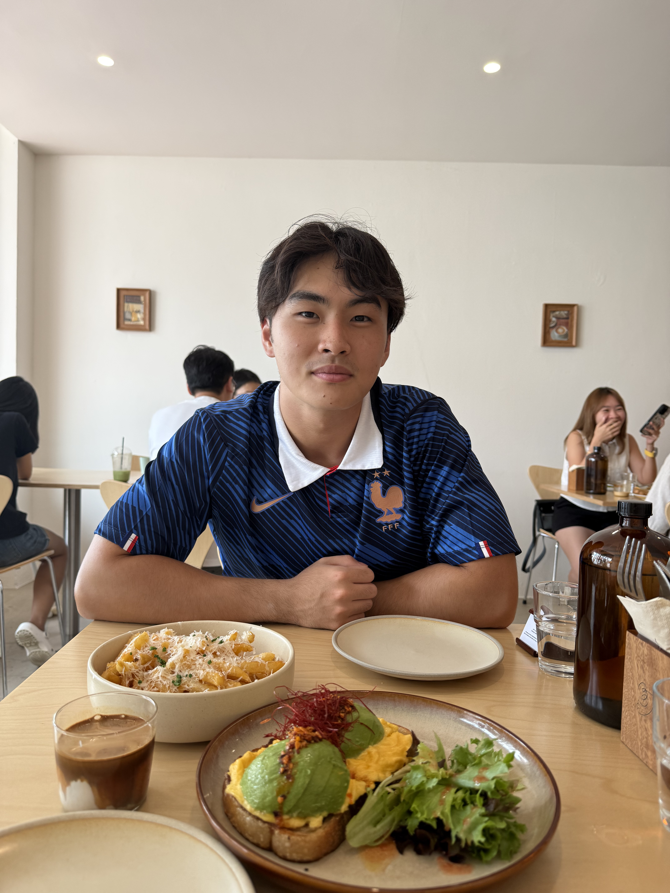

  <header class="about-intro">
    
THE PEOPLE BEHIND FITTIX

    <h1>About Us</h1>
    
We are a team based in the <a href="https://www.comp.nus.edu.sg">School of Computing, National University of Singapore</a>, building Fittix for gym trainers.

    
For bug reports and suggestions, visit the <a href="https://github.com/AY2627S1-CS2103T-T14-1/tp/issues">Fittix issue tracker</a>.

  </header>

  <section aria-labelledby="project-team">
    <h2 id="project-team">Project team</h2>
    

      <article class="about-card">
        
        <h3>Win Htut Khaung Soe</h3>
        
Project Lead

        
<a href="https://winhks25.github.io/winhtutkhaungsoe/">Win's homepage</a><a href="https://github.com/winhks25">Win's GitHub</a>

      </article>
      <article class="about-card">
        
        <h3>Dao Anh Khoa</h3>
        
Developer

        
Diet goals and body progress tracking

        
<a href="https://www.linkedin.com/in/anhkhoadao/">Khoa's LinkedIn</a><a href="https://github.com/itzkhoadao">Khoa's GitHub</a>

      </article>
      <article class="about-card">
        
        <h3>Pham Doan Gia Hien</h3>
        
Developer

        
Training sessions and meetings, day schedules, and inactive-client monitoring

        
<a href="https://github.com/HienPahm">Hien's GitHub</a>

      </article>
      <article class="about-card">
        
        <h3>Frederico Samuel Halim</h3>
        
Developer

        
Workout session logging

        
<a href="https://github.com/fikoww">Frederico's GitHub</a>

      </article>
      <article class="about-card">
        
        <h3>Zhang Kaiwen</h3>
        
Developer

        
Desktop UI design and implementation, including the client workspace and command terminal

        
<a href="https://www.linkedin.com/in/zhang-kaiwen2004/">Kaiwen's LinkedIn</a><a href="https://github.com/zkw2004">Kaiwen's GitHub</a>

      </article>
    

  </section>

