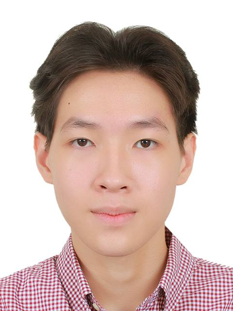
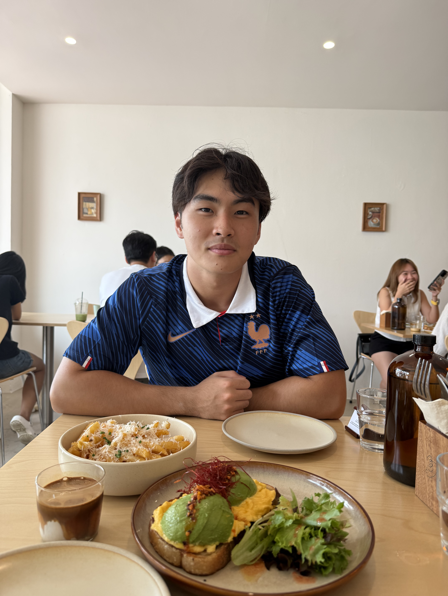

We are a team based in the [School of Computing, National University of Singapore](https://www.comp.nus.edu.sg).

For bug reports and suggestions, use the [Fittix issue tracker](https://github.com/AY2627S1-CS2103T-T14-1/tp/issues).

## Project team

### Win Htut Khaung Soe

[[homepage](https://winhks25.github.io/winhtutkhaungsoe/)]
[[github](https://github.com/winhks25)]

* Role: Project Lead

### Dao Anh Khoa

[[homepage](https://www.linkedin.com/in/anhkhoadao/)]
[[github](https://github.com/itzkhoadao)]

* Role: Developer
* Responsibilities: Diet goals and body progress tracking

### Pham Doan Gia Hien

[[github](https://github.com/HienPahm)]

* Role: Developer
* Responsibilities: Training schedule management

### Frederico Samuel Halim

[[github](https://github.com/fikoww)]

* Role: Developer
* Responsibilities: Workout session logging

### Zhang Kaiwen

[[github](https://github.com/zkw2004)]

* Role: Developer
* Responsibilities: UI
