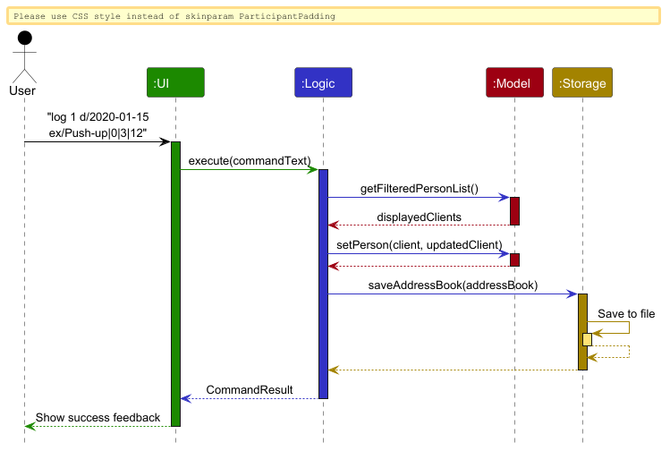
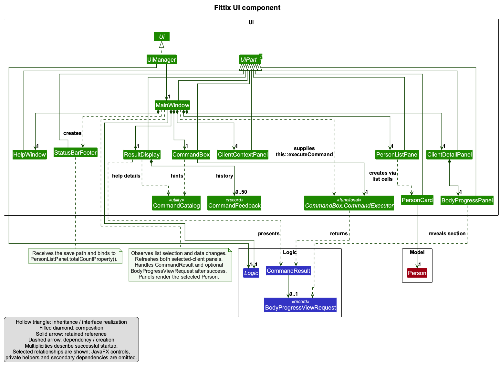
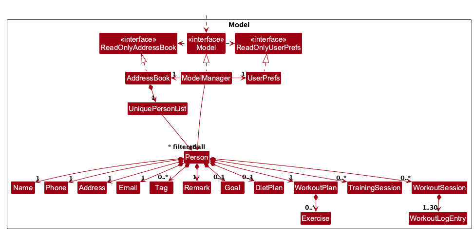
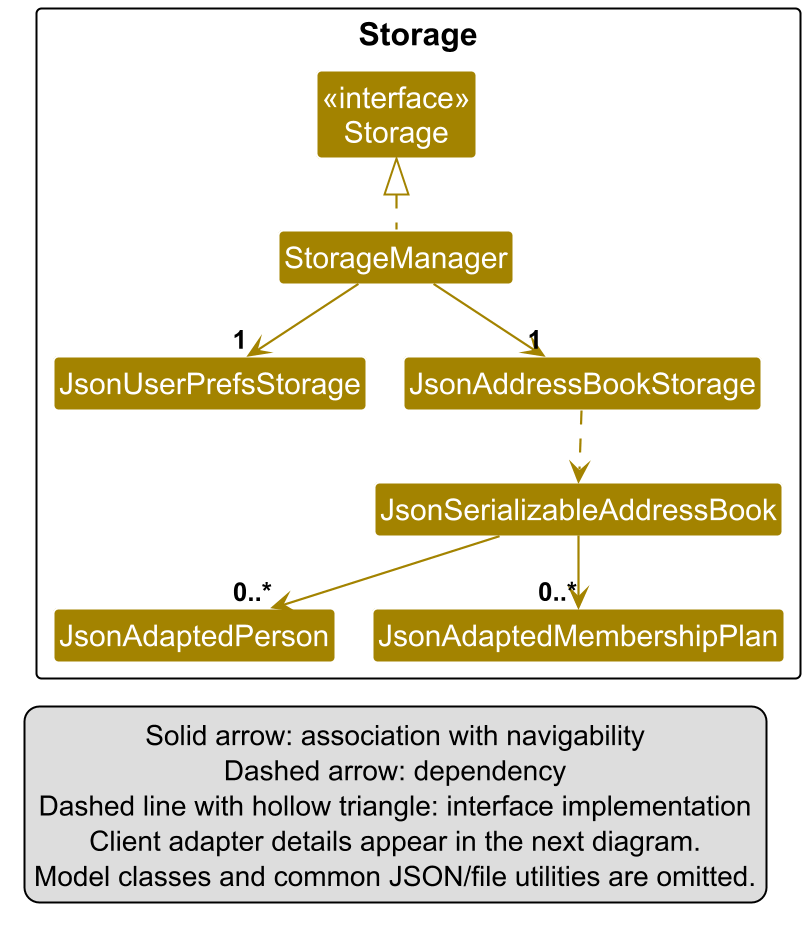
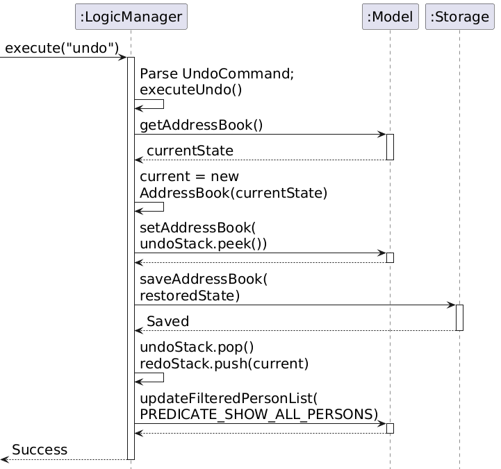
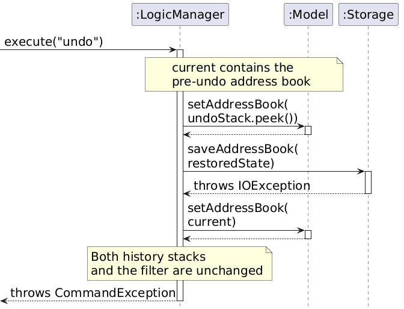

- Table of Contents
  {:toc}

---

## **Acknowledgements**

- _{List the sources of reused or adapted ideas, code, documentation, and third-party libraries here, with links to the originals.}_

---

## **Setting up, getting started**

Refer to the guide [_Setting up and getting started_](SettingUp.md).

---

## **Design**

:bulb: **Tip:** The `.puml` files used to create diagrams are in `docs/diagrams`. Refer to the [_PlantUML Tutorial_ at se-edu/guides](https://se-education.org/guides/tutorials/plantUml.html) to learn how to create and edit diagrams.

### Architecture

The **_Architecture Diagram_** given above explains the high-level design of the App.

The following provides a quick overview of the main components and their interactions.

**Main components of the architecture**

**`Main`** (consisting of classes [`Main`](https://github.com/se-edu/addressbook-level3/tree/master/src/main/java/seedu/address/Main.java) and [`MainApp`](https://github.com/se-edu/addressbook-level3/tree/master/src/main/java/seedu/address/MainApp.java)) is in charge of the app launch and shut down.

- At app launch, it initializes the other components in the correct sequence, and connects them up with each other.
- At shut down, it shuts down the other components and invokes cleanup methods where necessary.

The bulk of the app's work is done by the following four components:

- [**`UI`**](#ui-component): The UI of the App.
- [**`Logic`**](#logic-component): The command executor.
- [**`Model`**](#model-component): Holds the data of the App in memory.
- [**`Storage`**](#storage-component): Reads data from, and writes data to, the hard disk.

[**`Commons`**](#common-classes) represents a collection of classes used by multiple other components.

**How the architecture components interact with each other**

The _Sequence Diagram_ below shows how the components interact with each other for the scenario where the user issues the command `delete 1`.

Each of the four main components (also shown in the diagram above),

- defines its _API_ in an `interface` with the same name as the Component.
- provides its functionality through a concrete `{Component Name}Manager` class that implements the corresponding API interface.

For example, the `Logic` component defines its API in `Logic.java` and implements it in `LogicManager.java`. Other components interact with a component through its interface rather than its concrete class, preventing them from coupling to that component's implementation, as illustrated in the following partial class diagram.

The sections below give more details of each component.

### UI component

The **API** of this component is specified in [`Ui.java`](https://github.com/se-edu/addressbook-level3/tree/master/src/main/java/seedu/address/ui/Ui.java)

The UI consists of a `MainWindow` and its parts, such as `CommandBox`, `ResultDisplay`, `PersonListPanel`, and `StatusBarFooter`. All of these, including `MainWindow`, inherit from the abstract `UiPart` class, which captures common behavior among classes that represent visible GUI parts.

The `UI` component uses the JavaFX UI framework. The layouts of these UI parts are defined in matching `.fxml` files in `src/main/resources/view`. For example, [`MainWindow.fxml`](https://github.com/se-edu/addressbook-level3/tree/master/src/main/resources/view/MainWindow.fxml) specifies the layout of [`MainWindow`](https://github.com/se-edu/addressbook-level3/tree/master/src/main/java/seedu/address/ui/MainWindow.java).

The `UI` component,

- executes user commands using the `Logic` component.
- listens for changes to `Model` data so that the UI can be updated with the modified data.
- keeps a reference to the `Logic` component, because the `UI` relies on the `Logic` to execute commands.
- depends on some classes in the `Model` component because it displays `Person` objects from the model.

### Logic component

**API** : [`Logic.java`](https://github.com/se-edu/addressbook-level3/tree/master/src/main/java/seedu/address/logic/Logic.java)

Here's a (partial) class diagram of the `Logic` component:

The sequence diagram below illustrates the interactions within the `Logic` component, taking `execute("delete 1")` API call as an example.

:information_source: **Note:** The lifeline for `DeleteCommandParser` should end at the destroy marker (X), but due to a limitation of PlantUML, it continues to the end of the diagram.

How the `Logic` component works:

1. When `Logic` is called upon to execute a command, the command is passed to an `AddressBookParser` object, which in turn creates a parser that matches the command (e.g., `DeleteCommandParser`) and uses it to parse the command.
1. This results in a `Command` object (more precisely, an object of one of its subclasses e.g., `DeleteCommand`) which is executed by the `LogicManager`.
1. The command can communicate with the `Model` when it is executed (e.g. to delete a person). 
   Note that although this is shown as a single step in the diagram above for simplicity, the code can require several interactions between the command object and the `Model` to complete the operation.
1. The result of the command execution is encapsulated as a `CommandResult` object which is returned from `Logic`.

Here are the other classes in `Logic` (omitted from the class diagram above) that are used for parsing a user command:

How the parsing works:

- When called upon to parse a user command, the `AddressBookParser` class creates an `XYZCommandParser` (`XYZ` is a placeholder for the specific command name, e.g., `AddCommandParser`). The parser uses the other classes shown above to parse the user command and create an `XYZCommand` object (e.g., `AddCommand`). The `AddressBookParser` returns that object as a `Command` object.
- All `XYZCommandParser` classes, such as `AddCommandParser` and `DeleteCommandParser`, implement the `Parser` interface so they can be treated similarly where appropriate, for example during testing.

### Model component

**API** : [`Model.java`](https://github.com/se-edu/addressbook-level3/tree/master/src/main/java/seedu/address/model/Model.java)

The `Model` component,

- stores the address book data i.e., all `Person` objects (which are contained in a `UniquePersonList` object).
- stores the `Person` objects selected by the current filter, such as search results, in a separate _filtered_ list. It exposes this list as an unmodifiable `ObservableList<Person>` that the UI can observe and bind to, so the UI updates when the list changes.
- stores a `UserPrefs` object that represents the user’s preferences (currently, just the GUI settings). This is exposed to the outside as a `ReadOnlyUserPrefs` object.
- does not depend on any of the other three components (as the `Model` represents data entities of the domain, they should make sense on their own without depending on other components)

:information_source: **Note:** The alternative, arguably more object-oriented, design below keeps a unique list of tags in `AddressBook`, and each `Person` references tags from that list. This lets `AddressBook` maintain one `Tag` object per unique tag instead of each `Person` holding its own `Tag` objects. 

### Storage component

**API** : [`Storage.java`](https://github.com/se-edu/addressbook-level3/tree/master/src/main/java/seedu/address/storage/Storage.java)

The `Storage` component,

- can save both address book data and user preference data in JSON format, and read them back into corresponding objects.
- is implemented by `StorageManager`, which delegates the actual JSON file access to `JsonAddressBookStorage` and `JsonUserPrefsStorage` (one class per data file).
- depends on some classes in the `Model` component (because the `Storage` component's job is to save/retrieve objects that belong to the `Model`)

### Common classes

Classes used by multiple components are in the `seedu.address.commons` package.

---

## **Implementation**

This section describes some noteworthy details on how certain features are implemented.

### Workout plan feature (`addex` / `delex` / `dayex` / `clearplan`)

The workout plan feature lets a trainer keep a per-client list of prescribed exercises, optionally scheduled by weekday. Each `Person` owns one immutable `WorkoutPlan` (possibly empty); each `Exercise` is immutable and validated at construction. Plans are always kept sorted Monday-to-Sunday, with unscheduled exercises last.

#### Model: `Exercise`, `Weekday` and `WorkoutPlan`

- `model.person.Exercise` stores `name` (`String`), `sets` (`int`), `reps` (`int`), `weightKg` (`double`) and `day` (`String`, empty when unscheduled).
- Validation (`Exercise#isValidName`, `#isValidSets`, `#isValidReps`, `#isValidWeight`):
  - name is valid when `!test.trim().isEmpty()`; failure message is `Exercise name should not be blank`.
  - sets/reps are valid when `> 0`; failure messages are `Sets should be a positive integer greater than 0` and `Reps should be a positive integer greater than 0`.
  - weight is valid when `Double.isFinite(test) && test >= 0`; failure message is `Weight should be a finite non-negative number in kg`.
  - Combined message is `Exercise name should not be blank, sets and reps should be positive integers greater than 0, and weight should be a finite non-negative number in kg`.
- Command parsers supply the canonical full weekday name (`Monday`…`Sunday`) or `""` for unscheduled exercises. The constructor trims the input and normalizes legacy values: anything equal (ignoring case) to `Day not specified` becomes `""`. `Exercise#withDay(day)` returns a copy assigned to a new day; `Exercise#getDay` returns the stored value.
- Identity is name-based case-insensitive (`Exercise#isSameExercise`); full equality also compares sets/reps/weight/day. Duplicate checking in `WorkoutPlan#hasExercise` additionally compares the day, resolving weekday prefixes and ignoring letter case. Unassigned exercises share one group; matching names on different days are allowed. `SetExerciseDayCommand` checks for a duplicate on the destination day after excluding the selected exercise.
- `model.person.Weekday` is the canonical weekday enum (`MONDAY`…`SUNDAY` with display names `Monday`…`Sunday`).
  - `Weekday#fromPrefix` resolves a case-insensitive full name or prefix: minimum length is 1 except `Tuesday`/`Thursday`/`Sunday`, which need at least 2 characters. Hence a lone `s` means Saturday (Sunday needs `su`), and a lone `t` is invalid (`tu` = Tuesday, `th` = Thursday).
  - `Weekday#sortOrder(day)` returns the weekday rank (Monday 0 … Sunday 6); missing or unrecognized days sort after Sunday.
- `model.person.WorkoutPlan` wraps `List<Exercise>` with defensive copies and an unmodifiable view (`#getExercises`). Every constructor and mutator re-sorts by `Weekday.sortOrder` (a stable sort, so exercises in the same day group keep their relative order). Key APIs: `#hasExercise` (duplicate check), `#addExercise` (returns new plan), `#removeExercise`, `#setExerciseDay(index, day)` (replaces the exercise at the zero-based index via `Exercise#withDay` and re-sorts), `#isEmpty`, `#size`. `Person` stores the plan and exposes it via `#getWorkoutPlan`; `PersonBuilder#withWorkoutPlan` is used in tests.
- `WorkoutPlan#isWithinDailyLimit` checks a weekday against `MAX_EXERCISES_PER_DAY` (7), resolving weekday prefixes and letter case through `Weekday#fromPrefix`. Unassigned exercises have no daily limit. `AddExerciseCommand` and `SetExerciseDayCommand` check the destination day in the proposed immutable plan before updating the model. A violation produces `Messages.MESSAGE_DAILY_EXERCISE_LIMIT` and leaves the model unchanged. Checking the proposed plan allows reassignment to the same day at capacity and moving exercises away from a full day. Existing saved plans are still loaded without truncation.

#### Logic: commands and parsers

- `logic.commands.AddExerciseCommand` (`COMMAND_WORD = addex`):
  - `MESSAGE_USAGE = addex: Adds an exercise to the workout plan of the person identified by the index number used in the last person listing. Parameters: INDEX (must be a positive integer) n/EXERCISE_NAME [s/SETS] [r/REPS] [w/WEIGHT_KG] [d/DAY] Example: addex 1 n/Bench Press s/3 r/10 w/60 d/M`.
  - Success message `MESSAGE_ADD_EXERCISE_SUCCESS = Added exercise to Person: %1$s` (formatted with `Messages.format(editedPerson)`).
  - Duplicate message `MESSAGE_DUPLICATE_EXERCISE = This exercise already exists on this day in the workout plan.`
  - `execute` checks `Messages.MESSAGE_INVALID_PERSON_DISPLAYED_INDEX` (`The person index provided is invalid.`) for an out-of-range person index, rejects duplicates, then builds a new `Person` with `WorkoutPlan#addExercise` and calls `model#setPerson` + `model#updateFilteredPersonList(PREDICATE_SHOW_ALL_PERSONS)`.
- `logic.commands.DeleteExerciseCommand` (`COMMAND_WORD = delex`):
  - `MESSAGE_USAGE = delex: Removes the exercise at the specified exercise index from the workout plan of the person identified by the index number used in the last person listing. Parameters: PERSON_INDEX EXERCISE_INDEX (both must be positive integers) Example: delex 1 2`.
  - Success message `MESSAGE_DELETE_EXERCISE_SUCCESS = Removed exercise from Person: %1$s`.
  - Invalid exercise message `MESSAGE_INVALID_EXERCISE_DISPLAYED_INDEX = The exercise index provided is invalid.` shown when `exerciseIndex` is out of range, including when the plan is empty.
  - `execute` checks the person index first (`MESSAGE_INVALID_PERSON_DISPLAYED_INDEX`), then the exercise index, removes that entry from a copy of the list, wraps it in a new `WorkoutPlan`, and saves via `model#setPerson`. The exercise index is the current display number (see feedback formatting below), not the raw insertion order.
- `logic.commands.SetExerciseDayCommand` (`COMMAND_WORD = dayex`):
  - `MESSAGE_USAGE = dayex: Assigns a day tag to an exercise in a person's workout plan. Parameters: PERSON_INDEX EXERCISE_INDEX DAY Example: dayex 1 2 Tuesday`.
  - Success message `MESSAGE_SUCCESS = Assigned day to exercise: %1$s` (formatted with `Messages.format(editedPerson)`).
  - Invalid exercise message `MESSAGE_INVALID_EXERCISE_INDEX = The exercise index provided is invalid.` shown when `exerciseIndex` is out of range, including when the plan is empty.
  - `execute` checks the person index first (`MESSAGE_INVALID_PERSON_DISPLAYED_INDEX`), then the exercise index, applies `WorkoutPlan#setExerciseDay` (which re-sorts Monday-to-Sunday and renumbers), and saves via `model#setPerson` + `model#updateFilteredPersonList(PREDICATE_SHOW_ALL_PERSONS)`.
- `logic.commands.ClearPlanCommand` (`COMMAND_WORD = clearplan`):
  - `MESSAGE_USAGE = clearplan: Clears all exercises from the workout plan of the person identified by the index number used in the last person listing. Parameters: INDEX (must be a positive integer) Example: clearplan 1`.
  - Success `MESSAGE_CLEAR_PLAN_SUCCESS = Cleared workout plan for Person: %1$s`; already-empty `MESSAGE_PLAN_ALREADY_EMPTY = Workout plan is already empty for Person: %1$s` (no model change in the latter case).
- Parsers: `AddExerciseCommandParser` rejects unknown alphabetic parameter prefixes before tokenizing with `n/ s/ r/ w/ d/`; only `n/` is required, while omitted sets, reps, and weight default to `1`, `1`, and `0`. An omitted `d/` stores `""` (rendered under the `Day not specified` heading); a provided `d/` value is resolved via `DayParserUtil#parseDay` to the canonical weekday name. It rejects duplicates via `verifyNoDuplicatePrefixesFor` and delegates provided values to the matching `ParserUtil` validation methods (`parseExerciseName/Sets/Reps/Weight`); empty values such as `s/` or `d/` therefore fail validation. Any `ParseException` is wrapped as `Invalid command format!` + `MESSAGE_USAGE`. `DeleteExerciseCommandParser` expects exactly two indices (`PERSON_INDEX EXERCISE_INDEX`); `ClearPlanCommandParser` expects exactly one index; both wrap failures the same way. `SetExerciseDayCommandParser` splits the trimmed args on whitespace and requires exactly three parts (`PERSON_INDEX EXERCISE_INDEX DAY`), parsing the indices with `ParserUtil#parseIndex` and the day with `DayParserUtil#parseDay`, wrapping failures as `Invalid command format!` + `SetExerciseDayCommand.MESSAGE_USAGE`. `DayParserUtil#parseDay` delegates to `Weekday#fromPrefix` and returns the canonical display name, throwing `ParseException("Invalid day")` for anything else (e.g. `t`, `funday`, or the `Day not specified` heading). `AddressBookParser` routes `addex`/`delex`/`dayex`/`clearplan` to these parsers; unknown words return `Unknown command.`
- Feedback formatting: `Messages#format(Person)` appends `; Workout Plan: ` + `formatWorkoutPlan(plan)`, where an empty plan renders as `Empty` and a non-empty plan renders grouped by day in Monday-to-Sunday order with **Day not specified** last, e.g. `(4):` followed by `**Monday**`, `1. Squat 4x8 @80kg`, blank line, `**Wednesday**`, `2. Bench Press 3x10 @60kg`, and so on via `formatExercise` (`%s %dx%d @%skg`, e.g. `Bench Press 3x10 @60kg`, trimming `.0` weights). `Messages#getExercisesInDisplayOrder` re-sorts a copy of the plan the same way and assigns continuous 1-based numbers across all groups; `Messages#getExerciseDayHeading` maps `""` to `Day not specified` and any stored day through `Weekday#fromPrefix` to its display name. These numbers are exactly the `EXERCISE_INDEX` values accepted by `delex` and `dayex`, and appear after `%1$s` in all four success messages.

#### Storage: `JsonAdaptedExercise` and `JsonAdaptedPerson`

- `storage.JsonAdaptedExercise` is the Jackson-friendly form with fields `name`, `sets`, `reps`, `weightKg`, `day`. `toModelType` throws `IllegalValueException` with `Exercise's %s field is missing!` for null `name`/`sets`/`reps`/`weightKg`, or the matching `Exercise.MESSAGE_CONSTRAINTS_*` message for invalid values, and rejects non-finite/negative weights. A missing/`null` `day` loads as `""` (unscheduled, backward compatible with old files); any other stored day goes through the `Exercise` constructor, so legacy `Day not specified` values (any casing) also normalize to `""`.
- `storage.JsonAdaptedPerson` persists the plan as JSON array `exercises`. The `@JsonCreator` constructor treats a missing/`null` `exercises` field as empty (backward compatible with old files). `toModelType` rejects `null` entries with `Workout plan must not contain null exercises`, converts each entry via `JsonAdaptedExercise#toModelType`, and builds `new WorkoutPlan(personExercises)` (which re-sorts by weekday). Any invalid exercise therefore fails the whole person load, which `JsonSerializableAddressBook` propagates as `IllegalValueException`; the app then starts with an empty address book (same corrupted-file behavior as other fields).
- Save path: `JsonAdaptedPerson(Person source)` copies `source.getWorkoutPlan().getExercises()` into adapted exercises (including each exercise's canonical `day`), so every `addex`/`delex`/`dayex`/`clearplan` is persisted on the next `StorageManager` save (automatic after each mutating command).

#### UI: person card rendering

- `ui.PersonCard#displayWorkoutPlan` renders the plan inside `workoutPlanContainer`, reusing `Messages#getExercisesInDisplayOrder`, `#getExerciseDayHeading` and `#formatExercise` so the card and command feedback always agree.
  - Header is `Workout Plan:` when empty, otherwise `Workout Plan (N):` where `N` is the plan size.
  - An empty plan shows placeholder label `No workout plan yet`.
  - Non-empty plan groups exercises under bold full-weekday headings in Monday-to-Sunday order with `Day not specified` last; only non-empty groups are shown, separated by an 8px spacer. Within each group, one `Label` per exercise is numbered with the continuous 1-based display index (`1. ...`, `2. ...`) using the `Name SetsxReps @Weightkg` format (e.g. `Bench Press 4x10 @60kg`). These numbers are exactly the `EXERCISE_INDEX` values accepted by `delex` and `dayex`, so the card doubles as the index reference; `addex`/`dayex`/`delex` re-sort and renumber, so callers must always use the current card numbering.
  - Labels wrap (`setWrapText(true)`, max width 350) so long lists grow vertically without breaking the card layout. The card observes the filtered person list, so it refreshes automatically after each command.

### Diet plan management

Each `Person` owns an optional immutable `DietPlan`, consisting of one required target and optional notes. The model trims outer whitespace, counts Unicode code points, rejects nonprintable characters, and requires at least one letter or digit in the target. It preserves internal text and case. `JsonAdaptedPerson` and `JsonAdaptedDietPlan` serialize the plan in the client's JSON record, so deleting the client also removes the plan. A client has at most one current plan; no history or structured restrictions are stored.

For `diet INDEX t/TARGET [n/NOTES]`, `AddressBookParser` passes the raw arguments to `DietCommandParser`. This preserves invalid line breaks for validation. The parser recognises single-letter prefixes only at the beginning of an argument or after horizontal whitespace; it leaves slashes inside values such as `kcal/day` untouched. It validates the displayed-list index, one required target, at most one optional notes value, and rejects unknown or repeated prefixes. `DietCommand` looks up the `Person` in the filtered list, compares the candidate with the current plan after trimming and ignoring case, then uses `Model#setPerson` to replace the client record while retaining the other fields and current list filter. An omitted `n/` creates a plan without notes, even when the previous plan had notes.

`LogicManager` snapshots the address book before executing a diet command. `JsonAddressBookStorage` writes a complete JSON document to a temporary file in the data file's directory, then atomically moves it over the old file. If writing or replacing the file fails, `LogicManager` restores the snapshot and returns `The diet plan could not be saved. The previous plan remains unchanged.` The storage layer does not fall back to a non-atomic replacement when the filesystem does not support atomic moves. Validation and duplicate failures occur before any model change.

`PersonListPanel` observes the selected client and the filtered client list. Its details pane shows the current target and notes, hides notes when absent, and provides an empty state for clients without a plan. Wrapping and scrolling keep long accepted values readable. The UI does not evaluate the plan's nutritional or medical suitability.

`DietCommandParserTest`, `DietCommandTest`, `DietIntegrationTest`, and `PersonListPanelTest` cover parsing limits, duplicate and replacement behavior, filtered indexes, save and restart, injected commit failure, and selected-client display. The manual scenarios below cover the main user flows.

### Workout session logging

Each `Person` owns an immutable list of `WorkoutSession` objects. Each session contains a required `LocalDate`, an optional `LocalTime`, and an ordered list of 1 to 30 `WorkoutLogEntry` objects.

`WorkoutSession` rejects future dates, times containing seconds or nanoseconds, empty exercise lists, and lists exceeding the entry limit. Each `WorkoutLogEntry` validates its exercise name, weight, sets, and repetitions. Weight uses `BigDecimal` and is displayed with `toPlainString()`.

For `log INDEX d/DATE [t/TIME] ex/EXERCISE|WEIGHT|SETS|REPS ...`, `AddressBookParser` delegates to `LogCommandParser`. The parser checks required arguments, repeated date or time prefixes, date and time formats, and the four values in every exercise entry. It constructs the complete validated session before returning a `LogCommand`.

`LogCommand` resolves the index against the filtered client list. It rejects a session if that client already has the same date and optional time, using `WorkoutSession#hasSameDateTime`. Exercise contents do not affect this duplicate check. An unspecified time is distinct from every specified time.

On success, the command appends the session to a copy of the existing session list and replaces the client through `Model#setPerson`, preserving their other fields and the current filter. Sessions remain in recording order rather than chronological order.

`JsonAdaptedWorkoutLogEntry`, `JsonAdaptedWorkoutSession`, and `JsonAdaptedPerson` handle persistence. Dates use `yyyy-MM-dd`, specified times use `HH:mm`, and exercise order is preserved. Older person records without a workout-session field load with an empty session list. Invalid entries and duplicate session keys are rejected during conversion to model objects.

`LogicManager` saves the updated address book through the storage component. If saving throws an `IOException`, it restores the address-book snapshot taken before command execution and reports the save error.

`PersonListPanel` observes the selected client and changes to the client list. It displays the last session in the selected client's session list, including every exercise entry. It shows an empty state when the client has no sessions and hides the workout details when no client is selected. Labels wrap, and the details pane supports scrolling.

Automated coverage includes model validation and immutability, JSON round trips and legacy records, parser validation, duplicate rejection, filtered-list targeting, preservation of sessions by other client-update commands, and selected-client display.

### Membership plan management

#### Model and persistence

- `AddressBook` owns an insertion-ordered collection of uniquely named `MembershipPlan` definitions. A plan has a normalized display name, a positive `BigDecimal` price stored at two decimal places, and 1 to 1000 starting sessions. Names are compared without regard to case after trimming and collapsing internal whitespace.
- Each `Person` has at most one optional `MembershipAssignment`. It keeps a reference to the shared plan, a copy of its display name, an independent remaining balance from 0 to 1000, and an optional expiry date. Assigning a plan copies its starting sessions; subsequent adjustments change only that client's balance. A referenced plan cannot be deleted.
- JSON stores `membershipPlans` at the address-book root and `membershipAssignment` on each person. Missing fields in older files mean an empty catalog or an unassigned client. Loading rejects duplicate plan keys, malformed values, and assignments referring to missing plans. Expired assignments remain loadable; expiry is checked against the local date only when `amem` runs.
- Address-book snapshots and person replacement copy membership data. On an `IOException` during save, `LogicManager` restores the complete pre-command state and reports that the membership change could not be saved.

#### Commands and UI

`AddressBookParser` routes `addmem n/NAME p/PRICE s/NUMBER_OF_SESSIONS`, `delmem n/NAME`, `amem MEMBERSHIP_NAME PERSON_INDEX [e/YYYY-MM-DD]`, `rmem PERSON_INDEX`, `imem PERSON_INDEX NUMBER_TO_INCREMENT`, `dmem PERSON_INDEX NUMBER_TO_DECREMENT`, `clearmem`, and both `view mem` and `view membership`. Command words and the `view` argument are case-sensitive; prefix letters and plan name matching are case-insensitive. Client indexes refer to the currently displayed client list. For `amem`, the final non-prefixed token before an optional `e/` is the client index, allowing spaces in the plan name.

`ClearmemCommand` (`COMMAND_WORD = clearmem`, `MESSAGE_SUCCESS = Cleared all membership plans.`) takes no parameters and deletes every plan in the catalog while leaving all other data, including client records, workout plans, schedules, diet plans, and workout logs, unchanged. It is rejected with `Membership plans are in use and cannot be cleared. Remove all client assignments with rmem first.` while any plan is referenced by a client assignment, so it can never create a dangling assignment; the trainer must clear those with `rmem` first. The client `clear` command (`ClearCommand`) is the counterpart for client records: it removes all persons only and must not delete any membership plans. Either command persists its result through the automatic save after the command runs.

Parsers require each mandatory prefix exactly once, reject repeated or unknown prefixes and extra text, and validate prices, session counts, and dates before changing the model. `amem` requires a future expiry date when one is supplied. `imem` and `dmem` accept amounts from 1 to 1000 and keep the resulting balance within 0 to 1000. A client with an assignment must use `rmem` before receiving another plan. Both view aliases show the same plan order and `No membership plans available.` when the catalog is empty.

The client card shows a single membership tag reading `PLAN_NAME Member: N sessions left`, with `[expires YYYY-MM-DD]` appended when an expiry exists. It shows no tag for an unassigned client. The plan-list output of `view mem`/`view membership` prefixes each price with `S$`. Command messages and error behavior follow the [Feature 10 specification](featureSpecs.md#feature-10-membership-plan).

### \[Proposed\] Undo/redo feature

#### Proposed Implementation

The proposed undo/redo mechanism is facilitated by `VersionedAddressBook`. It extends `AddressBook` with an undo/redo history, stored internally as an `addressBookStateList` and `currentStatePointer`. Additionally, it implements the following operations:

- `VersionedAddressBook#commit()` — Saves the current address book state in its history.
- `VersionedAddressBook#undo()` — Restores the previous address book state from its history.
- `VersionedAddressBook#redo()` — Restores a previously undone address book state from its history.

These operations are exposed in the `Model` interface as `Model#commitAddressBook()`, `Model#undoAddressBook()` and `Model#redoAddressBook()` respectively.

Given below is an example usage scenario and how the undo/redo mechanism behaves at each step.

Step 1. The user launches the application for the first time. The `VersionedAddressBook` will be initialized with the initial address book state, and the `currentStatePointer` pointing to that single address book state.

Step 2. The user executes `delete 5` command to delete the 5th person in the address book. The `delete` command calls `Model#commitAddressBook()`, causing the modified state of the address book after the `delete 5` command executes to be saved in the `addressBookStateList`, and the `currentStatePointer` is shifted to the newly inserted address book state.

Step 3. The user executes `add n/David …​` to add a new person. The `add` command also calls `Model#commitAddressBook()`, causing another modified address book state to be saved into the `addressBookStateList`.

:information_source: **Note:** If a command fails its execution, it will not call `Model#commitAddressBook()`, so the address book state will not be saved into the `addressBookStateList`.

Step 4. The user now decides that adding the person was a mistake, and decides to undo that action by executing the `undo` command. The `undo` command will call `Model#undoAddressBook()`, which will shift the `currentStatePointer` once to the left, pointing it to the previous address book state, and restores the address book to that state.

:information_source: **Note:** If the `currentStatePointer` is at index 0, pointing to the initial AddressBook state, then there are no previous AddressBook states to restore. The `undo` command uses `Model#canUndoAddressBook()` to check if this is the case. If so, it will return an error to the user rather
than attempting to perform the undo.

The following sequence diagram shows how an undo operation goes through the `Logic` component:

:information_source: **Note:** The lifeline for `UndoCommand` should end at the destroy marker (X), but due to a limitation of PlantUML, it continues to the end of the diagram.

Similarly, how an undo operation goes through the `Model` component is shown below:

The `redo` command does the opposite — it calls `Model#redoAddressBook()`, which shifts the `currentStatePointer` once to the right, pointing to the previously undone state, and restores the address book to that state.

:information_source: **Note:** If the `currentStatePointer` is at index `addressBookStateList.size() - 1`, pointing to the latest address book state, then there are no undone AddressBook states to restore. The `redo` command uses `Model#canRedoAddressBook()` to check if this is the case. If so, it will return an error to the user rather than attempting to perform the redo.

Step 5. The user then decides to execute the command `list`. Commands that do not modify the address book, such as `list`, will usually not call `Model#commitAddressBook()`, `Model#undoAddressBook()` or `Model#redoAddressBook()`. Thus, the `addressBookStateList` remains unchanged.

Step 6. The user executes `clear`, which calls `Model#commitAddressBook()`. Since the `currentStatePointer` is not pointing at the end of the `addressBookStateList`, all address book states after the `currentStatePointer` will be purged. Reason: It no longer makes sense to redo the `add n/David …​` command. This is the behavior that most modern desktop applications follow.

The following activity diagram summarizes what happens when a user executes a new command:

#### Design considerations:

**Aspect: How undo & redo execute:**

- **Alternative 1 (current choice):** Saves the entire address book.
  - Pros: Easy to implement.
  - Cons: May have performance issues in terms of memory usage.

- **Alternative 2:** Individual command knows how to undo/redo by
  itself.
  - Pros: Will use less memory (e.g. for `delete`, just save the person being deleted).
  - Cons: We must ensure that the implementation of each individual command is correct.

_{more aspects and alternatives to be added}_

### \[Proposed\] Data archiving

_{Explain here how the data archiving feature will be implemented}_

---

## **Documentation, logging, testing, dev-ops**

- [Documentation guide](Documentation.md)
- [Testing guide](Testing.md)
- [Logging guide](Logging.md)
- [DevOps guide](DevOps.md)

---

## **Appendix: Requirements**

### Product scope

**Target user profile**:

- **Name:** Marcus
- **Age:** 31
- **Job:** Freelance personal trainer
- **Experience:** 6 years
- **Education:** Diploma in Sports & Exercise Science
- **Location:** Commercial gym in Tampines
- **Clients:** 28 active clients
- **Workload:** ~32 sessions/week, starting at 6:30am
- **Packages:** 10 or 20 sessions
- **Payments:** Mostly PayNow
- **Admin:** Short breaks and late nights
- **Tech:** Laptop user, fast typist
  <small>Marcus is a sample persona representing our target user group and their typical needs, behaviours, and workflows.</small>

**Value proposition**:

- **All-in-one client management:** Keep client goals, injuries, workout plans, diet plans, progress, sessions, and payments in one place.
- **Fast and efficient:** Quickly access and update information between sessions.
- **Progress tracking:** Easily monitor each client's fitness progress over time.
- **Session & payment management:** Track remaining sessions, payments, and unpaid balances.
- **Less admin work:** Reduce time spent searching through chats, notes, spreadsheets, and payment records.

### User stories

Priorities: High (must have) - `* * *`, Medium (nice to have) - `* *`, Low (unlikely to have) - `*`

| Priority | As a …​     | I want to …​                                                                         | So that I can …​                                                       |
| -------- | ----------- | ------------------------------------------------------------------------------------ | ---------------------------------------------------------------------- |
| `* * *`  | gym trainer | add a client's contact details                                                       | contact them easily                                                    |
| `* * *`  | gym trainer | record a client's gym schedule                                                       | schedule my business appropriately                                     |
| `* * *`  | gym trainer | record the workout plan for each client                                              | ensure consistent progress through a consistent workout plan           |
| `* * *`  | gym trainer | log a completed workout session, including exercises, weights, sets, and repetitions | review the client's training history                                   |
| `* * *`  | gym trainer | record the diet plan for each client                                                 | track the impact of diet on their improvement                          |
| `* * *`  | gym trainer | delete a former client                                                               | keep my active roster uncluttered                                      |
| `* * *`  | gym trainer | record when and where to meet each client                                            | remind myself of upcoming client sessions                              |
| `* *`    | gym trainer | track the body progress of each client                                               | see how effective my plan is                                           |
| `* *`    | gym trainer | track fee payments                                                                   | check which clients have paid their fees                               |
| `* *`    | gym trainer | search for clients by name                                                           | find a particular client quickly                                       |
| `* *`    | gym trainer | filter clients by training goal                                                      | work with clients who have similar objectives                          |
| `* *`    | gym trainer | record a client's dietary restrictions                                               | ensure their diet plan is suitable for them                            |
| `* *`    | gym trainer | list clients with unpaid fees                                                        | quickly identify which payments need to be followed up                 |
| `* *`    | gym trainer | check whether a proposed session time conflicts with another client                  | avoid accidentally double-booking myself                               |
| `* *`    | gym trainer | view all clients scheduled for a particular day                                      | quickly prepare for the clients I will be training that day            |
| `* *`    | gym trainer | generate a concise training summary for a client                                     | brief a cover trainer without sharing unnecessary personal information |
| `*`      | gym trainer | edit a client's personal details                                                     | correct outdated or inaccurate information                             |
| `*`      | gym trainer | search for clients by phone number or email                                          | identify a client using their contact information                      |
| `*`      | gym trainer | record each client's training goal                                                   | tailor their training towards a clear objective                        |
| `*`      | gym trainer | record a client's injuries and physical limitations                                  | avoid exercises that may be unsafe for them                            |
| `*`      | gym trainer | view a client's latest workout session                                               | quickly know what they did previously before starting the next session |
| `*`      | gym trainer | view a client's complete workout history                                             | review how their training has changed over time                        |
| `*`      | gym trainer | edit a previously logged workout session                                             | correct mistakes in weights, sets, repetitions, or exercises           |
| `*`      | gym trainer | record a client's starting body measurements                                         | have a baseline against which future progress can be compared          |
| `*`      | gym trainer | view the history of a client's body measurements                                     | see how their body measurements have changed over time                 |
| `*`      | gym trainer | compare a client's latest progress with their starting measurements                  | clearly show the client how much progress they have made               |
| `*`      | gym trainer | record the number of sessions purchased by a client                                  | keep track of their training package                                   |
| `*`      | gym trainer | view the number of sessions remaining in a client's package                          | know when a client is close to needing a renewal                       |
| `*`      | gym trainer | record a completed session against a client's package                                | keep the remaining number of sessions accurate                         |
| `*`      | gym trainer | list clients whose packages are running low                                          | ask them about renewal before their package runs out                   |
| `*`      | gym trainer | list clients I have not trained recently                                             | identify clients who may be becoming inactive                          |

_{More to be added}_

### Use cases

(For all use cases below, the **System** is `Fittix` and the **Actor** is the `trainer`, unless specified otherwise)

**Use case: UC01 - Add a client**

**MSS**

1.  Trainer requests to add a new client, giving the client's details.
2.  Fittix adds the client and shows the newly added client's details.

    Use case ends.

**Extensions**

- 1a. A compulsory detail is missing, or a detail is in an invalid format.
  - 1a1. Fittix shows an error message stating the expected format.

    Use case resumes at step 1.

- 1b. A client with the same name and phone number already exists.
  - 1b1. Fittix shows a duplicate client error and does not add the client.

    Use case ends.

**Use case: UC02 - Delete a client**

**MSS**

1.  Trainer requests to list clients.
2.  Fittix shows a list of clients.
3.  Trainer requests to delete a specific client in the list.
4.  Fittix deletes the client and shows the deleted client's details.

    Use case ends.

**Extensions**

- 2a. The list is empty.

  Use case ends.

- 3a. The given index is invalid.
  - 3a1. Fittix shows an error message.

    Use case resumes at step 2.

**Use case: UC03 - Find a client by name**

**MSS**

1.  Trainer requests to find clients whose names match a given keyword.
2.  Fittix shows the list of matching clients.

    Use case ends.

**Extensions**

- 1a. No keyword is given.
  - 1a1. Fittix shows an error message stating the expected format.

    Use case resumes at step 1.

- 2a. No client matches the keyword.
  - 2a1. Fittix shows an empty list and states that no client matched.

    Use case ends.

**Use case: UC04 - Log a completed workout session**

**MSS**

1.  Trainer requests to list clients.
2.  Fittix shows a list of clients.
3.  Trainer requests to log a completed session for a specific client in the list, giving the exercise, weight, sets and repetitions.
4.  Fittix records the session against that client and shows the logged entry.

    Use case ends.

**Extensions**

- 3a. The given index is invalid.
  - 3a1. Fittix shows an error message.

    Use case resumes at step 2.

- 3b. The weight, sets or repetitions is not a positive number.
  - 3b1. Fittix shows an error message stating the expected format.

    Use case resumes at step 3.

**Use case: UC05 - View a client's workout history**

**MSS**

1.  Trainer requests to list clients.
2.  Fittix shows a list of clients.
3.  Trainer requests to view the workout history of a specific client in the list.
4.  Fittix shows that client's logged sessions, most recent first.

    Use case ends.

**Extensions**

- 3a. The given index is invalid.
  - 3a1. Fittix shows an error message.

    Use case resumes at step 2.

- 4a. The client has no logged sessions.
  - 4a1. Fittix states that no sessions have been logged for that client.

    Use case ends.

**Use case: UC06 - Manage a client's workout plan (`addex` / `delex` / `dayex` / `clearplan`)**

**MSS**

1.  Trainer requests to list clients.
2.  Fittix shows a list of clients.
3.  Trainer requests to add an exercise to a specific client in the list, giving the exercise name and optionally sets, reps, weight and day (`addex INDEX n/NAME [s/SETS] [r/REPS] [w/WEIGHT_KG] [d/DAY]`, e.g. `addex 1 n/Bench Press s/3 r/10 w/60 d/M`). Omitted sets/reps/weight default to `1`/`1`/`0`; an omitted day leaves the exercise under `Day not specified`.
4.  Fittix appends the exercise to that client's workout plan (sorted Monday-to-Sunday, unscheduled last) and shows `Added exercise to Person: ` followed by the updated plan.
5.  Trainer optionally assigns or changes an exercise's day (`dayex PERSON_INDEX EXERCISE_INDEX DAY`, e.g. `dayex 1 2 Tuesday`; the plan is re-sorted and renumbered), removes an exercise (`delex PERSON_INDEX EXERCISE_INDEX`, e.g. `delex 1 2`), or clears the whole plan (`clearplan INDEX`, e.g. `clearplan 1`).
6.  Fittix updates the plan and shows `Assigned day to exercise: `, `Removed exercise from Person: `, or `Cleared workout plan for Person: ` with the updated plan.

    Use case ends.

**Extensions**

- 3a-6a. The given person index is invalid (out of range for the displayed list).
  - 3a1-6a1. Fittix shows `The person index provided is invalid.`.

    Use case resumes at step 2.

- 3b. A compulsory prefix (`n/`) is missing or duplicated, or sets/reps/weight/day is in an invalid format.
  - Sets/reps must be positive integers greater than 0; weight must be a finite non-negative number in kg; name must not be blank; day must be a weekday name or accepted prefix (`tu`/`th`/`su` need at least 2 letters; `t` alone and `Day not specified` are invalid).
    - 3b1. Fittix shows `Invalid command format!` followed by the `addex` usage (`addex: Adds an exercise to the workout plan of the person identified by the index number used in the last person listing. Parameters: INDEX (must be a positive integer) n/EXERCISE_NAME [s/SETS] [r/REPS] [w/WEIGHT_KG] [d/DAY] Example: addex 1 n/Bench Press s/3 r/10 w/60 d/M`), with the specific constraint as cause (e.g. `Exercise name should not be blank`, `Sets should be a positive integer greater than 0`, `Reps should be a positive integer greater than 0`, `Weight should be a finite non-negative number in kg`).

      Use case resumes at step 3.

- 3c. An exercise with the same name (case-insensitive) is already on the same day in that client's plan.
  - 3c1. Fittix shows `This exercise already exists on this day in the workout plan.` and does not add it.

    Use case ends.

- 5a. `delex` or `dayex` targets an empty plan or an out-of-range exercise index (the current 1-based display number across all day groups on the person card; numbering shifts after every add/day-change/delete).
  - 5a1. Fittix shows `The exercise index provided is invalid.`.

    Use case resumes at step 2.

- 5b. `delex` arguments are not exactly two positive integers.
  - 5b1. Fittix shows `Invalid command format!` followed by the `delex` usage (`delex: Removes the exercise at the specified exercise index from the workout plan of the person identified by the index number used in the last person listing. Parameters: PERSON_INDEX EXERCISE_INDEX (both must be positive integers) Example: delex 1 2`).

    Use case resumes at step 5.

- 5c. `dayex` arguments are not exactly two positive integers plus a valid day (e.g. missing day, extra tokens, or an invalid day such as `t`, `funday`, or `Day not specified`).
  - 5c1. Fittix shows `Invalid command format!` followed by the `dayex` usage (`dayex: Assigns a day tag to an exercise in a person's workout plan. Parameters: PERSON_INDEX EXERCISE_INDEX DAY Example: dayex 1 2 Tuesday`).

    Use case resumes at step 5.

- 6b. `clearplan` targets a client whose plan is already empty.
  - 6b1. Fittix shows `Workout plan is already empty for Person: ` followed by that person and makes no change.

    Use case ends.

- 6c. `clearplan` argument is not exactly one positive integer.
  - 6c1. Fittix shows `Invalid command format!` followed by the `clearplan` usage (`clearplan: Clears all exercises from the workout plan of the person identified by the index number used in the last person listing. Parameters: INDEX (must be a positive integer) Example: clearplan 1`).

    Use case resumes at step 5.

**Use case: UC07 - Record a diet plan for a client**

**MSS**

1.  Trainer requests to list clients.
2.  Fittix shows a list of clients.
3.  Trainer gives the displayed client index, a nutrition target, and optional notes.
4.  Fittix saves and shows the target and notes as that client's current plan.

    Use case ends.

**Extensions**

- 3a. The given index is invalid.
  - 3a1. Fittix shows an error message.

    Use case resumes at step 2.

- 3b. The target or supplied notes are invalid, or a parameter is repeated or unsupported.
  - 3b1. Fittix shows the relevant validation or format error and leaves the current plan unchanged.

    Use case resumes at step 3.

- 3c. The candidate matches the current plan after trimming and ignoring case.
  - 3c1. Fittix reports that the plan is already current and does not replace it.

    Use case ends.

- 4a. The client already has a different plan.
  - 4a1. Fittix replaces the complete plan and reports the replacement. Old versions are not retained.

    Use case ends.

- 4b. Saving fails.
  - 4b1. Fittix reports the failure; the previous plan remains unchanged in memory and on disk.

    Use case ends.

**Use case: UC08 - Schedule a session with a client**

The first increment stores an immutable `TrainingSession` (date/time and location) in each client's `Person` record. The `schedule` command validates a future ISO date and 24-hour time, then replaces the client record with a copy containing the new session. `viewschedule` orders saved sessions by date/time. JSON storage writes a `trainingSessions` list for each client; when that field is absent, older data loads with an empty list. Editing a client or its remark preserves its sessions. Session conflict detection and recurring appointments remain separate increments.

**MSS**

1.  Trainer requests to list clients.
2.  Fittix shows a list of clients.
3.  Trainer requests to schedule a session for a specific client in the list, giving the date, time and location.
4.  Fittix saves the appointment and shows the client's updated schedule.

    Use case ends.

**Extensions**

- 3a. The date or time is in an invalid format, or is in the past.
  - 3a1. Fittix shows an error message stating the expected format.

    Use case resumes at step 3.

- 3b. The requested time overlaps an existing appointment.
  - 3b1. Fittix shows a clash warning naming the conflicting client and does not save the appointment.

    Use case ends.

### Non-Functional Requirements

**Technical and environment**

1.  Should work on any _mainstream OS_ as long as it has Java `25` or above installed, without requiring any other installation.
2.  Should be delivered as a single JAR file of at most 100MB that runs without an installer.
3.  Should work fully offline, with no dependency on a remote server or network connection.

**Performance and capacity**

4.  Should be able to hold up to 1000 clients without noticeable sluggishness in performance for typical usage.
5.  Every command should return a visible response within 2 seconds when the data file holds 1000 clients.
6.  A user with above average typing speed for regular English text (i.e. not code, not system admin commands) should be able to accomplish most of the tasks faster using commands than using the mouse.
7.  Logging a completed workout session should require a single command line, so that a user with above average typing speed can complete it in under 15 seconds between sets.

**Data and reliability**

8.  Data should be saved to disk after every command that modifies it, so an unexpected shutdown loses at most the command in progress.
9.  Data should be stored locally in a human editable text file, with no database management system.
10. If the data file is missing or unreadable, the app should start with an empty data set rather than fail to launch.

**Usability and privacy**

11. Error messages should state what was rejected and the expected format, so the user can correct the command without consulting the user guide.
12. The GUI should be usable at a screen resolution of 1280x720 and above, and remain readable at 150% display scaling.
13. Dates and times should be displayed in one consistent, unambiguous format throughout the app.
14. A shareable client summary should exclude _private contact details_ and the client's home address.

**Product scope constraints**

15. The product is for a single user; it should not support concurrent access to the same data file by multiple users.
16. The product should not require the user to log in or create an account.

### Glossary

- **Mainstream OS**: Windows, Linux, Unix, or macOS
- **Private contact detail**: A contact detail that is not meant to be shared with others
- **Client**: A person the trainer trains, stored as a record in Fittix
- **Session**: One completed training appointment, logged with the exercises, weights, sets and repetitions performed
- **Package**: A block of prepaid sessions (typically 10 or 20) bought by a client
- **Workout plan**: The client's current prescribed set of exercises; a client has at most one at a time
- **Diet plan**: The client's current prescribed eating guidance; a client has at most one at a time

---

## **Appendix: Instructions for manual testing**

Given below are instructions to test the app manually.

:information_source: **Note:** These instructions only provide a starting point for testers to work on;
testers are expected to do more *exploratory* testing.

### Launch and shutdown

1. Initial launch
   1. Download the JAR file and copy it into an empty folder.

   1. Double-click the JAR file. 
      Expected: The GUI opens with a set of sample contacts. The window size may not be optimal.

1. Saving window preferences
   1. Resize the window to an optimal size. Move the window to a different location. Close the window.

   1. Relaunch the app by double-clicking the JAR file. 
      Expected: The most recent window size and location are retained.

1. _{ more test cases …​ }_

### Deleting a person

1. Deleting a person while all persons are being shown
   1. Prerequisites: List all persons using the `list` command, with multiple persons in the list.

   1. Test case: `delete 1` 
      Expected: The first contact is deleted from the list. The status message shows the deleted contact's details.

   1. Test case: `delete 0` 
      Expected: No person is deleted. The status message shows error details.

   1. Other incorrect delete commands to try: `delete`, `delete x`, `...` (where x is larger than the list size) 
      Expected: Similar to previous.

1. _{ more test cases …​ }_

### Diet plan management

Use a disposable copy of the data file. Start with at least two clients; run `list` and note the displayed index and name of one client.

1. Create a target-only plan: `diet 1 t/1800 kcal per day, 120 g protein`. 
   Expected: `Created diet plan for NAME.` and the selected client's details pane shows the full target without notes.
1. Add notes: `diet 1 t/1800 kcal per day, 120 g protein n/Prioritise vegetables`. 
   Expected: `Replaced diet plan for NAME.` and the notes appear in the pane.
1. Replace with `diet 1 t/2000 kcal/day`. 
   Expected: The target changes, old notes disappear, and `kcal/day` remains intact.
1. Repeat `diet 1 t/2000 KCAL/DAY`. 
   Expected: `This is already the current diet plan for NAME.` and the saved spelling remains `2000 kcal/day`.
1. Try `diet 1 t/`, `diet 1 t/2000 kcal n/`, `diet 1 t/2000 kcal r/vegan`, and `diet 0 t/2000 kcal`. 
   Expected: Respectively, the target, notes, format, and client-index errors appear. The previous plan remains visible.
1. Close and restart the app. 
   Expected: Selecting the same client shows the saved target with no notes.
1. Run `find` for that client and use the index shown in the filtered list in a `diet` command. 
   Expected: Only the displayed client is updated. Run `list` to confirm the other client's plan is unchanged.
1. Delete the client using the displayed index, then restart. 
   Expected: The client and their plan are gone; the details pane no longer shows the deleted client's target.

An I/O failure is best checked with the fault-injected `DietIntegrationTest`: it forces the atomic replacement to throw, verifies the specified failure message, confirms that both the model and original JSON bytes are unchanged, and checks that the temporary file is removed.

### Saving data

1. Dealing with missing/corrupted data files
   1. Missing file: delete `[JAR file location]/data/addressbook.json`, then relaunch. 
      Expected: The app starts with an empty address book (or sample data on first run) and recreates the file after the next mutating command.

   1. Corrupted top-level JSON: open `addressbook.json`, replace its contents with `not json`, save, then relaunch. 
      Expected: The app starts with an empty address book rather than crashing. The invalid file stays on disk until the next save overwrites it.

   1. Corrupted `exercises` entry: open `addressbook.json`, pick a person, and set one exercise to an invalid value (e.g. `"sets": 0`, `"reps": -1`, `"weightKg": -5`, `"name": "  "`, or `"weightKg": "NaN"` / `Infinity` / `null`, or a `null` array element). Save, then relaunch. 
      Expected: That person fails validation (`Sets should be a positive integer greater than 0`, `Reps should be a positive integer greater than 0`, `Weight should be a finite non-negative number in kg`, `Exercise name should not be blank`, `Exercise's <field> field is missing!`, or `Workout plan must not contain null exercises`), so the whole file is treated as corrupted and the app starts with an empty address book.

   1. Missing `exercises` field (backward compatibility): open `addressbook.json`, delete the `"exercises": [...]` array from one person, save, then relaunch. 
      Expected: That person loads with an empty workout plan; the card shows `No workout plan yet` and `Messages.format` shows `Workout Plan: Empty`.

   1. Missing `day` field on an exercise (backward compatibility): open `addressbook.json`, delete the `"day"` key from one exercise object, save, then relaunch. 
      Expected: That exercise loads as unscheduled and appears under `Day not specified`; a stored `"day": "Day not specified"` (any casing, from older saves) normalizes the same way.

1. Persistence reload for workout plans
   1. Prerequisites: at least one person in the list (use `list`).
   1. Test case: `addex 1 n/Bench Press s/3 r/10 w/60 d/M` then close the app and relaunch. 
      Expected: The status message shows `Added exercise to Person: ` with the grouped plan (`**Monday**` + `1. Bench Press 3x10 @60kg`); after relaunch the same plan is still shown on the first person's card under the `Monday` heading, and `data/addressbook.json` contains an `exercises` array with `{"name":"Bench Press","sets":3,"reps":10,"weightKg":60.0,"day":"Monday"}`.
   1. Test case: `addex 1 n/Stretch` (defaults) then close and relaunch. 
      Expected: Added with 1 set, 1 rep, 0kg under `Day not specified` (`"day":""` in JSON); the plan stays after relaunch.
   1. Test case: `dayex 1 1 Tuesday` then close and relaunch. 
      Expected: The status message shows `Assigned day to exercise: ` with the exercise under `**Tuesday**`; after relaunch the day assignment persists.
   1. Test case: `delex 1 1` then close and relaunch. 
      Expected: The status message shows `Removed exercise from Person: ` with the remaining plan; after relaunch the plan stays removed.
   1. Test case: `clearplan 1` then close and relaunch. 
      Expected: The status message shows `Cleared workout plan for Person: ` (or `Workout plan is already empty for Person: ` if it was already empty); after relaunch the plan is still empty.

### Managing workout plans

1. Adding an exercise (`addex`)
   1. Prerequisites: List all persons using the `list` command, with multiple persons in the list.
   1. Test case: `addex 1 n/Bench Press s/3 r/10 w/60 d/M` 
      Expected: The exercise is added to the 1st person's plan under the `Monday` heading. The status message shows `Added exercise to Person: ` with the grouped plan, and the card shows `Workout Plan (1):` + `Monday` + `1. Bench Press 3x10 @60kg`.
   1. Test case: `addex 1 n/Stretch` (all optionals omitted) 
      Expected: Added with defaults 1 set, 1 rep, 0kg under `Day not specified` with the next display number; the plan stays sorted Monday-to-Sunday with unscheduled exercises last.
   1. Test case: `addex 1 n/Squat s/4 r/8 w/80 d/Saturday` when the plan already holds a Monday exercise and an unscheduled one. 
      Expected: The plan is sorted by weekday (Monday group, then Saturday group, then `Day not specified`) and renumbered continuously from 1 across all groups; card and status message agree.
   1. Invalid cases to try: `addex 0 n/X s/3 r/10 w/60` (bad person index), `addex 1 n/  s/3 r/10 w/60` (blank name), `addex 1 n/X s/0 r/10 w/60` / `s/-1` / `s/abc` / `s/` (empty), `addex 1 n/X s/3 r/0 w/60` / `r/abc`, `addex 1 n/X s/3 r/10 w/-1` / `w/abc` / `w/Infinity` / `w/NaN`, `addex 1 n/X d/t` / `d/funday` / `d/Day not specified` (invalid day), missing `n/` prefix, duplicated prefix (e.g. two `n/`). 
      Expected: No exercise is added. Out-of-range person shows `The person index provided is invalid.`; all other bad values show `Invalid command format!` + the `addex` usage with the specific constraint (`Exercise name should not be blank`, `Sets should be a positive integer greater than 0`, `Reps should be a positive integer greater than 0`, `Weight should be a finite non-negative number in kg`) as the cause.
   1. Test case: add the same name twice with different casing, e.g. `addex 1 n/bench press s/3 r/10 w/60 d/M` after `Bench Press` exists on Monday. 
      Expected: Rejected with `This exercise already exists on this day in the workout plan.`
   1. Test case: `addex 1 n/Exercise1 d/Monday`, then `addex 1 n/Exercise1 d/Friday`. 
      Expected: Both succeed, with one Exercise1 on each day. Repeating either command is rejected without changing the plan.

1. Deleting an exercise (`delex`)
   1. Prerequisites: 1st person has at least two exercises in different day groups (add them as above); note the current card numbering across all groups.
   1. Test case: `delex 1 1` 
      Expected: The currently numbered 1st exercise is removed. The status message shows `Removed exercise from Person: ` with the remaining grouped plan, and the card renumbers continuously from 1; a day heading disappears when its last exercise is removed.
   1. Test case: `delex 1 5` where only 1 exercise remains, and `delex 1 1` on a person whose plan is empty. 
      Expected: No change. Both show `The exercise index provided is invalid.`
   1. Other incorrect commands to try: `delex`, `delex 1`, `delex 1 2 3`, `delex 0 1`, `delex x y`. 
      Expected: `Invalid command format!` + the `delex` usage (`delex: Removes the exercise at the specified exercise index from the workout plan of the person identified by the index number used in the last person listing. Parameters: PERSON_INDEX EXERCISE_INDEX (both must be positive integers) Example: delex 1 2`). Out-of-range person index shows `The person index provided is invalid.`

1. Assigning a day to an exercise (`dayex`)
   1. Prerequisites: 1st person has at least two exercises, one under `Day not specified`; note the current card numbering.
   1. Test case: `dayex 1 2 Tuesday` (using the current display number of the unscheduled exercise) 
      Expected: The exercise keeps its name/sets/reps/weight but moves under the `Tuesday` heading; the plan is re-sorted Monday-to-Sunday and renumbered. The status message shows `Assigned day to exercise: ` with the regrouped plan, matching the card.
   1. Test case: `dayex 1 1 su` and abbreviated/case variants (`m`, `WED`, `th`, `F`) 
      Expected: Each resolves to the full weekday heading (`Monday`, `Wednesday`, `Thursday`, `Friday`); `s` means Saturday while Sunday needs at least `su`; `t` alone is rejected.
   1. Test case: `dayex 1 9 Monday` where only 2 exercises exist, and `dayex 1 1 Monday` on a person whose plan is empty. 
      Expected: No change. Both show `The exercise index provided is invalid.`
   1. Other incorrect commands to try: `dayex`, `dayex 1`, `dayex 1 2`, `dayex 1 2 Tuesday extra`, `dayex 0 1 Monday`, `dayex 1 0 Monday`, `dayex 1 1 funday`, `dayex 1 1 t`, `dayex 1 1 Day not specified`. 
      Expected: `Invalid command format!` + the `dayex` usage (`dayex: Assigns a day tag to an exercise in a person's workout plan. Parameters: PERSON_INDEX EXERCISE_INDEX DAY Example: dayex 1 2 Tuesday`). Out-of-range person index shows `The person index provided is invalid.` Always re-check the card numbering after a successful `dayex` before issuing another indexed command.

1. Clearing a workout plan (`clearplan`)
   1. Prerequisites: 1st person has at least one exercise; 2nd person has an empty plan.
   1. Test case: `clearplan 1` 
      Expected: All exercises are removed. The status message shows `Cleared workout plan for Person: ` with `Workout Plan: Empty`, and the card shows `Workout Plan:` + `No workout plan yet`.
   1. Test case: `clearplan 1` again (already empty), or `clearplan 2` on the empty-plan person. 
      Expected: No change. Shows `Workout plan is already empty for Person: ` with that person.
   1. Other incorrect commands to try: `clearplan`, `clearplan 0`, `clearplan x`, `clearplan 1 2`. 
      Expected: `Invalid command format!` + the `clearplan` usage (`clearplan: Clears all exercises from the workout plan of the person identified by the index number used in the last person listing. Parameters: INDEX (must be a positive integer) Example: clearplan 1`). Out-of-range index shows `The person index provided is invalid.`

### Workout session logging

Use a disposable copy of the data. Add a client named `WorkoutLogManualTest`, providing the required contact fields, then run `find WorkoutLogManualTest`. The following commands assume that client is displayed at index 1.

1. Run `log 1 d/2020-01-15 t/18:00 ex/Back squat|60|3|10 ex/Bench press|40.25|3|8`.
   Expected: The success message names the client and session date and time. Selecting the client shows both exercises in the entered order under LAST RECORDED WORKOUT SESSION.

2. Repeat the same command.
   Expected: `This client already has a workout session with the same date and time.` The existing session remains unchanged.

3. Run `log 1 d/2020-01-16 ex/Push-up|0|3|12`.
   Expected: The session is recorded. The panel shows `Date: 2020-01-16`, `Time: Not specified`, and the Push-up entry.

4. Run `log 1 d/2020-01-16 t/19:00 ex/Push-up|0|3|12`.
   Expected: The session is accepted because a specified time differs from an unspecified time.

5. Run `log 1 d/2020-01-17 ex/Back squat|60|3|10 ex/Bench press|-1|3|8`.
   Expected: A weight validation error appears. Neither exercise is saved as a new session.

6. Run `log 1 d/2020-01-17 ex/Back squat|60|3|10 ex/Bench press|40|3|8`.
   Expected: The corrected command succeeds, confirming that the rejected command did not reserve the session's date and time.

7. Run `log 1 d/2020-01-14 ex/Stretch|0|1|1`.
   Expected: The panel displays this newly recorded session despite its earlier workout date.

8. Close and restart the app, then find and select the same client.
   Expected: The panel still displays the session dated 2020-01-14. Repeating the command from step 1 is rejected as a duplicate, confirming that earlier sessions were also retained.

9. Select another client with no recorded sessions.
   Expected: `No workout sessions recorded.` appears, and the previous client's workout details disappear.

### Membership plan management

Use a disposable address book with at least two clients.

1. Run `addmem n/Gold p/150 s/30` and `addmem n/Silver p/80 s/12`, then `view mem` and `view membership`. 
   Expected: Both views list Gold then Silver with `S$`-prefixed two-decimal prices and starting session counts. Adding `n/gold` again is rejected.
2. Run `amem Gold 1 e/YYYY-MM-DD` with a real date later than today, then `amem Gold 2`. 
   Expected: Both clients start with 30 sessions. Only the first card shows an expiry date; another assignment to either client is rejected.
3. Run `imem 1 3` and `dmem 2 2`. 
   Expected: The clients show 33 and 28 remaining sessions. Decreasing below zero or increasing above 1000 is rejected without changing either balance.
4. Run `delmem n/Gold`, `rmem 1`, `delmem n/Gold`, `rmem 2`, and `delmem n/Gold` in that order. 
   Expected: Both deletion attempts while Gold is assigned fail. Each removal clears that client's membership fields. The final deletion succeeds.
5. Restart the app and view the catalog and both clients. 
   Expected: Silver remains, Gold is absent, and neither client has a membership assignment.
6. Assign a plan to a client with `amem`, run `clearmem`, remove the assignment with `rmem 1`, then run `clearmem` again. 
   Expected: The first `clearmem` is rejected with `Membership plans are in use and cannot be cleared. Remove all client assignments with rmem first.` and the catalog is unchanged. After the assignment is removed, `clearmem` shows `Cleared all membership plans.` The catalog is now empty (`view mem` shows `No membership plans available.`), while both clients and their other data are unchanged.
7. Run `addmem n/Platinum p/200 s/40`, then `clear`, then `view mem`. 
   Expected: `clear` deletes all clients, but the Platinum plan is still listed, confirming that clearing clients does not delete membership plans.
