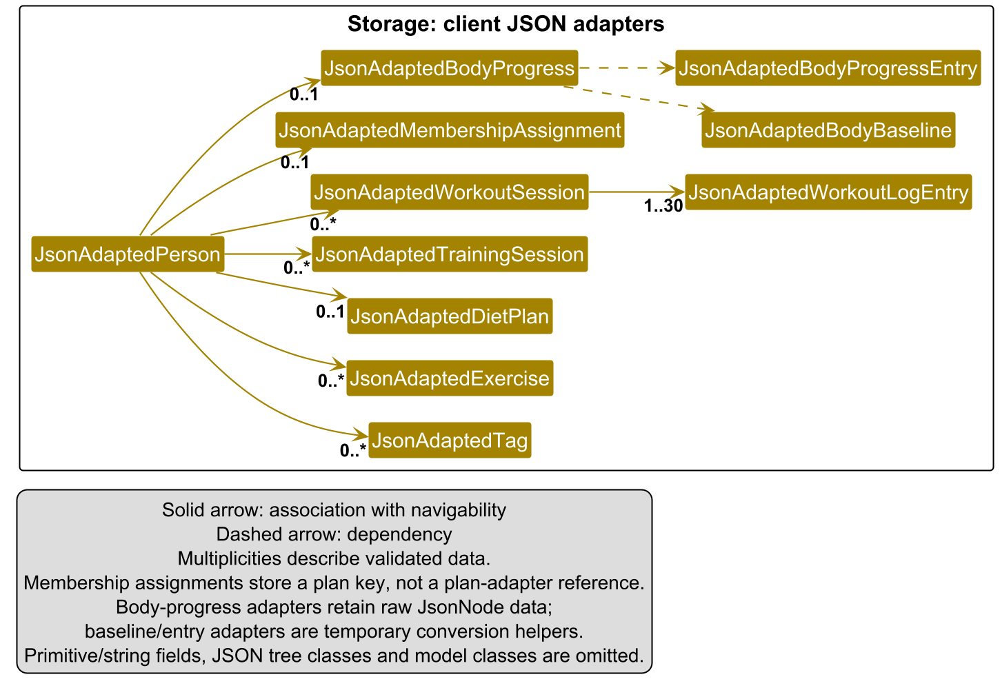
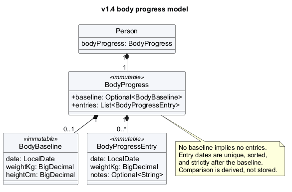
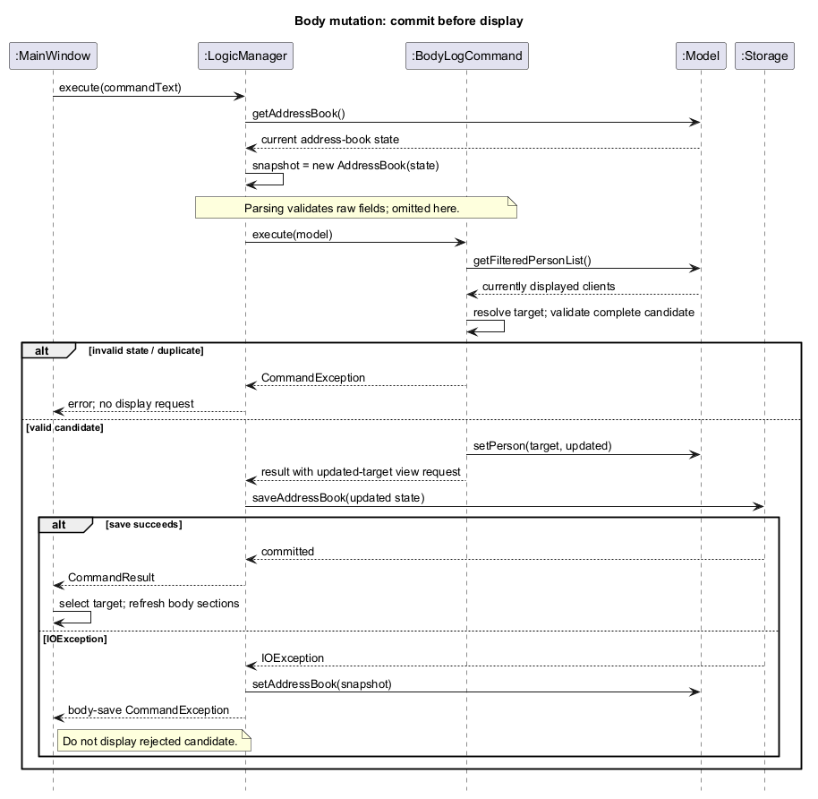

- Table of Contents
  {:toc}

---

## **Acknowledgements**

- _{List the sources of reused or adapted ideas, code, documentation, and third-party libraries here, with links to the originals.}_

---

## **Setting up, getting started**

Refer to the guide [_Setting up and getting started_](SettingUp.md).

---

## **Design**

<div markdown="span" class="alert alert-primary">

:bulb: **Tip:** The `.puml` files used to create diagrams are in `docs/diagrams`. Refer to the [_PlantUML Tutorial_ at se-edu/guides](https://se-education.org/guides/tutorials/plantUml.html) to learn how to create and edit diagrams.

</div>

### Architecture


The **_Architecture Diagram_** given above explains the high-level design of the App.

The following provides a quick overview of the main components and their interactions.

**Main components of the architecture**

**`Main`** (consisting of classes [`Main`](https://github.com/se-edu/addressbook-level3/tree/master/src/main/java/seedu/address/Main.java) and [`MainApp`](https://github.com/se-edu/addressbook-level3/tree/master/src/main/java/seedu/address/MainApp.java)) is in charge of the app launch and shut down.

- At app launch, it initializes the other components in the correct sequence, and connects them up with each other.
- At shut down, it shuts down the other components and invokes cleanup methods where necessary.

The bulk of the app's work is done by the following four components:

- [**`UI`**](#ui-component): The UI of the App.
- [**`Logic`**](#logic-component): The command executor.
- [**`Model`**](#model-component): Holds the data of the App in memory.
- [**`Storage`**](#storage-component): Reads data from, and writes data to, the hard disk.

[**`Commons`**](#common-classes) represents a collection of classes used by multiple other components.

**How the architecture components interact with each other**

The _Sequence Diagram_ below shows how the components interact when a trainer records a completed workout session using `log 1 d/2020-01-15 ex/Push-up|0|3|12`. This shows the successful case: client 1 exists in the displayed list and has no session with the same date and time.


Each of the four main components (also shown in the diagram above),

- defines its _API_ in an `interface` with the same name as the Component.
- provides its functionality through a concrete `{Component Name}Manager` class that implements the corresponding API interface.

For example, the `Logic` component defines its API in `Logic.java` and implements it in `LogicManager.java`. Other components interact with a component through its interface rather than its concrete class, preventing them from coupling to that component's implementation, as illustrated in the following partial class diagram.


The sections below give more details of each component.

### UI component

The **API** of this component is specified in [`Ui.java`](https://github.com/AY2627S1-CS2103T-T14-1/tp/blob/master/src/main/java/seedu/address/ui/Ui.java). `UiManager` implements this interface, loads the bundled fonts, and creates the `MainWindow` when the application starts.

*Scroll horizontally to explore the diagram, or click it to open the full-size image.*

<div class="diagram-scroll" role="region" aria-label="UI class diagram (scroll horizontally to view the full diagram)" tabindex="0">
  <a href="images/UiClassDiagram.png">
    
  </a>
</div>

The workspace has three columns: `PersonListPanel` displays clients and manages selection, `ClientDetailPanel` shows the selected client's profile and workout plan, and `ClientContextPanel` shows their diet, restrictions, appointments, and workout history. `ClientDetailPanel` owns a `BodyProgressPanel` for baseline measurements, progress history, and the latest comparison. These visible controllers, together with `MainWindow`, `CommandBox`, `ResultDisplay`, `HelpWindow`, `PersonCard`, and `StatusBarFooter`, inherit from the abstract `UiPart<T>` class, which loads their FXML and exposes their root node.

`MainWindow` creates and retains the main panels, command box, result display, and help window. It also creates a `StatusBarFooter` locally and supplies the save path and the list panel's observable client count. The footer binds its count label to that property. The list panel creates `PersonCard` controllers through its JavaFX cell renderer; it does not retain a separate card controller for every client.

`CommandBox` receives a `CommandExecutor` callback supplied as `MainWindow`'s `this::executeCommand` method reference. `MainWindow` calls `Logic.execute`, appends results or errors to `ResultDisplay`, and updates selection and filter indicators. `CommandCatalog` supplies command hints and help details. `ResultDisplay` retains up to 50 immutable `CommandFeedback` entries for its scrolling history. `MainWindow` does not implement the callback interface itself.

`MainWindow` listens to the list panel's selection and the observable client data supplied by `Logic`, then refreshes both selected-client panels. A `CommandResult` may also contain a `BodyProgressViewRequest`; after a successful body-progress command, `MainWindow` selects the resolved client and forwards the request through `ClientDetailPanel` to reveal the requested tracker section. UI controllers display `Person` data from the Model component.

The `UI` component uses JavaFX. Layouts are defined in `.fxml` resources under `src/main/resources/view`. For example, [`MainWindow.fxml`](https://github.com/AY2627S1-CS2103T-T14-1/tp/blob/master/src/main/resources/view/MainWindow.fxml) defines the layout loaded by [`MainWindow`](https://github.com/AY2627S1-CS2103T-T14-1/tp/blob/master/src/main/java/seedu/address/ui/MainWindow.java). The diagram omits individual JavaFX controls, private rendering helpers, and the detailed Model classes to keep the component relationships readable.

### Logic component

**API** : [`Logic.java`](https://github.com/se-edu/addressbook-level3/tree/master/src/main/java/seedu/address/logic/Logic.java)

Here's a (partial) class diagram of the `Logic` component:


The sequence diagram below illustrates the interactions within the `Logic` component, taking `execute("delete 1")` API call as an example.


<div markdown="span" class="alert alert-info">:information_source: **Note:** The lifeline for `DeleteCommandParser` should end at the destroy marker (X), but due to a limitation of PlantUML, it continues to the end of the diagram.
</div>

How the `Logic` component works:

1. When `Logic` is called upon to execute a command, the command is passed to an `AddressBookParser` object, which in turn creates a parser that matches the command (e.g., `DeleteCommandParser`) and uses it to parse the command.
1. This results in a `Command` object (more precisely, an object of one of its subclasses e.g., `DeleteCommand`) which is executed by the `LogicManager`.
1. The command can communicate with the `Model` when it is executed (e.g. to delete a person).<br>
   Note that although this is shown as a single step in the diagram above for simplicity, the code can require several interactions between the command object and the `Model` to complete the operation.
1. The result of the command execution is encapsulated as a `CommandResult` object which is returned from `Logic`.

Here are the other classes in `Logic` (omitted from the class diagram above) that are used for parsing a user command:


How the parsing works:

- When called upon to parse a user command, the `AddressBookParser` class creates an `XYZCommandParser` (`XYZ` is a placeholder for the specific command name, e.g., `AddCommandParser`). The parser uses the other classes shown above to parse the user command and create an `XYZCommand` object (e.g., `AddCommand`). The `AddressBookParser` returns that object as a `Command` object.
- All `XYZCommandParser` classes, such as `AddCommandParser` and `DeleteCommandParser`, implement the `Parser` interface so they can be treated similarly where appropriate, for example during testing.

### Model component

**API** : [`Model.java`](https://github.com/se-edu/addressbook-level3/tree/master/src/main/java/seedu/address/model/Model.java)


The `Model` component,

- stores the address book data i.e., all `Person` objects (which are contained in a `UniquePersonList` object).
  Each `Person` holds contact details, a workout plan, optional diet and fitness goals, scheduled training sessions,
  and completed workout sessions. A `WorkoutPlan` contains exercises, while each completed `WorkoutSession` contains
  its logged exercise entries.
- stores the `Person` objects selected by the current filter, such as search results, in a separate _filtered_ list. It exposes this list as an unmodifiable `ObservableList<Person>` that the UI can observe and bind to, so the UI updates when the list changes.
- stores a `UserPrefs` object that represents the user’s preferences (currently, just the GUI settings). This is exposed to the outside as a `ReadOnlyUserPrefs` object.
- does not depend on any of the other three components (as the `Model` represents data entities of the domain, they should make sense on their own without depending on other components)

<div markdown="span" class="alert alert-info">:information_source: **Note:** The alternative, arguably more object-oriented, design below keeps a unique list of tags in `AddressBook`, and each `Person` references tags from that list. This lets `AddressBook` maintain one `Tag` object per unique tag instead of each `Person` holding its own `Tag` objects.<br>


</div>

### Storage component

**API** : [`Storage.java`](https://github.com/AY2627S1-CS2103T-T14-1/tp/blob/master/src/main/java/seedu/address/storage/Storage.java)

`StorageManager` implements `Storage` and delegates JSON file access to one `JsonAddressBookStorage` and one `JsonUserPrefsStorage`. The overview shows these services and the top-level JSON representation. Model classes and common JSON/file utilities are omitted to keep the view focused on the storage component.


`JsonSerializableAddressBook` contains the saved clients and shared membership-plan catalog. Each `JsonAdaptedPerson` retains adapters for its tags, exercises, optional diet plan, scheduled sessions, recorded workouts, payment records, optional membership assignment and optional body tracker. Its payment-history list retains zero or more `JsonAdaptedPaymentRecord` instances, each storing an amount, date and optional remarks. The detail diagram expands these client adapters; its multiplicities describe supported, validated data. In particular, a recorded workout contains 1 to 30 exercise entries.



A membership assignment stores a plan key rather than a reference to `JsonAdaptedMembershipPlan`; loading validates that key against the catalog. `JsonAdaptedBodyProgress` retains a raw `JsonNode` and uses the baseline/entry adapters temporarily during conversion, so those helper relationships are dependencies rather than retained associations. Goal, health information and dietary restrictions are stored as strings or lists of strings and therefore have no separate adapter classes in these diagrams.

The storage component reads JSON back into the corresponding model objects and saves model data in JSON form. It therefore depends on model classes even though those dependencies are outside the scope of the two diagrams.

`MainApp#initModelManager` uses sample data only when the client file is absent. A `DataLoadingException` for an existing file aborts initialization before `LogicManager` is created. This prevents a subsequent command from overwriting unreadable data with an empty address book. The original file remains available for recovery after correcting the local date/time zone or restoring a backup. New future-dated workout input and invalid saved workout dates are still rejected.

### Common classes

Classes used by multiple components are in the `seedu.address.commons` package.

---

## **Implementation**

This section describes some noteworthy details on how certain features are implemented.

### Training schedule and client monitoring (`schedule` / `viewschedule` / `meeting` / `dayschedule` / `inactive`)

Each `Person` stores an immutable list of `TrainingSession` appointments. A session contains a `LocalDateTime`, a nonblank location, and a `Kind` of `TRAINING` or `MEETING`. `Person#withTrainingSession` returns a replacement person with the new appointment appended; the commands do not mutate the existing person. `JsonAdaptedTrainingSession` persists the appointment type alongside its date, time, and location. For compatibility with older saved data, a missing type is read as `TRAINING`.

`ScheduleCommandParser` and `MeetingCommandParser` use `AppointmentParser` to validate the displayed-list index, real calendar date, 24-hour time, nonblank location, and a start time later than the current local time. Their commands delegate to `AppointmentScheduler#add`. It searches the **entire** address book, including clients hidden by a filter, for an appointment with the same start time. If one exists, it reports the conflicting client and makes no change. Otherwise, it replaces the selected client with one containing the new appointment. Training sessions and meetings use the same conflict check. Because no duration is stored, appointments at different start times can still overlap in practice.

`ViewScheduleCommand` sorts one displayed client's appointments by start time; meetings are marked in the result. `DayScheduleCommand` instead scans all clients for the requested date, then orders appointments by start time and client name. Both commands are read-only. `InactiveCommand` also scans the full roster: for `inactive DAYS`, it calculates `today - (DAYS - 1)` and lists clients with no **completed workout log** on or after that date. A scheduled session or meeting does not count as a workout. The inactive list is ordered by client name and includes the latest recorded workout date, if any. `ClientContextPanel` labels meeting rows separately from training sessions, and `CommandCatalog` supplies usage hints for all five scheduling and monitoring commands.

To verify the main path manually, add two clients; use `schedule 1 d/2099-03-15 tm/14:30 l/Main gym`, then `meeting 2 d/2099-03-15 tm/15:30 l/Cafe`. `dayschedule d/2099-03-15` should list both in time order, and `viewschedule 2` should mark the second as a meeting. Scheduling either client at `14:30` again should report a conflict without adding an appointment. `inactive 1` should still list both clients until a completed workout dated today is logged for each of them.

### Workout plan feature (`addex` / `delex` / `dayex` / `clearplan`)

The workout plan feature lets a trainer keep a per-client list of prescribed exercises, optionally scheduled by weekday. Each `Person` owns one immutable `WorkoutPlan` (possibly empty); each `Exercise` is immutable and validated at construction. Plans are always kept sorted Monday-to-Sunday, with unscheduled exercises last.

#### Model: `Exercise`, `Weekday` and `WorkoutPlan`

- `model.person.Exercise` stores `name` (`String`), `sets` (`int`), `reps` (`int`), `weightKg` (`double`) and `day` (`String`, empty when unscheduled).
- Validation (`Exercise#isValidName`, `#isValidSets`, `#isValidReps`, `#isValidWeight`):
  - name is valid when `!test.trim().isEmpty()`; failure message is `Exercise name should not be blank`.
  - sets/reps are valid when `> 0`; failure messages are `Sets should be a positive integer greater than 0` and `Reps should be a positive integer greater than 0`.
  - weight is valid when `Double.isFinite(test) && test >= 0`; failure message is `Weight should be a finite non-negative number in kg`.
  - Combined message is `Exercise name should not be blank, sets and reps should be positive integers greater than 0, and weight should be a finite non-negative number in kg`.
- Command parsers supply the canonical full weekday name (`Monday`…`Sunday`) or `""` for unscheduled exercises. The constructor trims the input and normalizes legacy values: anything equal (ignoring case) to `Day not specified` becomes `""`. `Exercise#withDay(day)` returns a copy assigned to a new day; `Exercise#getDay` returns the stored value.
- Identity is name-based case-insensitive (`Exercise#isSameExercise`); full equality also compares sets/reps/weight/day. Duplicate checking in `WorkoutPlan#hasExercise` additionally compares the day, resolving weekday prefixes and ignoring letter case. Unassigned exercises share one group; matching names on different days are allowed. `SetExerciseDayCommand` checks for a duplicate on the destination day after excluding the selected exercise.
- `model.person.Weekday` is the canonical weekday enum (`MONDAY`…`SUNDAY` with display names `Monday`…`Sunday`).
  - `Weekday#fromPrefix` resolves a case-insensitive full name or prefix: minimum length is 1 except `Tuesday`/`Thursday`/`Sunday`, which need at least 2 characters. Hence a lone `s` means Saturday (Sunday needs `su`), and a lone `t` is invalid (`tu` = Tuesday, `th` = Thursday).
  - `Weekday#sortOrder(day)` returns the weekday rank (Monday 0 … Sunday 6); missing or unrecognized days sort after Sunday.
- `model.person.WorkoutPlan` wraps `List<Exercise>` with defensive copies and an unmodifiable view (`#getExercises`). Every constructor and mutator re-sorts by `Weekday.sortOrder` (a stable sort, so exercises in the same day group keep their relative order). Key APIs: `#hasExercise` (duplicate check), `#addExercise` (returns new plan), `#removeExercise`, `#setExerciseDay(index, day)` (replaces the exercise at the zero-based index via `Exercise#withDay` and re-sorts), `#isEmpty`, `#size`. `Person` stores the plan and exposes it via `#getWorkoutPlan`; `PersonBuilder#withWorkoutPlan` is used in tests.
- `WorkoutPlan#isWithinDailyLimit` checks a weekday against `MAX_EXERCISES_PER_DAY` (7), resolving weekday prefixes and letter case through `Weekday#fromPrefix`. Unassigned exercises have no daily limit. `AddExerciseCommand` and `SetExerciseDayCommand` check the destination day in the proposed immutable plan before updating the model. A violation produces `Messages.MESSAGE_DAILY_EXERCISE_LIMIT` and leaves the model unchanged. Checking the proposed plan allows reassignment to the same day at capacity and moving exercises away from a full day. Existing saved plans are still loaded without truncation.

#### Logic: commands and parsers

- `logic.commands.AddExerciseCommand` (`COMMAND_WORD = addex`):
  - `MESSAGE_USAGE = addex: Adds an exercise to the workout plan of the person identified by the index number used in the last person listing. Parameters: INDEX (must be a positive integer) n/EXERCISE_NAME [s/SETS] [r/REPS] [w/WEIGHT_KG] [d/DAY] Example: addex 1 n/Bench Press s/3 r/10 w/60 d/M`.
  - Success message `MESSAGE_ADD_EXERCISE_SUCCESS = Added exercise to Person: %1$s` (formatted with `Messages.format(editedPerson)`).
  - Duplicate message `MESSAGE_DUPLICATE_EXERCISE = This exercise already exists on this day in the workout plan.`
  - `execute` checks `Messages.MESSAGE_INVALID_PERSON_DISPLAYED_INDEX` (`The person index provided is invalid.`) for an out-of-range person index, rejects duplicates, then builds a new `Person` with `WorkoutPlan#addExercise` and calls `model#setPerson` + `model#updateFilteredPersonList(PREDICATE_SHOW_ALL_PERSONS)`.
- `logic.commands.DeleteExerciseCommand` (`COMMAND_WORD = delex`):
  - `MESSAGE_USAGE = delex: Removes the exercise at the specified exercise index from the workout plan of the person identified by the index number used in the last person listing. Parameters: PERSON_INDEX EXERCISE_INDEX (both must be positive integers) Example: delex 1 2`.
  - Success message `MESSAGE_DELETE_EXERCISE_SUCCESS = Removed exercise from Person: %1$s`.
  - Invalid exercise message `MESSAGE_INVALID_EXERCISE_DISPLAYED_INDEX = The exercise index provided is invalid.` shown when `exerciseIndex` is out of range, including when the plan is empty.
  - `execute` checks the person index first (`MESSAGE_INVALID_PERSON_DISPLAYED_INDEX`), then the exercise index, removes that entry from a copy of the list, wraps it in a new `WorkoutPlan`, and saves via `model#setPerson`. The exercise index is the current display number (see feedback formatting below), not the raw insertion order.
- `logic.commands.SetExerciseDayCommand` (`COMMAND_WORD = dayex`):
  - `MESSAGE_USAGE = dayex: Assigns a day tag to an exercise in a person's workout plan. Parameters: PERSON_INDEX EXERCISE_INDEX DAY Example: dayex 1 2 Tuesday`.
  - Success message `MESSAGE_SUCCESS = Assigned day to exercise: %1$s` (formatted with `Messages.format(editedPerson)`).
  - Invalid exercise message `MESSAGE_INVALID_EXERCISE_INDEX = The exercise index provided is invalid.` shown when `exerciseIndex` is out of range, including when the plan is empty.
  - `execute` checks the person index first (`MESSAGE_INVALID_PERSON_DISPLAYED_INDEX`), then the exercise index, applies `WorkoutPlan#setExerciseDay` (which re-sorts Monday-to-Sunday and renumbers), and saves via `model#setPerson` + `model#updateFilteredPersonList(PREDICATE_SHOW_ALL_PERSONS)`.
- `logic.commands.ClearPlanCommand` (`COMMAND_WORD = clearplan`):
  - `MESSAGE_USAGE = clearplan: Clears all exercises from the workout plan of the person identified by the index number used in the last person listing. Parameters: INDEX (must be a positive integer) Example: clearplan 1`.
  - Success `MESSAGE_CLEAR_PLAN_SUCCESS = Cleared workout plan for Person: %1$s`; already-empty `MESSAGE_PLAN_ALREADY_EMPTY = Workout plan is already empty for Person: %1$s` (no model change in the latter case).
- Parsers: `AddExerciseCommandParser` rejects unknown alphabetic parameter prefixes before tokenizing with `n/ s/ r/ w/ d/`; only `n/` is required, while omitted sets, reps, and weight default to `1`, `1`, and `0`. An omitted `d/` stores `""` (rendered under the `Day not specified` heading); a provided `d/` value is resolved via `DayParserUtil#parseDay` to the canonical weekday name. It rejects duplicates via `verifyNoDuplicatePrefixesFor` and delegates provided values to the matching `ParserUtil` validation methods (`parseExerciseName/Sets/Reps/Weight`); empty values such as `s/` or `d/` therefore fail validation. Any `ParseException` is wrapped as `Invalid command format!` + `MESSAGE_USAGE`. `DeleteExerciseCommandParser` expects exactly two indices (`PERSON_INDEX EXERCISE_INDEX`); `ClearPlanCommandParser` expects exactly one index; both wrap failures the same way. `SetExerciseDayCommandParser` splits the trimmed args on whitespace and requires exactly three parts (`PERSON_INDEX EXERCISE_INDEX DAY`), parsing the indices with `ParserUtil#parseIndex` and the day with `DayParserUtil#parseDay`, wrapping failures as `Invalid command format!` + `SetExerciseDayCommand.MESSAGE_USAGE`. `DayParserUtil#parseDay` delegates to `Weekday#fromPrefix` and returns the canonical display name, throwing `ParseException("Invalid day")` for anything else (e.g. `t`, `funday`, or the `Day not specified` heading). `AddressBookParser` routes `addex`/`delex`/`dayex`/`clearplan` to these parsers; unknown words return `Unknown command.`
- Feedback formatting: `Messages#format(Person)` appends `; Workout Plan: ` + `formatWorkoutPlan(plan)`, where an empty plan renders as `Empty` and a non-empty plan renders grouped by day in Monday-to-Sunday order with **Day not specified** last, e.g. `(4):` followed by `**Monday**`, `1. Squat 4x8 @80kg`, blank line, `**Wednesday**`, `2. Bench Press 3x10 @60kg`, and so on via `formatExercise` (`%s %dx%d @%skg`, e.g. `Bench Press 3x10 @60kg`, trimming `.0` weights). `Messages#getExercisesInDisplayOrder` re-sorts a copy of the plan the same way and assigns continuous 1-based numbers across all groups; `Messages#getExerciseDayHeading` maps `""` to `Day not specified` and any stored day through `Weekday#fromPrefix` to its display name. These numbers are exactly the `EXERCISE_INDEX` values accepted by `delex` and `dayex`, and appear after `%1$s` in all four success messages.

#### Storage: `JsonAdaptedExercise` and `JsonAdaptedPerson`

- `storage.JsonAdaptedExercise` is the Jackson-friendly form with fields `name`, `sets`, `reps`, `weightKg`, `day`. `toModelType` throws `IllegalValueException` with `Exercise's %s field is missing!` for null `name`/`sets`/`reps`/`weightKg`, or the matching `Exercise.MESSAGE_CONSTRAINTS_*` message for invalid values, and rejects non-finite/negative weights. A missing/`null` `day` loads as `""` (unscheduled, backward compatible with old files); any other stored day goes through the `Exercise` constructor, so legacy `Day not specified` values (any casing) also normalize to `""`.
- `storage.JsonAdaptedPerson` persists the plan as JSON array `exercises`. The `@JsonCreator` constructor treats a missing/`null` `exercises` field as empty (backward compatible with old files). `toModelType` rejects `null` entries with `Workout plan must not contain null exercises`, converts each entry via `JsonAdaptedExercise#toModelType`, and builds `new WorkoutPlan(personExercises)` (which re-sorts by weekday). Any invalid exercise therefore fails the whole person load, which `JsonSerializableAddressBook` propagates as `IllegalValueException`; startup then stops before creating the command-processing logic, preserving the original file instead of opening an empty roster that could overwrite it.
- Save path: `JsonAdaptedPerson(Person source)` copies `source.getWorkoutPlan().getExercises()` into adapted exercises (including each exercise's canonical `day`), so every `addex`/`delex`/`dayex`/`clearplan` is persisted on the next `StorageManager` save (automatic after each mutating command).

#### UI: person card rendering

- `ui.PersonCard#displayWorkoutPlan` renders the plan inside `workoutPlanContainer`, reusing `Messages#getExercisesInDisplayOrder`, `#getExerciseDayHeading` and `#formatExercise` so the card and command feedback always agree.
  - Header is `Workout Plan:` when empty, otherwise `Workout Plan (N):` where `N` is the plan size.
  - An empty plan shows placeholder label `No workout plan yet`.
  - Non-empty plan groups exercises under bold full-weekday headings in Monday-to-Sunday order with `Day not specified` last; only non-empty groups are shown, separated by an 8px spacer. Within each group, one `Label` per exercise is numbered with the continuous 1-based display index (`1. ...`, `2. ...`) using the `Name SetsxReps @Weightkg` format (e.g. `Bench Press 4x10 @60kg`). These numbers are exactly the `EXERCISE_INDEX` values accepted by `delex` and `dayex`, so the card doubles as the index reference; `addex`/`dayex`/`delex` re-sort and renumber, so callers must always use the current card numbering.
  - Labels wrap (`setWrapText(true)`, max width 350) so long lists grow vertically without breaking the card layout. The card observes the filtered person list, so it refreshes automatically after each command.

<a id="diet-plan-management"></a>

### Diet goals

Diet goals consist of one current nutrition target and optional coaching notes per client. The implementation retains the existing `DietPlan` model, `dietPlan` JSON field, and command-message wording; the feature rename does not change the command syntax or saved-data format.

Each `Person` owns an optional immutable `DietPlan`, consisting of one required target and optional notes. The model trims outer whitespace, counts Unicode code points, rejects nonprintable characters, and requires at least one letter or digit in the target. It preserves internal text and case. `JsonAdaptedPerson` and `JsonAdaptedDietPlan` serialize the diet goals in the client's JSON record, so deleting the client also removes their diet goals. A client has at most one current target record and no history of diet goals.

For `diet INDEX t/TARGET [n/NOTES]`, `AddressBookParser` passes the raw arguments to `DietCommandParser`. This preserves invalid line breaks for validation. At the beginning of an argument or after horizontal whitespace, the parser reserves single-letter prefixes and markers formed by repeating or mixing `t` and `n` in either case. Only exact lowercase `t/` and `n/` are accepted; mistyped markers such as `nn/`, `tt/`, `nt/`, and `tn/` are rejected before command execution, including inside notes. Other slash-separated words such as `kcal/day` remain ordinary text. It validates the displayed-list index, one required target, at most one optional notes value, and rejects unknown or repeated prefixes. `DietCommand` looks up the `Person` in the filtered list, compares the candidate with the current diet goals after trimming and ignoring case, then uses `Model#setPerson` to replace the client record while retaining the other fields and current list filter. An omitted `n/` saves diet goals without notes, even when the previous record had notes.

`LogicManager` snapshots the address book before executing a diet command. `JsonAddressBookStorage` writes a complete JSON document to a temporary file in the data file's directory, then atomically moves it over the old file. If writing or replacing the file fails, `LogicManager` restores the snapshot and returns `The diet plan could not be saved. The previous plan remains unchanged.` The storage layer does not fall back to a non-atomic replacement when the filesystem does not support atomic moves. Validation and duplicate failures occur before any model change.

`ClientContextPanel` shows the selected client's diet goals in the right-hand **DIET** section. It shows the current target and notes, hides notes when absent, and displays `No diet target recorded.` for clients without diet goals. Wrapping and scrolling keep long accepted values readable. The UI does not evaluate the diet goals' nutritional or medical suitability.

`DietCommandParserTest`, `DietCommandTest`, and `DietIntegrationTest` cover parsing limits, duplicate and replacement behavior, filtered indexes, save and restart, and injected commit failure. `WorkoutSessionDisplayTest#dietPlan_showsTargetAndOptionalNotes` checks the `ClientContextPanel` target text, optional-note visibility, and displayed client index in the command hint. `WorkoutSessionDisplayTest#switchingToClientWithoutRecords_clearsPriorRows` checks that switching to a client without records shows the empty diet state. The manual scenarios below cover the main user flows.

### Dietary restrictions

Each `Person` owns an immutable `DietaryRestrictions` list, which is empty when no restrictions are recorded. `restriction INDEX r/RESTRICTION [r/RESTRICTION]...` replaces the complete list; one blank sole `r/` clears it. The value object validates 1 to 10 ordered entries, each containing 1 to 100 printable Unicode characters and at least one letter or digit. It rejects duplicates after trimming and case-insensitive comparison while preserving the first supplied display text and ordering.

`DietaryRestrictionsCommandParser` parses a displayed-list index and repeated `r/` values. `DietaryRestrictionsCommand` rejects an unchanged list and replaces the client with `Person#withDietaryRestrictions`, preserving unrelated data. `JsonAdaptedPerson` stores the list as `dietaryRestrictions`; an absent field loads as an empty list for backwards compatibility. `find dr/KEYWORDS` uses `DietaryRestrictionsContainsKeywordsPredicate` and retains the existing OR semantics. The selected-client detail pane only displays the list when nonempty. Restriction text is informational and does not determine allergy or meal safety.

### Health considerations

Each `Person` has an optional immutable `HealthProfile` with one current trainer-visible note. `health INDEX h/NOTE` replaces the note and `health INDEX h/` clears it. `HealthProfile` trims outer whitespace, accepts 1 to 500 printable Unicode characters with at least one letter or digit, and rejects line breaks and control characters. The profile is serialized as the optional `healthProfile` field in `JsonAdaptedPerson`; older data without that field loads without a profile.

`HealthCommandParser` requires exactly one `h/` prefix and a displayed-list index. `HealthCommand` rejects a no-op update, replaces the client through `Person#withHealthProfile`, and preserves all unrelated client information. `find h/KEYWORDS` uses `HealthProfileContainsKeywordsPredicate` with the existing case-insensitive OR search behavior. The selected-client details panel displays the profile only when present. Health considerations are informational only; the application does not diagnose conditions or evaluate medical suitability.

### Search clients (`find`)

`find` has two forms: `find KEYWORD...`, a name search, and `find [n/NAME] [p/PHONE] [e/EMAIL] [g/GOAL] [dr/RESTRICTION] [h/HEALTH]`. Use case UC03 describes only the name form; the user-facing behaviour of all criteria is in the User Guide.

`FindCommandParser` tokenizes the input with the six supported prefixes. With no prefix, the whole trimmed input becomes a name search. With at least one prefix, it rejects a non-empty preamble (a bare keyword cannot be mixed with prefixes), a prefix used more than once, an empty value, and a `p/` value without a digit. It creates one predicate per supplied prefix and wraps them all in a `ClientMatchesAnyPredicate`, which uses `anyMatch`, so a client is shown when it satisfies any one criterion (OR).

| Prefix | Predicate | Matching rule |
| --- | --- | --- |
| `n/` | `NameContainsKeywordsPredicate` | any whitespace-separated keyword is a case-insensitive substring of the name |
| `p/` | `PhoneMatchesPredicate` | one query; spaces and hyphens are removed from the query and the stored phone, then the phone must contain the query |
| `e/` | `EmailContainsKeywordsPredicate` | any keyword is a case-insensitive substring of the email |
| `g/` | `GoalContainsKeywordsPredicate` | any keyword is a case-insensitive substring of the goal; clients without a goal never match |
| `dr/` | `DietaryRestrictionsContainsKeywordsPredicate` | any keyword is a case-insensitive substring of any current restriction |
| `h/` | `HealthProfileContainsKeywordsPredicate` | any keyword is a case-insensitive substring of the health note; clients without one never match |

Case-insensitive matching lowercases both sides with `Locale.ROOT`, except the name predicate, which uses `StringUtil#containsIgnoreCase`. The health predicate also folds the Greek final sigma (`ς`) to the ordinary sigma (`σ`) after lowercasing, so sigma variants match each other. `FindCommand` passes the combined predicate to `Model#updateFilteredPersonList` and reports `Found N client(s).` or the zero-result message. It does not modify stored data.

OR was chosen so that each additional criterion widens the result and so that each feature can contribute its own predicate without changing the others. To add a criterion, define a prefix in `CliSyntax`, add it to `FindCommandParser#SUPPORTED_PREFIXES`, write a `Predicate<Person>` in `model.person`, and add a branch to `FindCommandParser#createFindCommand`. Automated coverage is in `FindCommandParserTest`, `FindCommandTest`, `ClientMatchesAnyPredicateTest` and one test class per predicate.

### Workout session logging

Each `Person` owns an immutable list of `WorkoutSession` objects. Each session contains a required `LocalDate`, an optional `LocalTime`, and an ordered list of 1 to 30 `WorkoutLogEntry` objects.

`WorkoutSession` rejects future dates, times containing seconds or nanoseconds, empty exercise lists, and lists exceeding the entry limit. Each `WorkoutLogEntry` validates its exercise name, weight, sets, and repetitions. Weight uses `BigDecimal` and is displayed with `toPlainString()`.

For `log INDEX d/DATE [t/TIME] ex/EXERCISE|WEIGHT|SETS|REPS ...`, `AddressBookParser` delegates to `LogCommandParser`. The parser checks required arguments, repeated date or time prefixes, date and time formats, and the four values in every exercise entry. It constructs the complete validated session before returning a `LogCommand`.

`LogCommand` resolves the index against the filtered client list. It rejects a session if that client already has the same date and optional time, using `WorkoutSession#hasSameDateTime`. Exercise contents do not affect this duplicate check. An unspecified time is distinct from every specified time.

On success, the command appends the session to a copy of the existing session list and replaces the client through `Model#setPerson`, preserving their other fields and the current filter. Sessions remain in recording order rather than chronological order.

`JsonAdaptedWorkoutLogEntry`, `JsonAdaptedWorkoutSession`, and `JsonAdaptedPerson` handle persistence. Dates use `yyyy-MM-dd`, specified times use `HH:mm`, and exercise order is preserved. Older person records without a workout-session field load with an empty session list. Invalid entries and duplicate session keys are rejected during conversion to model objects.

`LogicManager` saves the updated address book through the storage component. If saving throws an `IOException`, it restores the address-book snapshot taken before command execution and reports the save error.

`MainWindow` observes the selected client and changes to the client list. `ClientContextPanel#showHistory` displays every completed session under **HISTORY** / **Completed workouts**, numbering rows consistently with `history`. It sorts a copy by date descending, then places unspecified times before specified times on the same date, with specified times descending. Unspecified times are distinct from midnight and display as `Time not specified`. The stored recording order and exercise order are unchanged. A client without sessions sees `No completed workouts logged.`; no selection shows the context placeholder. Exercise labels wrap, and the context panel supports scrolling.

`HistoryCommand` reads the filtered client list and formats all sessions without modifying data. `EditLogCommandParser` reuses `LogCommandParser` validation to construct a complete replacement session. `EditLogCommand` resolves the displayed client and history indexes, rejects unchanged and duplicate-key replacements, replaces the selected session in the client's stored list, and preserves every unrelated client field. `MainWindow` selects the targeted client before command execution. The usual `LogicManager` save and snapshot restoration protect edits from failed writes.

Automated coverage includes model validation and immutability, JSON round trips and legacy records, parser validation, duplicate rejection, filtered-list targeting, preservation of sessions by other client-update commands, and selected-client display.

### Membership plan management

#### Model and persistence

- `AddressBook` owns an insertion-ordered collection of uniquely named `MembershipPlan` definitions. A plan has a normalized display name, a positive `BigDecimal` price stored at two decimal places, and 1 to 1000 starting sessions. Names are compared without regard to case after trimming and collapsing internal whitespace.
- Each `Person` has at most one optional `MembershipAssignment`. It keeps a reference to the shared plan, a copy of its display name, an independent remaining balance from 0 to 1000, and an optional expiry date. Assigning a plan copies its starting sessions; subsequent adjustments change only that client's balance. A referenced plan cannot be deleted.
- JSON stores `membershipPlans` at the address-book root and `membershipAssignment` on each person. Missing fields in older files mean an empty catalog or an unassigned client. Loading rejects duplicate plan keys, null plan or person entries, malformed values, assignments referring to missing plans, and assignments whose copied plan name disagrees with the plan their key points to. Expired assignments remain loadable; expiry is checked against the local date only when `amem` runs.
- Address-book snapshots and person replacement copy membership data. On an `IOException` during save, `LogicManager` restores the complete pre-command state and reports that the membership change could not be saved.

#### Commands and UI

`AddressBookParser` routes `addmem n/NAME p/PRICE s/NUMBER_OF_SESSIONS`, `delmem n/NAME`, `amem MEMBERSHIP_NAME PERSON_INDEX [e/YYYY-MM-DD]`, `rmem PERSON_INDEX`, `imem PERSON_INDEX NUMBER_TO_INCREMENT`, `dmem PERSON_INDEX NUMBER_TO_DECREMENT`, `clearmem`, and both `view mem` and `view membership`. Command words and the `view` argument are case-sensitive; prefix letters and plan name matching are case-insensitive. Client indexes refer to the currently displayed client list. For `amem`, the final non-prefixed token before an optional `e/` is the client index, allowing spaces in the plan name.

`ClearmemCommand` (`COMMAND_WORD = clearmem`, `MESSAGE_SUCCESS = Cleared all membership plans.`) takes no parameters and deletes every plan in the catalog while leaving all other data, including client records, workout plans, schedules, diet goals, and workout logs, unchanged. Before deleting, it checks whether any plan is referenced by a client assignment. If so, it deletes nothing and returns `MESSAGE_PLANS_IN_USE = Membership plans are in use and cannot be cleared. Remove all client assignments with rmem first.`, consistent with `delmem`'s rule that a referenced plan cannot be deleted. The client `clear` command (`ClearCommand`) is the counterpart for client records: it removes all persons only and must not delete any membership plans, so it bypasses the in-use check. Either command persists its result through the automatic save after the command runs.

Parsers require each mandatory prefix exactly once, reject repeated or unknown prefixes and extra text, and validate prices, session counts, and dates before changing the model. `amem` requires a future expiry date when one is supplied. `imem` and `dmem` accept amounts from 1 to 1000 and keep the resulting balance within 0 to 1000. A client with an assignment must use `rmem` before receiving another plan. Both view aliases show the same plan order and `No membership plans available.` when the catalog is empty.

The client card shows a single membership tag reading `Plan_name Member: N sessions left`, with `[expires YYYY-MM-DD]` appended when an expiry exists and the plan name's first letter upper-cased. The tag joins the client's other tags in the card's tag area, directly under the name, and wraps within the card, so a long plan name does not push the balance or expiry outside it. An unassigned client shows no membership tag. The plan-list output of `view mem`/`view membership` prefixes each price with `S$` and upper-cases the first letter of each plan name. Command messages and error behavior follow the [Feature 11 specification](featureSpecs.md#feature-11-membership-plan).

### Payment records

Implemented for v1.4. The [feature contract](featureSpecs.md#feature-14-payment-records) defines user-visible behavior. `pay` appends one immutable payment to a client's history; it does not change a membership assignment, plan price, or session balance.

#### Model and persistence

- `model.person.PaymentRecord` is an immutable payment containing a `BigDecimal amount` (normalized to two decimal places), a `LocalDate date`, and an optional `remarks`. It exposes `fromText` and the `parse*`/`isValid*` helpers for raw input and validation, reused by parsing and storage.
  - `amount` is positive with no precision beyond two decimals; `AMOUNT_SCALE` is 2. It is stored and displayed via `BigDecimal.toPlainString()`, so there is no floating-point rounding and `75`, `75.5`, and `75.50` are equivalent. `AMOUNT_PATTERN` (`\d+(\.\d{1,2})?`) rejects signs, currency symbols, thousands separators, and over-precise or malformed text.
  - `date` must match `uuuu-MM-dd` with a `ResolverStyle.STRICT` formatter and year 0001–9999. Past, current, and future dates are all accepted.
  - `remarks` is optional; when present it trims outer horizontal whitespace, counts Unicode code points (1–300, `MAX_REMARKS_LENGTH`), and rejects ISO control, format, line/paragraph separator, surrogate, private-use, and unassigned code points. Internal spacing and case are preserved.
- `Person` owns an insertion-ordered `List<PaymentRecord>` (`paymentRecords`). `withAddedPayment` copies the list and appends the new record. Every other client-update command (`diet`, `edit`, `editlog`, `remark`, and the workout-plan, workout-logging, membership, and body-progress commands) constructs a new `Person` passing `person.getPaymentRecords()` through, so payments are preserved across unrelated edits. Deleting a client removes their payments with the client.
- JSON stores `paymentRecords` on each person. `JsonAdaptedPerson` initializes the field to an empty list, so a missing/null `paymentRecords` field in older files loads an empty payment history. `toModelType` rejects null entries (`Payment records must not contain null entries.`) and converts each entry via `JsonAdaptedPaymentRecord#toModelType`, preserving entry order and never deduplicating, so repeated payments stay distinct.
- `storage.JsonAdaptedPaymentRecord` is the Jackson form with required `amount` and `date` strings and a `@JsonInclude(JsonInclude.Include.NON_NULL)` `remarks` string. `toModelType` throws `IllegalValueException` with `Payment record's %s field is missing!` for a null `amount`/`date`, and maps invalid stored values to the `PaymentRecord` constraint messages.

#### Commands and UI

- `logic.commands.PayCommand` (`COMMAND_WORD = pay`):
  - `MESSAGE_USAGE = pay: Records a payment for the client identified by the index number used in the displayed client list.\nParameters: INDEX (must be a positive integer) a/AMOUNT d/YYYY-MM-DD [r/REMARKS]\nExample: pay 1 a/150 d/2026-10-20`.
  - Success `MESSAGE_SUCCESS = Recorded payment for %1$s: %2$s on %3$s.`, formatted with `updated.getName()`, `paymentRecord.getFormattedAmount()`, and `paymentRecord.getDate()`.
  - `MESSAGE_SAVE_FAILURE = Payment could not be saved. No payment was recorded.`
  - `execute` resolves the index against `getFilteredPersonList()`, rejects an out-of-range index with `Messages.MESSAGE_INVALID_PERSON_DISPLAYED_INDEX`, builds `target.withAddedPayment(paymentRecord)`, and saves via `model#setPerson`, preserving the client's other fields and the current filter.
- `logic.parser.PayCommandParser` reads the displayed index, then the prefixed `a/` (`CliSyntax.PREFIX_ADDRESS`), `d/` (`CliSyntax.PREFIX_DATE`), and optional `r/` (`CliSyntax.PREFIX_REMARK`) values. The command word and prefixes are matched case-sensitively. `AddressBookParser` routes `pay` with a `DOTALL` pattern (AddressBookParser.java:62) and the parser keeps raw arguments until validation so an embedded line break survives to be rejected (`containsLineBreak`); any line break produces `Invalid command format!` + `MESSAGE_USAGE`. It rejects a blank index or argument area, a repeated/unknown/empty prefix, an unknown `word/`-style token inside a value (e.g. `x/`), and extra unprefixed text. `a/` and `d/` are required and must be single tokens (internal whitespace is rejected), while a single empty `r/` is rejected. Validated values are built into a `PaymentRecord` via `PaymentRecord.fromText` before a `PayCommand` is returned.
- `LogicManager` maps an `IOException` from a `PayCommand` to `PayCommand.MESSAGE_SAVE_FAILURE` (LogicManager.java:159), so a failed write restores the previous payment data in memory and on disk, exactly like `diet`, membership, and body mutations.
- `ui.CommandCatalog` registers `PayCommand` for usage hints and the help window.
- `ui.ClientDetailPanel#showPayments` renders the client's payments: it sorts a copy by date (oldest first) with entry order within a date, shows `None` for an empty history or `N record(s)`, and adds one fixed-width `payment-row` per record with a monospace date, a right-aligned monospace amount, and an optional wrapable remarks label. Selection changes rebuild the rows, so switching clients never leaves a stale payment row.

Automated coverage includes model validation and immutability, JSON round trips and legacy absence, parser boundary cases, filtered-list targeting, preservation by other client-update commands, selected-client display, and the save-failure path. Manual scenarios are below.

### Body progress tracker

Implemented for v1.4. The [feature contract](featureSpecs.md#feature-10-body-progress-tracker) and [User Guide](UserGuide.md#body-progress-tracker) define user-visible behavior. The tracker supports baseline measurements, dated weight/notes, complete history, latest-to-baseline comparison, and correction/deletion.

#### Ownership and invariants

Each `Person` owns one immutable `BodyProgress` aggregate, initially empty. An optional `BodyBaseline` contains `LocalDate date`, `BigDecimal weightKg` and `BigDecimal heightCm`. Each immutable `BodyProgressEntry` contains a date, exact weight and optional notes. The aggregate defensively copies its entry collection and exposes an unmodifiable list in date order.



The model class diagram deliberately omits unrelated `Person` fields. It does not replace the shared Model diagram maintained by other members.

Aggregate invariants:

* No baseline implies no entries. An empty aggregate has neither.
* A baseline is unique; entry dates are unique per client and strictly later than the baseline date. Ordering uses date, not insertion order.
* Weight is `(0, 500]` kg and height is `(0, 300]` cm, at most two decimal places. Normalize stored decimal scale to two after validation; do not round invalid input. Numerical equality treats `75.5` and `75.50` as equal.
* Notes are optional; supplied notes obey the contract's code-point, trimming and printable-text rules. Compare notes exactly after normalization, including case and internal spacing.
* Baseline replacement retains entries and must validate its candidate date against **all** retained entries. Never silently drop or re-date history.
* Same-date `bodylog` replaces the complete entry, including clearing notes when omitted. An exact duplicate is rejected before replacement. `bodydelete` cannot remove the baseline.

`Person.withBodyProgress(updated)` copies every unrelated field. Existing client reconstruction paths and `PersonBuilder` retain the tracker. Full person equality/hashCode include it; client identity (`Person#isSamePerson`, used by `add`, `edit`, `UniquePersonList` and storage loading) is the name after trimming, collapsing internal whitespace, and lowercasing with `Locale.ROOT`, plus the phone number. Thus two clients may share only a name or only a phone, and identity does not depend on measurements. Deleting/clearing clients removes their owned aggregates; catalog operations preserve them.

#### Commands, parsing and UI requests

Command/parser pairs are `BodyBaselineCommand` / `BodyBaselineCommandParser` (`bodybase`), `BodyLogCommand` / `BodyLogCommandParser` (`bodylog`), `BodyHistoryCommand` / `BodyHistoryCommandParser` (`bodyhistory`), `BodyCompareCommand` / `BodyCompareCommandParser` (`bodycompare`) and `BodyDeleteCommand` / `BodyDeleteCommandParser` (`bodydelete`). `BodyHistoryCommand` and `BodyCompareCommand` are queries and leave domain data unchanged; the three mutation classes create complete candidates before `Model#setPerson`.

The reusable `BodyParserUtil` and `BodyMeasurements` helpers handle index, strict decimal syntax, dates, notes and prefix validation. Reserve alphabetic `PREFIX/` tokens only at argument boundaries; preserve `km/day` inside notes. Reject duplicate/unknown prefixes and raw nonprintable characters before normalization. Do not lowercase values or collapse notes' internal spacing. Recognize only the command's allowed prefixes. Tests must use the public command router as well as individual parsers so trimming at the router cannot hide a trailing newline.

Date checks use an injectable `Clock` with the local zone, not fixed test dates or a global mutable clock. Validate future-date restrictions against the execution date (including if midnight passes after parsing). Load checks use the same clock policy. The model also validates structural, measurement and cross-date invariants independently of parsers. Exceptions handle bad user/stored input; assertions are only appropriate for internal assumptions after validation.

Resolve indexes against `getFilteredPersonList()` exactly once before mutation. Do not reset the predicate to show all clients. `bodyhistory` and `bodycompare` should select/reveal the requested client even for valid empty-data states; invalid indexes must not change the UI.

`CommandResult` carries an optional typed `BodyProgressViewRequest` containing the resolved target `Person` and section (`HISTORY` or `COMPARISON`). Mutations request the updated client; queries request the existing client. Existing constructors retain an empty request by default; result equality and hashCode include the optional request. `MainWindow` consumes the request only after `LogicManager.execute` returns successfully, selects the target in `PersonListPanel`, and reveals the section. Do not pass the numeric index on for later re-resolution against a potentially changed list, and do not mutate domain data to implement selection.

`BodyProgressPanel` renders baseline, all entries and comparison in the centre column's `ClientDetailPanel`. The body card scrolls internally, and the centre details column scrolls when its content exceeds the available height. `MainWindow` observes selection/client replacement and consumes successful typed requests, then `ClientDetailPanel.revealBodyProgress` reveals the card and requested section. Maximum-length notes wrap within the available width. Selection changes rebuild/clear all body fields; the window never resizes automatically. All five commands are registered in `CommandCatalog` for usage hints and help.

#### Deriving history and comparison

Build the view from the aggregate on demand. Baseline is separate from the progress entry count. The comparison uses the maximum entry date and subtracts baseline weight with `BigDecimal.subtract`, formatting at scale two in plain decimal notation. Prefix a positive difference with `+`; negative differences retain `-`; zero is `0.00` with no sign. Do not store a separate cached latest-entry pointer, delta, BMI or health classification: those could become stale after correction or deletion. No entry produces the contract's empty state rather than a baseline-to-itself comparison.

#### Persistence schema and backward compatibility

`JsonAdaptedBodyProgress`, `JsonAdaptedBodyBaseline` and `JsonAdaptedBodyProgressEntry` adapters add a nested `bodyProgress` field to each JSON person. There is no shared catalog or cross-client reference. A populated example is:

```json
{
  "bodyProgress": {
    "baseline": {
      "date": "2020-01-01",
      "weightKg": "75.50",
      "heightCm": "175.00"
    },
    "entries": [
      {"date": "2020-01-08", "weightKg": "74.80", "notes": "Measured before breakfast"},
      {"date": "2020-01-15", "weightKg": "74.20"}
    ]
  }
}
```

This is a fragment of a person, not a complete standalone address book. Measurements are **JSON strings** with strict decimal content, serialized at scale two to preserve exact values. Dates are strings. Notes, when present, are strings. Read raw JSON nodes or equivalent strict adapters so Jackson cannot silently coerce a number/boolean into a string.

Missing/null `bodyProgress` in legacy persons means an empty tracker. Within a present object, missing/null baseline means absent baseline, and missing/null entries means an empty list; entries without a baseline are invalid. Missing/null notes means absent notes; a supplied empty/blank string is invalid. Present baseline/entry measurements and dates are required. Validate object/array types and every list element before conversion. Reject null entries, malformed or future dates, unsupported year ranges, invalid/wrong-type measurements, duplicates, baseline-date conflicts and all other invariant violations through `IllegalValueException`, translated by storage to `DataLoadingException`. Do not leak NPE/number-format exceptions, silently coerce values, remove bad entries or truncate old records. The shared startup guard stops initialization on a loading error and leaves the original client file untouched.

Load then sort valid entries by date. On save, emit the canonical date order. Round-trip tests must keep a populated baseline, several adjusted entries and optional notes present across restart. Also verify unrelated person data and shared address-book catalogs survive serialization and restore.

#### Atomic mutation, rollback and integration

For each mutation, take/retain the existing complete address-book snapshot, validate all requested fields and the proposed aggregate, replace the target client, and let the existing atomic storage boundary commit. On `IOException`, restore the snapshot and report `The body progress change could not be saved. No changes were made.` `BodyMutationCommand` identifies the three mutations for this message mapping. `LogicManager` returns successful non-mutating `BodyCommand` results without saving or changing undo/redo history. Thus history/comparison remain available with read-only storage and do not create a data file merely to show an empty tracker. They still return typed view requests for the UI. Mutations continue through the atomic save and undo boundary.



The sequence diagram abstracts parsing and the actual filesystem temporary-file/move implementation. Its save arrow represents the existing `Storage.saveAddressBook` boundary. Return a display request only on successful completion; an exception must not reveal or later persist a rejected candidate. Do not fire irreversible UI/history side effects during command execution before saving.

Snapshots, `AddressBook` copy/reset/equality, `Person` builders and the shared undo/redo history retain body data together with every other feature. This design adds no independent tracker undo stack; the shared history stores and restores these complete snapshots. Body logging is independent of workout logging and never deducts membership sessions.

#### Implementation increments and validation

Implementation commits cover: (1) immutable model/adapters and legacy/invalid-file tests, (2) baseline/log/delete commands and rollback integration, (3) query/UI handoff and readable display. The feature spec, UG and this DG describe the complete runtime companion PR. Merge the runtime PR before this documentation update. These increments together, not just a foundation model, complete the assigned v1.4 scope.

Automated coverage in `BodyProgressTest`, `JsonAdaptedBodyProgressTest`, `BodyProgressIntegrationTest` and `BodyProgressPanelTest` exercises:

* Parser/router boundaries: zero/signed/oversized and filtered indexes; missing/repeated/unknown prefixes; newline preservation; leap/impossible/future dates; decimal syntax/bounds; Unicode code-point note limits and nonprintables.
* Aggregate transitions: create/replace baseline; invalid correction keeps all entries; create/replace/delete entry; notes clearing; exact duplicates versus case-only note edits; duplicate dates; sorted backdating; independent clients.
* Derived views: positive, negative and zero differences; latest by date after backdated insertion/edit; fallback after deleting latest; no baseline and baseline-only empty states; no mutation by queries.
* Real save/reload: populated baseline and multiple entries, target-only notes absence, corrected entries, unrelated fields/catalogs, legacy absence, null/wrong-type fields/elements and invalid cross-date relationships.
* Fault injection for every mutation form (including both creation and replacement): unchanged model/filter/catalogs and original file bytes, cleaned temporary files, and a later successful command not persisting rejected values.
* UI selection/refresh, invalid-index stability, maximum-length notes and supported narrow-window layout; confirm target/notes/delta are not stale when switching clients or after failed saves.

The manual scenarios in the appendix complement automated tests. Runtime validation includes the full Gradle test/Checkstyle suite and the packaged application smoke test; the UI tests exercise command entry and produce a minimum-window screenshot for visual inspection.

### Undo/redo feature

#### Saved snapshots in `LogicManager`

`LogicManager` owns two in-memory `Deque<AddressBook>` stacks: `undoStack` and `redoStack`.
Each snapshot contains the complete client records and membership-plan catalogue. Immutable client values,
including body progress and workout sessions, can be shared safely between snapshots. The stacks are not
written to JSON and start empty whenever the application starts.

`AddressBookParser` uses `UndoCommandParser` and `RedoCommandParser` to reject extra arguments and
create marker commands. `LogicManager` handles them through `executeUndo` and `executeRedo`; their
`execute` methods are not used to restore data. An empty stack returns `No changes to undo.` or
`No changes to redo.` without saving or changing data.

For an ordinary command, `LogicManager` copies the current address book into `backup` before execution.
For undo/redo, it copies the current data into `current` and restores the top snapshot using
`Model#setAddressBook`. It saves the resulting address book through `Storage#saveAddressBook` before
changing either stack:

| Successfully saved operation | Undo stack | Redo stack |
| --- | --- | --- |
| An ordinary command changes address-book data | Push `backup`; discard the oldest snapshot if over the limit | Clear |
| `undo` | Pop the restored snapshot | Push `current` |
| `redo` | Push `current`, applying the same limit | Pop the restored snapshot |
| An ordinary command leaves address-book data unchanged | Unchanged | Unchanged |

`MAX_UNDO_HISTORY_SIZE` limits the undo stack to **50 snapshots**. The newest snapshot is at the front;
`pushUndoState` removes the oldest snapshot at the back when necessary. At most 50 undo steps can be
moved to the redo stack, so redo history is bounded by the same limit. A new saved mutation after undo
clears redo history. History retains complete snapshots, so memory still depends on the amount of client
data in those retained states.

The following diagram shows a successful undo with a nonempty undo stack. Parsing is summarized inside
`LogicManager`; the restored snapshot is `undoStack.peek()`.


#### Failure handling and search state

If command execution fails, no save or history transition occurs. If saving throws `IOException`,
`LogicManager` restores the snapshot from before execution (`backup` or `current`) and reports the existing command-specific or generic save error.
Neither stack is advanced, so a failed undo or redo can be retried after the storage problem is resolved.
The existing atomic JSON save boundary protects the previous file contents.


After a successful undo or redo, `LogicManager` resets the client predicate to
`Model.PREDICATE_SHOW_ALL_PERSONS`, and `MainWindow` clears the query indicator to `All clients`.
Restored clients are visible, and index-based commands use that complete list. An empty-history response
or a failed save leaves both the active search predicate and its indicator unchanged. Window settings,
the saved file location and command-entry history are not reversed.

For example, after a saved `delete 1` and a saved `add` command, two undo operations restore the states
before the add and before the deletion. A `list` between those undos does not consume a history step.
Redo reapplies the saved states in the opposite order. A new successful mutation replaces that redo path.

#### Design considerations and verification

Complete snapshots keep undo/redo independent of individual command implementations and preserve all
client features and shared plans together. The 50-step cap bounds the number of retained states. An
alternative would store inverse operations per command; that could reduce memory but would require each
mutation to implement and validate its own inverse.

`LogicManagerTest` covers multiple undos/redos, read-only commands, rejected commands, redo invalidation,
the history limit and save failure. `MainWindowUndoRedoTest` exercises real command entry through
`find`, undo and redo, checking the visible query, counts and subsequent indexed target.

### \[Proposed\] Data archiving

_{Explain here how the data archiving feature will be implemented}_

---

## **Documentation, logging, testing, dev-ops**

- [Documentation guide](Documentation.md)
- [Testing guide](Testing.md)
- [Logging guide](Logging.md)
- [DevOps guide](DevOps.md)

---

## **Appendix: Requirements**

### Product scope

**Target user profile**:

- **Name:** Marcus
- **Age:** 31
- **Job:** Freelance personal trainer
- **Experience:** 6 years
- **Education:** Diploma in Sports & Exercise Science
- **Location:** Commercial gym in Tampines
- **Clients:** 28 active clients
- **Workload:** ~32 sessions/week, starting at 6:30am
- **Packages:** 10 or 20 sessions
- **Payments:** Mostly PayNow
- **Admin:** Short breaks and late nights
- **Tech:** Laptop user, fast typist
  <small>Marcus is a sample persona representing our target user group and their typical needs, behaviours, and workflows.</small>

**Value proposition**:

- **All-in-one client management:** Keep client goals, injuries, workout plans, diet goals, progress, sessions, and payments in one place.
- **Fast and efficient:** Quickly access and update information between sessions.
- **Progress tracking:** Easily monitor each client's fitness progress over time.
- **Session & payment management:** Track remaining sessions, payments, and unpaid balances.
- **Less admin work:** Reduce time spent searching through chats, notes, spreadsheets, and payment records.

### User stories

Priorities: High (must have) - `* * *`, Medium (nice to have) - `* *`, Low (unlikely to have) - `*`

| Priority | As a …​     | I want to …​                                                                         | So that I can …​                                                       |
| -------- | ----------- | ------------------------------------------------------------------------------------ | ---------------------------------------------------------------------- |
| `* * *`  | gym trainer | add a client's contact details                                                       | contact them easily                                                    |
| `* * *`  | gym trainer | record a client's gym schedule                                                       | schedule my business appropriately                                     |
| `* * *`  | gym trainer | record the workout plan for each client                                              | ensure consistent progress through a consistent workout plan           |
| `* * *`  | gym trainer | log a completed workout session, including exercises, weights, sets, and repetitions | review the client's training history                                   |
| `* * *`  | gym trainer | record diet goals for each client                                                    | track the impact of diet on their improvement                          |
| `* * *`  | gym trainer | delete a former client                                                               | keep my active roster uncluttered                                      |
| `* * *`  | gym trainer | record when and where to meet each client                                            | remind myself of upcoming client sessions                              |
| `* * *` | gym trainer | record dated body weights and optional notes | review changes between training sessions |
| `* *`    | gym trainer | track fee payments                                                                   | check which clients have paid their fees                               |
| `* *`    | gym trainer | search for clients by name                                                           | find a particular client quickly                                       |
| `* *`    | gym trainer | filter clients by training goal                                                      | work with clients who have similar objectives                          |
| `* *`    | gym trainer | record a client's dietary restrictions                                               | keep food requirements visible alongside their diet goals             |
| `* *`    | gym trainer | list clients with unpaid fees                                                        | quickly identify which payments need to be followed up                 |
| `* *`    | gym trainer | check whether a proposed session time conflicts with another client                  | avoid accidentally double-booking myself                               |
| `* *`    | gym trainer | view all clients scheduled for a particular day                                      | quickly prepare for the clients I will be training that day            |
| `* *`    | gym trainer | generate a concise training summary for a client                                     | brief a cover trainer without sharing unnecessary personal information |
| `*`      | gym trainer | edit a client's personal details                                                     | correct outdated or inaccurate information                             |
| `*`      | gym trainer | search for clients by phone number or email                                          | identify a client using their contact information                      |
| `*`      | gym trainer | record each client's training goal                                                   | tailor their training towards a clear objective                        |
| `*`      | gym trainer | record a client's injuries and physical limitations                                  | avoid exercises that may be unsafe for them                            |
| `*`      | gym trainer | view a client's latest workout session                                               | quickly know what they did previously before starting the next session |
| `*`      | gym trainer | view a client's complete workout history                                             | review how their training has changed over time                        |
| `*`      | gym trainer | edit a previously logged workout session                                             | correct mistakes in weights, sets, repetitions, or exercises           |
| `* * *` | gym trainer | record a client's starting body weight and height | have a baseline for later weight comparisons |
| `* * *` | gym trainer | view a client's complete dated body-progress history | review all recorded changes in order |
| `* * *` | gym trainer | compare the latest dated weight with the baseline | see the exact recorded weight difference |
| `*`      | gym trainer | record the number of sessions purchased by a client                                  | keep track of their training package                                   |
| `*`      | gym trainer | view the number of sessions remaining in a client's package                          | know when a client is close to needing a renewal                       |
| `*`      | gym trainer | record a completed session against a client's package                                | keep the remaining number of sessions accurate                         |
| `*`      | gym trainer | list clients whose packages are running low                                          | ask them about renewal before their package runs out                   |
| `*`      | gym trainer | list clients I have not trained recently                                             | identify clients who may be becoming inactive                          |

_{More to be added}_

### Use cases

(For all use cases below, the **System** is `Fittix` and the **Actor** is the `trainer`, unless specified otherwise)

**Use case: UC01 - Add a client**

**MSS**

1.  Trainer requests to add a new client, giving the client's details.
2.  Fittix adds the client and shows the newly added client's details.

    Use case ends.

**Extensions**

- 1a. A compulsory detail is missing, or a detail is in an invalid format.
  - 1a1. Fittix shows an error message stating the expected format.

    Use case resumes at step 1.

- 1b. A client with the same name and phone number already exists.
  - 1b1. Fittix shows a duplicate client error and does not add the client.

    Use case ends.

**Use case: UC02 - Delete a client**

**MSS**

1.  Trainer requests to list clients.
2.  Fittix shows a list of clients.
3.  Trainer requests to delete a specific client in the list.
4.  Fittix deletes the client and shows the deleted client's details.

    Use case ends.

**Extensions**

- 2a. The list is empty.

  Use case ends.

- 3a. The given index is invalid.
  - 3a1. Fittix shows an error message.

    Use case resumes at step 2.

**Use case: UC03 - Find a client by name**

**MSS**

1.  Trainer requests to find clients whose names match a given keyword.
2.  Fittix shows the list of matching clients.

    Use case ends.

**Extensions**

- 1a. No keyword is given.
  - 1a1. Fittix shows an error message stating the expected format.

    Use case resumes at step 1.

- 2a. No client matches the keyword.
  - 2a1. Fittix shows an empty list and states that no client matched.

    Use case ends.

**Use case: UC04 - Log a completed workout session**

**MSS**

1.  Trainer requests to list clients.
2.  Fittix shows a list of clients.
3.  Trainer requests to log a completed session for a specific client in the list, giving the exercise, weight, sets and repetitions.
4.  Fittix records the session against that client and shows the logged entry.

    Use case ends.

**Extensions**

- 3a. The given index is invalid.
  - 3a1. Fittix shows an error message.

    Use case resumes at step 2.

- 3b. The weight is outside 0 to 1000 kg or has more than two decimal places, the sets are outside 1 to 100, or the repetitions are outside 1 to 1000. Weight 0 is valid for bodyweight exercises.
  - 3b1. Fittix shows an error message stating the expected format.

    Use case resumes at step 3.

**Use case: UC05 - View a client's workout history**

**MSS**

1.  Trainer requests to list clients.
2.  Fittix shows a list of clients.
3.  Trainer requests to view the workout history of a specific client in the list.
4.  Fittix shows that client's logged sessions, most recent first.

    Use case ends.

**Extensions**

- 3a. The given index is invalid.
  - 3a1. Fittix shows an error message.

    Use case resumes at step 2.

- 4a. The client has no logged sessions.
  - 4a1. Fittix states that no sessions have been logged for that client.

    Use case ends.

**Use case: UC06 - Manage a client's workout plan (`addex` / `delex` / `dayex` / `clearplan`)**

**MSS**

1.  Trainer requests to list clients.
2.  Fittix shows a list of clients.
3.  Trainer requests to add an exercise to a specific client in the list, giving the exercise name and optionally sets, reps, weight and day (`addex INDEX n/NAME [s/SETS] [r/REPS] [w/WEIGHT_KG] [d/DAY]`, e.g. `addex 1 n/Bench Press s/3 r/10 w/60 d/M`). Omitted sets/reps/weight default to `1`/`1`/`0`; an omitted day leaves the exercise under `Day not specified`.
4.  Fittix appends the exercise to that client's workout plan (sorted Monday-to-Sunday, unscheduled last) and shows `Added exercise to Person: ` followed by the updated plan.
5.  Trainer optionally assigns or changes an exercise's day (`dayex PERSON_INDEX EXERCISE_INDEX DAY`, e.g. `dayex 1 2 Tuesday`; the plan is re-sorted and renumbered), removes an exercise (`delex PERSON_INDEX EXERCISE_INDEX`, e.g. `delex 1 2`), or clears the whole plan (`clearplan INDEX`, e.g. `clearplan 1`).
6.  Fittix updates the plan and shows `Assigned day to exercise: `, `Removed exercise from Person: `, or `Cleared workout plan for Person: ` with the updated plan.

    Use case ends.

**Extensions**

- 3a-6a. The given person index is invalid (out of range for the displayed list).
  - 3a1-6a1. Fittix shows `The person index provided is invalid.`.

    Use case resumes at step 2.

- 3b. A compulsory prefix (`n/`) is missing or duplicated, or sets/reps/weight/day is in an invalid format.
  - Sets/reps must be positive integers greater than 0; weight must be a finite non-negative number in kg; name must not be blank; day must be a weekday name or accepted prefix (`tu`/`th`/`su` need at least 2 letters; `t` alone and `Day not specified` are invalid).
    - 3b1. Fittix shows `Invalid command format!` followed by the `addex` usage (`addex: Adds an exercise to the workout plan of the person identified by the index number used in the last person listing. Parameters: INDEX (must be a positive integer) n/EXERCISE_NAME [s/SETS] [r/REPS] [w/WEIGHT_KG] [d/DAY] Example: addex 1 n/Bench Press s/3 r/10 w/60 d/M`), with the specific constraint as cause (e.g. `Exercise name should not be blank`, `Sets should be a positive integer greater than 0`, `Reps should be a positive integer greater than 0`, `Weight should be a finite non-negative number in kg`).

      Use case resumes at step 3.

- 3c. An exercise with the same name (case-insensitive) is already on the same day in that client's plan.
  - 3c1. Fittix shows `This exercise already exists on this day in the workout plan.` and does not add it.

    Use case ends.

- 5a. `delex` or `dayex` targets an empty plan or an out-of-range exercise index (the current 1-based display number across all day groups on the person card; numbering shifts after every add/day-change/delete).
  - 5a1. Fittix shows `The exercise index provided is invalid.`.

    Use case resumes at step 2.

- 5b. `delex` arguments are not exactly two positive integers.
  - 5b1. Fittix shows `Invalid command format!` followed by the `delex` usage (`delex: Removes the exercise at the specified exercise index from the workout plan of the person identified by the index number used in the last person listing. Parameters: PERSON_INDEX EXERCISE_INDEX (both must be positive integers) Example: delex 1 2`).

    Use case resumes at step 5.

- 5c. `dayex` arguments are not exactly two positive integers plus a valid day (e.g. missing day, extra tokens, or an invalid day such as `t`, `funday`, or `Day not specified`).
  - 5c1. Fittix shows `Invalid command format!` followed by the `dayex` usage (`dayex: Assigns a day tag to an exercise in a person's workout plan. Parameters: PERSON_INDEX EXERCISE_INDEX DAY Example: dayex 1 2 Tuesday`).

    Use case resumes at step 5.

- 6b. `clearplan` targets a client whose plan is already empty.
  - 6b1. Fittix shows `Workout plan is already empty for Person: ` followed by that person and makes no change.

    Use case ends.

- 6c. `clearplan` argument is not exactly one positive integer.
  - 6c1. Fittix shows `Invalid command format!` followed by the `clearplan` usage (`clearplan: Clears all exercises from the workout plan of the person identified by the index number used in the last person listing. Parameters: INDEX (must be a positive integer) Example: clearplan 1`).

    Use case resumes at step 5.

**Use case: UC07 - Record diet goals for a client**

**MSS**

1.  Trainer requests to list clients.
2.  Fittix shows a list of clients.
3.  Trainer gives the displayed client index, a nutrition target, and optional notes.
4.  Fittix saves and shows the target and notes as that client's current diet goals.

    Use case ends.

**Extensions**

- 3a. The given index is invalid.
  - 3a1. Fittix shows an error message.

    Use case resumes at step 2.

- 3b. The target or supplied notes are invalid, or a parameter is repeated or unsupported.
  - 3b1. Fittix shows the relevant validation or format error and leaves the current diet goals unchanged.

    Use case resumes at step 3.

- 3c. The candidate matches the current diet goals after trimming and ignoring case.
  - 3c1. Fittix reports that the diet goals are already current and does not replace them.

    Use case ends.

- 4a. The client already has different diet goals.
  - 4a1. Fittix replaces the complete target and notes and reports the replacement. Old versions are not retained.

    Use case ends.

- 4b. Saving fails.
  - 4b1. Fittix reports the failure; the previous diet goals remain unchanged in memory and on disk.

    Use case ends.

**Use case: UC08 - Schedule a session with a client**

Each client's `Person` record stores immutable `TrainingSession` appointments with a date/time, location, and kind (`TRAINING` or `MEETING`). The `schedule` and `meeting` commands validate a future ISO date and 24-hour time, then replace the client record with a copy containing the new appointment. `AppointmentScheduler` checks every client in the full address book for another appointment at the same start time before changing the model. `viewschedule` orders saved appointments by date/time; `dayschedule` combines appointments across clients for a date. JSON storage writes a `trainingSessions` list for each client. Missing lists load as empty, and missing `kind` values load as `TRAINING` for older data. Editing a client or its remark preserves appointments. Appointment durations and recurring appointments are not stored; therefore only equal start times can be detected as conflicts.

**MSS**

1.  Trainer requests to list clients.
2.  Fittix shows a list of clients.
3.  Trainer requests to schedule a session for a specific client in the list, giving the date, time and location.
4.  Fittix saves the appointment and reports its date, time, and location. The trainer can use `viewschedule` to list the client's saved appointments.

    Use case ends.

**Extensions**

- 3a. The date or time is in an invalid format.
  - 3a1. Fittix shows an error message stating the expected format.

    Use case resumes at step 3.

- 3b. The date and time are not in the future.
  - 3b1. Fittix reports that training sessions must be in the future and does not add the appointment.

    Use case resumes at step 3.

- 3c. The location is blank or missing.
  - 3c1. Fittix shows the expected date, time, and location format and does not add the appointment.

    Use case resumes at step 3.

- 3d. The requested start time equals an existing appointment start time.
  - 3d1. Fittix shows a clash warning naming the conflicting client and does not save the appointment.

    Use case ends.

**Use case: UC09 - Monitor clients and daily appointments**

1. The trainer enters `inactive DAYS` to list clients without a completed workout logged within the last `DAYS` calendar days, including today. The full address book is searched, regardless of the current filter; a client with no workout logs is included.
2. The trainer enters `dayschedule d/YYYY-MM-DD` to list all appointments on that date across the full address book, sorted by start time and client name. Training sessions and ad-hoc meetings are identified separately.
3. The trainer enters `meeting INDEX d/YYYY-MM-DD tm/HH:mm l/LOCATION` to record an ad-hoc client meeting. It uses the same validation and conflict check as `schedule`; `INDEX` refers to the currently displayed client list.

The command parsers reject invalid dates, times, blank locations, and nonpositive day counts before model mutation. Both kinds of appointment use the existing `trainingSessions` storage list with a new `kind` field, so older saved files remain readable.

**Use case: UC10 - Record starting body measurements**

**MSS**

1. Trainer identifies a client in the displayed list.
2. Trainer supplies the starting date, weight and height.
3. Fittix validates the complete baseline, saves it and shows the recorded measurements.

Use case ends.

**Extensions**

* 1a. The client index is invalid: Fittix reports the index error; no data changes. Resume at step 1.
* 2a. A required value is missing/invalid or the date is in the future: Fittix reports the relevant error. Resume at step 2.
* 3a. A different baseline exists: Fittix replaces it only if its date remains earlier than every retained progress entry; otherwise it reports the conflict and preserves all data. Use case ends.
* 3b. The baseline is identical: Fittix reports that it is already current. Use case ends.
* 3c. Saving fails: Fittix reports the body-save error and retains the previous model and file. Use case ends.

**Use case: UC11 - Record or correct dated body progress**

**Precondition:** The client has a body baseline.

**MSS**

1. Trainer identifies a client in the displayed list.
2. Trainer supplies a progress date, weight and optional notes.
3. Fittix validates the candidate entry against the baseline and existing records.
4. Fittix saves the entry and shows the refreshed history/comparison.

Use case ends.

**Extensions**

* 1a. The client index is invalid: Fittix reports the index error. Resume at step 1.
* 2a. Required data is invalid, or the date is on/before the baseline or in the future: Fittix reports the relevant error; all data stays unchanged. Resume at step 2.
* 3a. The date already exists with different values: Fittix prepares a complete replacement, with absent notes if omitted. Continue at step 4, reporting replacement only after saving succeeds.
* 3b. The entry is identical: Fittix reports a duplicate and makes no change. Use case ends.
* 4a. Saving fails: Fittix reports the body-save error and restores the previous model/file. Use case ends.
* Correction alternative: Trainer deletes a progress entry by client/date; Fittix preserves the baseline and other entries and refreshes the latest comparison after saving. A missing entry or an attempt to delete the baseline is rejected. The same save-failure guarantee applies.

**Use case: UC12 - View complete body-progress history**

**MSS**

1. Trainer identifies a client in the displayed list and requests body-progress history.
2. Fittix selects that client and shows the baseline and every dated entry, oldest first, without changing domain data or the list filter.

Use case ends.

**Extensions**

* 1a. The index is invalid: Fittix reports the index error and keeps selection unchanged. Use case ends.
* 2a. No baseline exists: Fittix shows the selected client's missing-baseline state. Use case ends.
* 2b. Only a baseline exists: Fittix shows it and the no-progress state. Use case ends.

**Use case: UC13 - Compare latest body progress with the baseline**

**MSS**

1. Trainer identifies a client in the displayed list and requests a comparison.
2. Fittix selects that client and shows baseline/latest dates and weights, baseline height and the exact signed weight difference, using the greatest progress date.

Use case ends.

**Extensions**

* 1a. The index is invalid: Fittix reports the index error and keeps selection unchanged. Use case ends.
* 2a. No baseline or no progress entries exist: Fittix shows the relevant empty state, without fabricating a measurement or changing data. Use case ends.

### Non-Functional Requirements

**Technical and environment**

1.  Should work on any _mainstream OS_ as long as it has Java `25` or above installed, without requiring any other installation.
2.  Should be delivered as a single JAR file of at most 100MB that runs without an installer.
3.  Should work fully offline, with no dependency on a remote server or network connection.

**Performance and capacity**

4.  Should be able to hold up to 1000 clients without noticeable sluggishness in performance for typical usage.
5.  Every command should return a visible response within 2 seconds when the data file holds 1000 clients.
6.  A user with above average typing speed for regular English text (i.e. not code, not system admin commands) should be able to accomplish most of the tasks faster using commands than using the mouse.
7.  Logging a completed workout session should require a single command line, so that a user with above average typing speed can complete it in under 15 seconds between sets.

**Data and reliability**

8.  Data should be saved to disk after every command that modifies it, so an unexpected shutdown loses at most the command in progress.
9.  Data should be stored locally in a human editable text file, with no database management system.
10. If the data file is missing or unreadable, the app should start with an empty data set rather than fail to launch.

**Usability and privacy**

11. Error messages should state what was rejected and the expected format, so the user can correct the command without consulting the user guide.
12. The GUI should be usable at a screen resolution of 1280x720 and above, and remain readable at 150% display scaling.
13. Dates and times should be displayed in one consistent, unambiguous format throughout the app.
14. A shareable client summary should exclude _private contact details_ and the client's home address.

**Product scope constraints**

15. The product is for a single user; it should not support concurrent access to the same data file by multiple users.
16. The product should not require the user to log in or create an account.

### Glossary

- **Mainstream OS**: Windows, Linux, Unix, or macOS
- **Private contact detail**: A contact detail that is not meant to be shared with others
- **Client**: A person the trainer trains, stored as a record in Fittix
- **Session**: One completed training appointment, logged with the exercises, weights, sets and repetitions performed
- **Package**: A block of prepaid sessions (typically 10 or 20) bought by a client
- **Workout plan**: The client's current prescribed set of exercises; a client has at most one at a time
- **Diet goals**: The client's current nutrition target and optional coaching notes; a client has at most one current target record at a time

---

## **Appendix: Instructions for manual testing**

Given below are instructions to test the app manually.

<div markdown="span" class="alert alert-info">:information_source: **Note:** These instructions only provide a starting point for testers to work on;
testers are expected to do more *exploratory* testing.

</div>

### Launch and shutdown

1. Initial launch
   1. Download the JAR file and copy it into an empty folder.

   1. Double-click the JAR file.<br>
      Expected: The GUI opens with a set of sample contacts. The window size may not be optimal.

1. Saving window preferences
   1. Resize the window to an optimal size. Move the window to a different location. Close the window.

   1. Relaunch the app by double-clicking the JAR file.<br>
      Expected: The most recent window size and location are retained.

1. _{ more test cases …​ }_

### Deleting a person

1. Deleting a person while all persons are being shown
   1. Prerequisites: List all persons using the `list` command, with multiple persons in the list.

   1. Test case: `delete 1`<br>
      Expected: The first contact is deleted from the list. The status message shows the deleted contact's details.

   1. Test case: `delete 0`<br>
      Expected: No person is deleted. The status message shows error details.

   1. Other incorrect delete commands to try: `delete`, `delete x`, `...` (where x is larger than the list size)<br>
      Expected: Similar to previous.

1. _{ more test cases …​ }_

<a id="diet-plan-management-1"></a>

### Diet goals

Use a disposable copy of the data file. Start with at least two clients; run `list` and note the displayed index and name of one client.

1. Record diet goals without notes: `diet 1 t/1800 kcal per day, 120 g protein`.<br>
   Expected: `Created diet plan for NAME.` and the selected client's details pane shows the full target without notes.
1. Add notes: `diet 1 t/1800 kcal per day, 120 g protein n/Prioritise vegetables`.<br>
   Expected: `Replaced diet plan for NAME.` and the notes appear in the pane.
1. Mistype the notes marker: `diet 1 t/2000 kcal nn/Include vegetables`.<br>
   Expected: `Invalid command format. Use: diet INDEX t/TARGET [n/NOTES]`. The previous target and `Prioritise vegetables` notes remain visible. Restart and select the same client to confirm both values are unchanged, then correct `nn/` to `n/` and retry successfully.
1. Replace with `diet 1 t/2000 kcal/day`.<br>
   Expected: The target changes, old notes disappear, and `kcal/day` remains intact.
1. Repeat `diet 1 t/2000 KCAL/DAY`.<br>
   Expected: `This is already the current diet plan for NAME.` and the saved spelling remains `2000 kcal/day`.
1. Try `diet 1 t/`, `diet 1 t/2000 kcal n/`, `diet 1 t/2000 kcal r/vegan`, and `diet 0 t/2000 kcal`.<br>
   Expected: Respectively, the target, notes, format, and client-index errors appear. The previous diet goals remain visible.
1. Close and restart the app.<br>
   Expected: Selecting the same client shows the saved target with no notes.
1. Run `find` for that client and use the index shown in the filtered list in a `diet` command.<br>
   Expected: Only the displayed client is updated. Run `list` to confirm the other client's diet goals are unchanged.
1. Delete the client using the displayed index, then restart.<br>
   Expected: The client and their diet goals are gone; the context panel no longer shows the deleted client's target.

An I/O failure is best checked with the fault-injected `DietIntegrationTest`: it forces the atomic replacement to throw, verifies the specified failure message, confirms that both the model and original JSON bytes are unchanged, and checks that the temporary file is removed.

### Saving data

1. Dealing with missing/corrupted data files
   1. Missing file: delete `[JAR file location]/data/addressbook.json`, then relaunch.<br>
      Expected: The app starts with an empty address book (or sample data on first run) and recreates the file after the next mutating command.

   1. Corrupted top-level JSON: open `addressbook.json`, replace its contents with `not json`, save, then relaunch.<br>
      Expected: Startup stops with an error identifying the client file. No empty roster is opened and the invalid file is not overwritten. Keep a backup and restore valid data before restarting.

   1. Corrupted `exercises` entry: open `addressbook.json`, pick a person, and set one exercise to an invalid value (e.g. `"sets": 0`, `"reps": -1`, `"weightKg": -5`, `"name": "  "`, or `"weightKg": "NaN"` / `Infinity` / `null`, or a `null` array element). Save, then relaunch.<br>
      Expected: That person fails validation (`Sets should be a positive integer greater than 0`, `Reps should be a positive integer greater than 0`, `Weight should be a finite non-negative number in kg`, `Exercise name should not be blank`, `Exercise's <field> field is missing!`, or `Workout plan must not contain null exercises`), so startup stops and the original file remains unchanged. No command-processing logic is created for an empty replacement roster.

   1. Missing `exercises` field (backward compatibility): open `addressbook.json`, delete the `"exercises": [...]` array from one person, save, then relaunch.<br>
      Expected: That person loads with an empty workout plan; the card shows `No workout plan yet` and `Messages.format` shows `Workout Plan: Empty`.

   1. Missing `day` field on an exercise (backward compatibility): open `addressbook.json`, delete the `"day"` key from one exercise object, save, then relaunch.<br>
      Expected: That exercise loads as unscheduled and appears under `Day not specified`; a stored `"day": "Day not specified"` (any casing, from older saves) normalizes the same way.

1. Persistence reload for workout plans
   1. Prerequisites: at least one person in the list (use `list`).
   1. Test case: `addex 1 n/Bench Press s/3 r/10 w/60 d/M` then close the app and relaunch.<br>
      Expected: The status message shows `Added exercise to Person: ` with the grouped plan (`**Monday**` + `1. Bench Press 3x10 @60kg`); after relaunch the same plan is still shown on the first person's card under the `Monday` heading, and `data/addressbook.json` contains an `exercises` array with `{"name":"Bench Press","sets":3,"reps":10,"weightKg":60.0,"day":"Monday"}`.
   1. Test case: `addex 1 n/Stretch` (defaults) then close and relaunch.<br>
      Expected: Added with 1 set, 1 rep, 0kg under `Day not specified` (`"day":""` in JSON); the plan stays after relaunch.
   1. Test case: `dayex 1 1 Tuesday` then close and relaunch.<br>
      Expected: The status message shows `Assigned day to exercise: ` with the exercise under `**Tuesday**`; after relaunch the day assignment persists.
   1. Test case: `delex 1 1` then close and relaunch.<br>
      Expected: The status message shows `Removed exercise from Person: ` with the remaining plan; after relaunch the plan stays removed.
   1. Test case: `clearplan 1` then close and relaunch.<br>
      Expected: The status message shows `Cleared workout plan for Person: ` (or `Workout plan is already empty for Person: ` if it was already empty); after relaunch the plan is still empty.

### Managing workout plans

1. Adding an exercise (`addex`)
   1. Prerequisites: List all persons using the `list` command, with multiple persons in the list.
   1. Test case: `addex 1 n/Bench Press s/3 r/10 w/60 d/M`<br>
      Expected: The exercise is added to the 1st person's plan under the `Monday` heading. The status message shows `Added exercise to Person: ` with the grouped plan, and the card shows `Workout Plan (1):` + `Monday` + `1. Bench Press 3x10 @60kg`.
   1. Test case: `addex 1 n/Stretch` (all optionals omitted)<br>
      Expected: Added with defaults 1 set, 1 rep, 0kg under `Day not specified` with the next display number; the plan stays sorted Monday-to-Sunday with unscheduled exercises last.
   1. Test case: `addex 1 n/Squat s/4 r/8 w/80 d/Saturday` when the plan already holds a Monday exercise and an unscheduled one.<br>
      Expected: The plan is sorted by weekday (Monday group, then Saturday group, then `Day not specified`) and renumbered continuously from 1 across all groups; card and status message agree.
   1. Invalid cases to try: `addex 0 n/X s/3 r/10 w/60` (bad person index), `addex 1 n/  s/3 r/10 w/60` (blank name), `addex 1 n/X s/0 r/10 w/60` / `s/-1` / `s/abc` / `s/` (empty), `addex 1 n/X s/3 r/0 w/60` / `r/abc`, `addex 1 n/X s/3 r/10 w/-1` / `w/abc` / `w/Infinity` / `w/NaN`, `addex 1 n/X d/t` / `d/funday` / `d/Day not specified` (invalid day), missing `n/` prefix, duplicated prefix (e.g. two `n/`).<br>
      Expected: No exercise is added. Out-of-range person shows `The person index provided is invalid.`; all other bad values show `Invalid command format!` + the `addex` usage with the specific constraint (`Exercise name should not be blank`, `Sets should be a positive integer greater than 0`, `Reps should be a positive integer greater than 0`, `Weight should be a finite non-negative number in kg`) as the cause.
   1. Test case: add the same name twice with different casing, e.g. `addex 1 n/bench press s/3 r/10 w/60 d/M` after `Bench Press` exists on Monday.<br>
      Expected: Rejected with `This exercise already exists on this day in the workout plan.`
   1. Test case: `addex 1 n/Exercise1 d/Monday`, then `addex 1 n/Exercise1 d/Friday`.<br>
      Expected: Both succeed, with one Exercise1 on each day. Repeating either command is rejected without changing the plan.

1. Deleting an exercise (`delex`)
   1. Prerequisites: 1st person has at least two exercises in different day groups (add them as above); note the current card numbering across all groups.
   1. Test case: `delex 1 1`<br>
      Expected: The currently numbered 1st exercise is removed. The status message shows `Removed exercise from Person: ` with the remaining grouped plan, and the card renumbers continuously from 1; a day heading disappears when its last exercise is removed.
   1. Test case: `delex 1 5` where only 1 exercise remains, and `delex 1 1` on a person whose plan is empty.<br>
      Expected: No change. Both show `The exercise index provided is invalid.`
   1. Other incorrect commands to try: `delex`, `delex 1`, `delex 1 2 3`, `delex 0 1`, `delex x y`.<br>
      Expected: `Invalid command format!` + the `delex` usage (`delex: Removes the exercise at the specified exercise index from the workout plan of the person identified by the index number used in the last person listing. Parameters: PERSON_INDEX EXERCISE_INDEX (both must be positive integers) Example: delex 1 2`). Out-of-range person index shows `The person index provided is invalid.`

1. Assigning a day to an exercise (`dayex`)
   1. Prerequisites: 1st person has at least two exercises, one under `Day not specified`; note the current card numbering.
   1. Test case: `dayex 1 2 Tuesday` (using the current display number of the unscheduled exercise)<br>
      Expected: The exercise keeps its name/sets/reps/weight but moves under the `Tuesday` heading; the plan is re-sorted Monday-to-Sunday and renumbered. The status message shows `Assigned day to exercise: ` with the regrouped plan, matching the card.
   1. Test case: `dayex 1 1 su` and abbreviated/case variants (`m`, `WED`, `th`, `F`)<br>
      Expected: Each resolves to the full weekday heading (`Monday`, `Wednesday`, `Thursday`, `Friday`); `s` means Saturday while Sunday needs at least `su`; `t` alone is rejected.
   1. Test case: `dayex 1 9 Monday` where only 2 exercises exist, and `dayex 1 1 Monday` on a person whose plan is empty.<br>
      Expected: No change. Both show `The exercise index provided is invalid.`
   1. Other incorrect commands to try: `dayex`, `dayex 1`, `dayex 1 2`, `dayex 1 2 Tuesday extra`, `dayex 0 1 Monday`, `dayex 1 0 Monday`, `dayex 1 1 funday`, `dayex 1 1 t`, `dayex 1 1 Day not specified`.<br>
      Expected: `Invalid command format!` + the `dayex` usage (`dayex: Assigns a day tag to an exercise in a person's workout plan. Parameters: PERSON_INDEX EXERCISE_INDEX DAY Example: dayex 1 2 Tuesday`). Out-of-range person index shows `The person index provided is invalid.` Always re-check the card numbering after a successful `dayex` before issuing another indexed command.

1. Clearing a workout plan (`clearplan`)
   1. Prerequisites: 1st person has at least one exercise; 2nd person has an empty plan.
   1. Test case: `clearplan 1`<br>
      Expected: All exercises are removed. The status message shows `Cleared workout plan for Person: ` with `Workout Plan: Empty`, and the card shows `Workout Plan:` + `No workout plan yet`.
   1. Test case: `clearplan 1` again (already empty), or `clearplan 2` on the empty-plan person.<br>
      Expected: No change. Shows `Workout plan is already empty for Person: ` with that person.
   1. Other incorrect commands to try: `clearplan`, `clearplan 0`, `clearplan x`, `clearplan 1 2`.<br>
      Expected: `Invalid command format!` + the `clearplan` usage (`clearplan: Clears all exercises from the workout plan of the person identified by the index number used in the last person listing. Parameters: INDEX (must be a positive integer) Example: clearplan 1`). Out-of-range index shows `The person index provided is invalid.`

### Workout session logging

Use a disposable copy of the data. Add a client named `WorkoutLogManualTest`, providing the required contact fields, then run `find WorkoutLogManualTest`. The following commands assume that client is displayed at index 1.

1. Run `log 1 d/2020-01-15 t/18:00 ex/Back squat|60|3|10 ex/Bench press|40.25|3|8`.
   Expected: The success message names the client and session date and time. Selecting the client shows both exercises in the entered order in the right-hand **HISTORY** / **Completed workouts** section.

2. Repeat the same command.
   Expected: `This client already has a workout session with the same date and time.` The existing session remains unchanged.

3. Run `log 1 d/2020-01-16 ex/Push-up|0|3|12`.
   Expected: The session is recorded. A new history row shows `Thu 16 Jan 2020`, `Time not specified`, and the Push-up entry above the session dated 2020-01-15.

4. Run `log 1 d/2020-01-16 t/19:00 ex/Push-up|0|3|12`.
   Expected: The session is accepted because a specified time differs from an unspecified time. Its `19:00` row appears below the unspecified-time row on the same date. Among specified times on that date, later times appear first; midnight remains distinct from an unspecified time.

5. Run `log 1 d/2020-01-17 ex/Back squat|60|3|10 ex/Bench press|-1|3|8`.
   Expected: A weight validation error appears. Neither exercise is saved as a new session.

6. Run `log 1 d/2020-01-17 ex/Back squat|60|3|10 ex/Bench press|40|3|8`.
   Expected: The corrected command succeeds, confirming that the rejected command did not reserve the session's date and time.

7. Run `log 1 d/2020-01-14 ex/Stretch|0|1|1`.
   Expected: The history includes this newly recorded session below the newer dated sessions. Adding an older workout does not move it to the top of the history.

8. Close and restart the app, then find and select the same client.
   Expected: All recorded sessions remain visible in newest-first workout-date/time order, including the session dated 2020-01-14. Repeating the command from step 1 is rejected as a duplicate, confirming that the earlier entry was retained.

9. Select another client with no recorded sessions.
   Expected: `No completed workouts logged.` appears, and the previous client's workout details disappear.

### Membership plan management

Use a disposable address book with at least two clients.

1. Run `addmem n/Gold p/150 s/30` and `addmem n/Silver p/80 s/12`, then `view mem` and `view membership`.<br>
   Expected: Both views list Gold then Silver with `S$`-prefixed two-decimal prices and starting session counts. Adding `n/gold` again is rejected.
2. Run `amem Gold 1 e/YYYY-MM-DD` with a real date later than today, then `amem Gold 2`.<br>
   Expected: Both clients start with 30 sessions. Only the first card shows an expiry date; another assignment to either client is rejected.
3. Run `imem 1 3` and `dmem 2 2`.<br>
   Expected: The clients show 33 and 28 remaining sessions. Decreasing below zero or increasing above 1000 is rejected without changing either balance.
4. Run `clearmem` while Gold is assigned to both clients.<br>
   Expected: `Membership plans are in use and cannot be cleared. Remove all client assignments with rmem first.` `view mem` still lists Gold and Silver, and both client cards are unchanged.
5. Run `delmem n/Gold`, `rmem 1`, `delmem n/Gold`, `rmem 2`, and `delmem n/Gold` in that order.<br>
   Expected: Both deletion attempts while Gold is assigned fail. Each removal clears that client's membership fields. The final deletion succeeds.
6. Restart the app and view the catalog and both clients.<br>
   Expected: Silver remains, Gold is absent, and neither client has a membership assignment.
7. Run `clearmem`.<br>
   Expected: With no plan assigned, the status message shows `Cleared all membership plans.` The catalog is now empty (`view mem` shows `No membership plans available.`), while both clients and their other data are unchanged.
8. Run `addmem n/Platinum p/200 s/40`, then `clear`, then `view mem`.<br>
    Expected: `clear` deletes all clients, but the Platinum plan is still listed, confirming that clearing clients does not delete membership plans.

### Payment records acceptance checks

Use a disposable address book with at least two clients. If needed, add a uniquely named client and run `find` so the target is displayed at index 1.

1. Run `pay 1 a/150 d/2026-10-20`.<br>
   Expected: `Recorded payment for NAME: 150.00 on 2026-10-20.` The Payments section shows one record, the card summary reads `1 record`, and the plan balance and price are unchanged.
2. Run `pay 1 d/2026-10-19 a/75.50 r/October membership payment`.<br>
   Expected: The record is added. The section lists both records oldest first (`2026-10-19` before `2026-10-20`); the amount is right-aligned and two decimals, and the remarks wrap.
3. Repeat the command from step 1.<br>
   Expected: A third identical record is added and the summary reads `3 records`. Repeated records are allowed and stay in entry order for the same date.
4. Try `pay 1 a/0 d/2026-10-20`, `pay 1 a/-5 d/2026-10-20`, `pay 1 a/1.234 d/2026-10-20`, `pay 1 a/S$150 d/2026-10-20`, `pay 1 a/150 d/2026-13-40`, `pay 1 a/150 d/2026-10-20 x/extra`, and `pay 1 a/150 a/200 d/2026-10-20`.<br>
   Expected: Each is rejected with the relevant amount or date error, or with `Invalid command format!` for the unknown-prefix, extra-text, and repeated-prefix cases. No record is added and the summary is unchanged.
5. Try `pay 0 a/150 d/2026-10-20` and `pay 99 a/150 d/2026-10-20`.<br>
   Expected: `The person index provided is invalid.` for an index outside the displayed list.
6. Run `pay 1 a/150 d/2026-10-20 r/`.<br>
   Expected: `Invalid command format!` followed by the `pay` usage; the empty `r/` is rejected.
7. Close and restart the app, then find and select the same client.<br>
   Expected: All three records remain, oldest first, with the same amounts and remarks.
8. Run an unrelated command such as `diet 1 t/1800 kcal` or `amem Gold 1`, then restart.<br>
   Expected: Payment records are preserved alongside the other change.
9. Delete the client with `delete`, then restart.<br>
   Expected: The client and their payments are gone.

### Body progress tracker acceptance checks

Run these using disposable data and a correct local clock. The fixed dates below are historical; on a controlled test clock earlier than them, substitute equivalent past dates. Prepare two uniquely named clients, Priya Nair and Daniel Tan. Run `list` and use their actual displayed indexes in place of `P` and `D`. Preserve Daniel's values for cross-client checks. Start Priya with no tracker; optionally give her diet/workout/schedule/membership data to verify preservation.

1. Run `bodyhistory P` and `bodycompare P`, then `bodylog P d/2020-01-08 w/74.80`.<br>
   Expected: Queries select Priya and display the missing-baseline state without changing data. Logging fails with `No body baseline recorded for Priya Nair. Use bodybase first.`
2. Run `bodybase P d/2020-01-01 w/75.50 h/175`, then `bodycompare P`.<br>
   Expected: Created feedback, baseline 75.50 kg/175.00 cm, no progress entries and no fabricated comparison. Repeating with `w/75.5 h/175.00` is rejected as already current.
3. Run `bodylog P d/2020-01-15 w/74.20`, then `bodylog P d/2020-01-08 w/74.80 n/Measured before breakfast`, then `bodyhistory P` and `bodycompare P`.<br>
   Expected: History lists 8 January before 15 January; latest remains 15 January. Weight change is -1.30 kg. Missing notes appear as `—`.
4. **Restart while the baseline and both entries are still present.** Find/select Priya; run both queries.<br>
   Expected: Baseline, height, both dates/weights and the first entry's notes survive; the second has no notes. Chronological order, latest date and -1.30 kg remain correct. Daniel and Priya's other feature data are unchanged.
5. Run `bodylog P d/2020-01-08 w/74.60`, then the same command again.<br>
   Expected: First command replaces only the 8 January entry and clears its notes; second reports an identical entry. Latest comparison still uses 15 January. Adding notes with different capitalization is a valid correction; an identical normalized note is a duplicate.
6. Run `bodybase P d/2020-01-10 w/75 h/175`.<br>
   Expected: Rejected because the retained 8 January entry would be on/before the baseline. Original baseline, both entries and comparison remain unchanged. Run `bodybase P d/2020-01-01 w/75 h/175`; expected: baseline replacement retains both entries and updates the difference to -0.80 kg.
7. Run `bodylog P d/2020-01-15 w/76`, then compare; replace that weight with `75`, then compare.<br>
   Expected: Respectively +1.00 kg and 0.00 kg, with no health judgement and no negative zero. No new same-date row is added.
8. Use `find Priya`, then `bodyhistory 1`, `bodylog 1 d/2020-01-22 w/74 n/Walk 5 km/day`, and `bodycompare 1`.<br>
   Expected: All target Priya; filter and numbering remain stable. Notes retain `km/day`. Run `list` and confirm Daniel is unchanged; refresh `P`/`D` indexes before continuing.
9. Try `bodylog P d/2020-01-01 w/74`, an impossible date (`2020-02-30`), tomorrow's date, `w/0`, `w/500.01`, `w/74.001`, `w/NaN`, a blank `n/`, and repeated/unknown prefixes.<br>
   Expected: Each is rejected with the corresponding contract error. No entry, baseline or other data changes. In automated/router tests, also inject trailing newlines, invalid control characters, 300/301-code-point notes, and invalid/overflow indexes.
10. Correct a mistaken date by recording `bodylog P d/2020-01-23 w/74 n/Walk 5 km/day`, then `bodydelete P d/2020-01-22`.<br>
    Expected: Only the requested old date is removed. Delete 23 January, then 15 January: latest falls back to 8 January (74.60 kg; -0.40 kg). Delete 8 January: baseline stays and no-progress states return. Repeating deletion reports no matching entry; deleting the baseline date reports the baseline-protection error.
11. Record a new valid entry and restart before deleting the client. Switch between Priya and Daniel, including a client with no tracker.<br>
    Expected: Saved data survives; no stale notes/dates/delta remain when selection changes. At the minimum supported window size, maximum valid notes remain readable through wrapping and scrolling without automatic resizing. An invalid-index query leaves selection unchanged.
12. With populated body data, execute unrelated contact/remark/diet/workout/schedule/membership updates as available; then delete Priya and restart.<br>
    Expected: Unrelated updates retain all body data. Client deletion removes Priya and her body data, preserving Daniel and shared plans. In separate disposable scenarios, verify `clear` removes body data with clients while retaining shared membership plans, and `clearmem` leaves body data unchanged when permitted.

Save-failure and malformed-file cases require automated fault injection/fixtures: fail the atomic commit for baseline create/replace, entry create/replace and deletion; verify the specified body-save error, unchanged original JSON bytes and model, no success display request, no leftover temp file, and no later persistence of rejected data. Restart fixtures with legacy missing/null tracker fields, populated records, duplicate dates, null list elements, wrong scalar types, future dates and baseline-order violations. Malformed data must enter the guarded loading-error path: startup stops with an explanatory error, preserving the original file rather than opening an empty replacement roster or silently dropping individual entries. Do not simulate these failures by corrupting real client data.

### Undo and redo acceptance checks

Use disposable data. Add a uniquely named client `UndoManualTest` with all required contact fields. Before every indexed command below, run `find UndoManualTest` and confirm this client is the only match at index 1. Successful undo/redo shows the full list, so restore that filter before another indexed command. Record the client's other data to check preservation.

1. Set `remark 1 r/Before`, close and restart, then find the same client. Run `undo` and `redo`.<br>
   Expected: `No changes to undo.` and `No changes to redo.` The remark is still `Before`; saved data survives restart while session history does not.
2. Run `remark 1 r/After`, then `undo`. Restore the name filter and inspect the remark.<br>
   Expected: `Undid the last change.` The remark returns to `Before`, unrelated fields remain unchanged, and the full list was shown immediately after undo. Run `redo`; expected: `Redid the last change.`, remark `After`, full list shown again.
3. Run `undo`, then read-only commands `list`, `find UndoManualTest` and `help`, followed by the failing command `delete 0`. Try `undo extra` and `redo extra`, then `redo`.<br>
   Expected: Extra arguments and invalid deletion are rejected without changing data/history. Read-only commands also retain redo. The final redo still restores `After`.
4. Run `undo`, restore the name filter, and run `remark 1 r/Branch`. Run `redo`.<br>
   Expected: The new effective change clears redo. `No changes to redo.` leaves `Branch` intact. Restart and find the client; `Branch` remains saved, while both histories are empty.
5. In a separate fresh session, make 51 effective remark changes on this client (`History step 1` through `History step 51`), restoring the name filter before each indexed command. Run `undo` 50 times, then once more.<br>
   Expected: Only the newest 50 steps can be undone, leaving `History step 1`. The 51st undo reports no history. Fifty redo commands restore `History step 51`; another redo reports no history.
6. In a separate session with populated diet and body-progress data, delete a progress entry or the client, then undo and redo before restarting.<br>
   Expected: Undo restores the complete address-book snapshot, including diet/body data; redo reapplies the deletion. The state visible immediately before restart is the state loaded afterwards, with empty undo/redo histories.

Save failures are covered by the fault-injected `LogicManagerTest` cases: a failed undo/redo save must preserve the model and both history stacks. Do not make real client data unwritable or corrupt it to simulate this failure.
