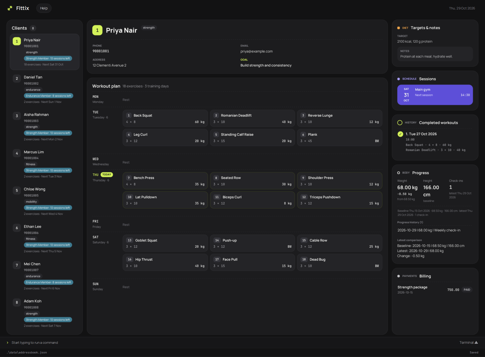

Fittix is a **desktop application for gym trainers to manage clients, workout plans, diet goals and training sessions through a Command Line Interface (CLI)**, with a Graphical User Interface (GUI) for viewing client details.

* Table of Contents
{:toc}

--------------------------------------------------------------------------------------------------------------------

## Quick start

1. Ensure that Java `25` or later is installed on your computer.<br>
   **Mac users:** Ensure you have the precise JDK version prescribed [here](https://se-education.org/guides/tutorials/javaInstallationMac.html).

1. Download **`fittix-v1.jar`** from the **Assets** section of the [Fittix release](https://github.com/AY2627S1-CS2103T-T14-1/tp/releases/latest). The same JAR supports Windows x64, macOS Intel or Apple silicon, and Linux x64 or ARM64.

1. Copy the file to a folder where you have write permission. Use this folder as your Fittix _home folder_.

1. Open a terminal, `cd` to that folder, and run `java -jar fittix-v1.jar`.<br>
   Fittix saves its `data` folder and `preferences.json` in the terminal's current folder. Always start it from the same home folder to use the same client records.<br>
   A GUI similar to the one below should appear in a few seconds. Note how the app contains some sample data.<br>
   

1. Type a command in the command box and press Enter to execute it. For example, type **`help`** and press Enter to open the help window.<br>
   Some example commands you can try:

   * `list` : Lists all contacts.

   * `add n/John Doe p/98765432 e/johnd@example.com a/John street, block 123, #01-01` : Adds a contact named `John Doe` to the Address Book.

   * `delete 3` : Deletes the 3rd contact shown in the current list.

   * `diet 2 t/1800 kcal per day n/Prioritise vegetables` : Records diet goals for the 2nd client shown.

   * `log 1 d/2020-01-15 ex/Push-up|0|3|12` : Records a completed workout session for the 1st client shown.

   * `clear` : Deletes all contacts, but keeps membership plans.

   * `exit` : Exits the app.

1. Refer to the [Features](#features) section below for details of each command.

--------------------------------------------------------------------------------------------------------------------

## Features

<div markdown="block" class="alert alert-info">

**:information_source: Notes about the command format:**<br>

* Words in `UPPER_CASE` are the parameters to be supplied by the user.<br>
  For example, in `add n/NAME`, replace `NAME` with a value such as `John Doe`.

* Items in square brackets are optional.<br>
  For example, `n/NAME [t/TAG]` can be used as `n/John Doe t/friend` or as `n/John Doe`.

* Items followed by `…`​ can appear zero or more times.<br>
  For example, `[t/TAG]…​` may be omitted, or written as `t/friend` or `t/friend t/family`.

* Prefixed parameters can be in any order.<br>
  For example, if the command specifies `n/NAME p/PHONE_NUMBER`, `p/PHONE_NUMBER n/NAME` is also acceptable. Positional parameters, such as the indices and day in `dayex PERSON_INDEX EXERCISE_INDEX DAY`, must follow the order shown.

* Extraneous parameters for commands that take no parameters, such as `help`, `list`, `exit`, `clear`, and `clearmem`, are ignored.<br>
  For example, `help 123` is interpreted as `help`.

* If you are using a PDF version of this document, be careful when copying and pasting commands that span multiple lines as space characters surrounding line-breaks may be omitted when copied over to the application.
</div>

### Viewing help: `help`

Shows a message explaining how to access the help page.


Format: `help`


### Adding a client: `add`

Adds a client to Fittix.

Format: `add n/NAME p/PHONE_NUMBER e/EMAIL a/ADDRESS [g/GOAL] [t/TAG]…​`

<div markdown="span" class="alert alert-primary">:bulb: **Tip:**
A client can have any number of tags, including zero.
</div>

* `g/GOAL` is optional. A goal must contain 1 to 100 characters after trimming and include at least one letter or digit.
* A supplied goal is saved with the client and shown on the client card.

Examples:
* `add n/Priya Nair p/91234567 e/priya@example.com a/123 Clementi Road g/Build strength`
* `add n/Betsy Crowe t/friend e/betsycrowe@example.com a/Newgate Prison p/1234567 t/criminal`

### Listing all persons: `list`

Shows a list of all persons in the address book.

Format: `list`

### Scheduling a training session: `schedule`

Adds a future training session to the client at the displayed index. Sessions are saved automatically and multiple sessions can be added to one client.

Format: `schedule INDEX d/YYYY-MM-DD tm/HH:mm l/LOCATION`

The date and 24-hour time must be valid and in the future, and the location must not be blank. The index refers to the current client list. For example, `schedule 1 d/2099-03-15 tm/14:30 l/Main gym` schedules a session for the first listed client. Fittix rejects an appointment when another client already has a training session or meeting at the same start time.

### Viewing a client's training sessions: `viewschedule`

Shows all saved training sessions and meetings for the client at the displayed index, ordered by date and time. Meetings are marked `(meeting)`. Past appointments remain visible for reference.

Format: `viewschedule INDEX`

Example: `viewschedule 1`

### Recording a client meeting: `meeting`

Records a future ad-hoc meeting for the client at the displayed index. Give the date, 24-hour time, and meeting location.

Format: `meeting INDEX d/YYYY-MM-DD tm/HH:mm l/LOCATION`

Example: `meeting 1 d/2099-03-15 tm/14:30 l/Cafe`

The meeting appears in `viewschedule` and `dayschedule`. A meeting cannot use a start time already occupied by any client's training session or meeting.

### Viewing all appointments on a day: `dayschedule`

Lists all clients with a training session or meeting on the specified date, ordered by time. This checks the full client roster, even if the displayed list is filtered.

Format: `dayschedule d/YYYY-MM-DD`

Example: `dayschedule d/2099-03-15`

### Finding clients who have not trained recently: `inactive`

Lists clients without a **recorded completed workout** in the last `DAYS` calendar days, including today. Clients with no recorded workout are included. Scheduled appointments alone do not count as completed workouts. The command checks the full client roster.

Format: `inactive DAYS` (a positive whole number)

Example: `inactive 14`

Fittix stores appointment start times, not durations. Conflict detection checks equal start times; it cannot identify appointments that start at different times but overlap.

### Editing a client: `edit`

Edits an existing client in Fittix.

Format: `edit INDEX [n/NAME] [p/PHONE] [e/EMAIL] [a/ADDRESS] [g/GOAL] [t/TAG]…​`

* Edits the client at the specified `INDEX`. The index refers to the index number shown in the displayed client list. The index must be a positive whole number; leading zeros are accepted.
* At least one field must be provided.
* Existing values will be updated to the input values.
* `g/` without a value removes the client's fitness goal. `t/` without a value removes all tags.
* Empty `n/`, `p/`, `e/`, or `a/` values are invalid. Email and address remain required fields.
* When editing tags, all of the client's existing tags are replaced; adding tags is not cumulative.
* An edit that would duplicate another client's name is rejected. Changing only the letter case of the same client's name is allowed.
* If the values are identical to the client's current details, Fittix reports `No changes made: the new values are the same as the current details.`
* On success, Fittix reports `Edited client: NAME; Phone: PHONE.`

Common errors:

| Cause | Message |
| --- | --- |
| Missing index | `Client index is required. Use: edit INDEX [n/NAME] [p/PHONE] [e/EMAIL] [a/ADDRESS] [g/GOAL] [t/TAG]...` |
| Invalid index | `The client index must be a positive whole number shown in the client list.` |
| Index outside the displayed list | `No client exists at index INDEX.` |
| Repeated `n/`, `p/`, `e/`, `a/`, or `g/` | `The n/, p/, e/, a/ and g/ prefixes may each be used only once. Repeat t/ for multiple tags.` |
| No fields supplied | `At least one field to edit must be provided.` |
| Duplicate client | `This person already exists in the address book.` |

Examples:
* `edit 1 p/91234567 e/johndoe@example.com` edits the phone number and email address of the first client.
* `edit 2 n/Betsy Crower t/` edits the name and clears all existing tags.
* `edit 3 g/Marathon prep` sets a fitness goal; `edit 3 g/` clears it.

<a id="recording-a-clients-diet-plan-diet"></a>

### Recording a client's diet goals: `diet`

Records a client's current nutrition target and optional coaching notes. Together, these are the client's **diet goals**; only one current target record is stored per client. Select a client in the list to read their target and notes in the **DIET** section of the right-hand context panel. The section shows **No diet target recorded.** when that client has no diet goals. Long text wraps, and the panel can be scrolled.

The `diet` command's feedback still calls this record a "diet plan". The messages below quote the application's exact wording.

Format: `diet INDEX t/TARGET [n/NOTES]`

* `INDEX` is the positive whole-number index shown in the **current** client list. For example, after `find Priya`, `diet 1 ...` updates the first displayed search result. Leading zeros are accepted; `0`, negative numbers, signs, decimals, and indices outside the displayed list are rejected.
* `TARGET` is required. After trimming outer whitespace, it must contain 1 to 200 printable characters and at least one letter or digit. Numbers, units, punctuation, internal spaces, and letter case are preserved. Line breaks and control characters are rejected.
* `NOTES` is optional. If `n/` is supplied, its value must contain 1 to 300 printable characters after trimming. A blank `n/` is invalid; omit `n/` when no notes are needed. Internal spacing and case are preserved, and line breaks and control characters are rejected.
* `t/` and `n/` may appear in either order, but each may appear only once. They are recognised at the start of an argument or after whitespace. A slash inside a word, such as `kcal/day`, remains part of that value. Dietary restrictions are managed separately with the `restriction` command.
* Different diet goals **replace the complete current target and notes**. Omitting `n/` during replacement clears any old notes. Earlier versions are not kept. Diet goals with the same trimmed target and notes, ignoring case, are rejected without changing the saved record.

Examples:

* `diet 2 t/1800 kcal per day, 120 g protein` records diet goals without coaching notes.
* `diet 2 t/1800 kcal per day, 120 g protein n/Prioritise lean protein and vegetables` adds notes.
* `diet 2 t/2000 kcal/day n/Include fruit` replaces the target and notes; the slash in `kcal/day` is ordinary text.
* `diet 2 t/2000 kcal/day` replaces the target again and removes its notes.
* `diet 3 t/2000 kcal per day n/Prioritise lean protein` records coaching notes. Use `restriction` for separate dietary restrictions.

On success, Fittix reports `Created diet plan for NAME.` or `Replaced diet plan for NAME.`. Common errors include:

| Cause | Message |
| --- | --- |
| Missing client index | `Client index is required. Use: diet INDEX t/TARGET [n/NOTES]` |
| Invalid client index | `The client index must be a positive whole number shown in the client list.` |
| Index outside the displayed list | `No client exists at index INDEX.` |
| Missing target | `Diet target is required. Use: diet INDEX t/TARGET [n/NOTES]` |
| Repeated `t/` or `n/` | `The t/ and n/ prefixes may each be used only once.` |
| Unknown prefix or extra text | `Invalid command format. Use: diet INDEX t/TARGET [n/NOTES]` |
| Invalid target | `Diet target must contain 1 to 200 printable characters.` |
| Invalid supplied notes | `Diet-plan notes must contain 1 to 300 printable characters.` |
| Same current diet goals | `This is already the current diet plan for NAME.` |
| Saving fails | `The diet plan could not be saved. The previous plan remains unchanged.` |

Invalid commands and failed saves leave the previous diet goals unchanged. Deleting a client permanently removes that client's diet goals along with the client record. Fittix records the trainer's text; it does not assess medical suitability, safety, or nutritional completeness.

### Recording dietary restrictions: `restriction`

Stores a client's current ordered list of allergies, exclusions, religious requirements, or food preferences separately from their diet goals.

Format: `restriction INDEX r/RESTRICTION [r/RESTRICTION]...`

* Repeating `r/` replaces the complete existing list. A single blank `r/` clears all restrictions.
* Supply 1 to 10 nonblank restrictions; each must contain 1 to 100 printable characters and at least one letter or digit.
* Restrictions that match after trimming and ignoring case are rejected as duplicates.
* Fittix records trainer-entered information only; it does not determine allergy, nutritional, or meal safety.

Examples:
* `restriction 2 r/Peanut allergy r/Halal meals r/No shellfish`
* `restriction 2 r/`

### Recording health considerations: `health`

Stores one current trainer-visible note about a client's injuries or physical limitations.

Format: `health INDEX h/NOTE`

* A nonblank note creates or replaces the current profile. `health INDEX h/` clears it.
* Notes must contain 1 to 500 printable characters and at least one letter or digit.
* Fittix records information only; it does not diagnose, recommend treatment, or decide whether a workout is medically safe.

Examples:
* `health 2 h/Recovering from a left ankle sprain; avoid jumping exercises`
* `health 2 h/`

### Finding clients: `find`

Finds clients matching one or more name, phone, email, fitness-goal, dietary-restriction, or health-considerations criteria.

Format:

* `find KEYWORD [MORE_KEYWORDS]...`
* `find [n/NAME_KEYWORDS] [p/PHONE] [e/EMAIL_KEYWORDS] [g/GOAL_KEYWORDS] [dr/RESTRICTION_KEYWORDS] [h/HEALTH_KEYWORDS]`

The first form is a name search and behaves exactly like `find n/KEYWORD [MORE_KEYWORDS]...`.

* `n/` splits its value into keywords. A client's name matches if it contains any keyword as a case-insensitive substring. For example, `find n/pri` matches `Priya`.
* `p/` searches one phone query. Spaces and hyphens are ignored, and the normalised phone must contain the normalised query. The query must contain at least one digit.
* `e/` splits its value into keywords. A client's email matches if it contains any keyword as a case-insensitive substring.
* `g/` splits its value into keywords. A client's fitness goal matches if it contains any keyword as a case-insensitive substring. Clients without a goal do not match a goal search.
* `dr/` splits its value into keywords. A client matches when any current dietary restriction contains any keyword as a case-insensitive substring.
* `h/` splits its value into keywords. A client's health considerations match if they contain any keyword as a case-insensitive substring.
* Criteria are combined with OR. For example, `find n/tan g/fat loss` returns clients whose name contains `tan` or whose goal contains `fat` or `loss`.
* Each of `n/`, `p/`, `e/`, `g/`, `dr/`, and `h/` may appear at most once. A bare keyword cannot be combined with a prefix.

Examples:
* `find pri` and `find n/pri` find clients whose names contain `pri`.
* `find p/9123 4567` and `find p/9123-4567` find a client with phone `91234567`.
* `find e/example.com` finds clients with an email containing `example.com`.
* `find g/strength` finds clients with a goal containing `strength`.
* `find dr/peanut` finds clients with a dietary restriction containing `peanut`.
* `find h/ankle` finds clients whose health considerations contain `ankle`.
* `find n/tan g/fat loss` combines name and goal criteria using OR.

Common errors:

| Cause | Message |
| --- | --- |
| No search value | `Search keyword is required. Use: find KEYWORD... or find [n/NAME] [p/PHONE] [e/EMAIL] [g/GOAL] [dr/RESTRICTION] [h/HEALTH]` |
| Bare keyword mixed with a prefix | `Invalid command format. Use: find KEYWORD... or find [n/NAME] [p/PHONE] [e/EMAIL] [g/GOAL] [dr/RESTRICTION] [h/HEALTH]` |
| Repeated supported prefix | `The n/, p/, e/, g/, dr/ and h/ prefixes may each be used only once.` |
| Empty `n/` value | `The n/ search value cannot be empty.` The same message uses `p/`, `e/`, `g/`, `dr/`, or `h/` for those prefixes. |
| Phone query without a digit | `Phone search must contain at least one digit.` |

Fittix reports `Found N client(s).` when there are matches, or `Found 0 client(s). Use list to show all clients.` when there are none.

### Deleting a person: `delete`

Deletes the specified person from the address book.

Format: `delete INDEX`

* Deletes the person at the specified `INDEX`.
* The index refers to the index number shown in the displayed person list.
* The index **must be a positive integer** 1, 2, 3, …​

Examples:
* `list` followed by `delete 2` deletes the 2nd person in the address book.
* `find Betsy` followed by `delete 1` deletes the 1st person in the results of the `find` command.

### Clearing all entries: `clear`

Clears all client entries from the address book.

Format: `clear`

* `clear` deletes client records only. It does **not** delete any membership plans; use [`clearmem`](#clearing-all-membership-plans-clearmem) to remove membership plans.

### Adding an exercise to a client's workout plan: `addex`

Adds an exercise to the workout plan of the person identified by the index number used in the last person listing.

Format: `addex INDEX n/NAME [s/SETS] [r/REPS] [w/WEIGHT_KG] [d/DAY]`

`INDEX` and `n/NAME` are required. All other fields are optional:

| Field | Accepted value | Default when omitted |
|-------|----------------|----------------------|
| `n/NAME` | A non-blank exercise name | Required |
| `s/SETS` | A positive integer greater than 0 | `1` |
| `r/REPS` | A positive integer greater than 0 | `1` |
| `w/WEIGHT_KG` | A finite, non-negative number in kg; decimals are allowed | `0` |
| `d/DAY` | A weekday name or accepted prefix; see [Weekday values](#weekday-values) | Grouped under **Day not specified** |

* `INDEX` refers to the index number shown in the displayed person list. It **must be a positive integer** 1, 2, 3, …​
* Each prefix, including `n/`, may appear at most once.
* Only `n/`, `s/`, `r/`, `w/`, and `d/` are accepted parameter prefixes. A word made of letters followed by `/` after whitespace is treated as a parameter prefix; unknown prefixes such as `x/` or `ex/` cause `Invalid command format!`. For example, `addex 1 n/Stretch x/unexpected` is rejected without changing the plan. Plain words in `n/NAME` remain part of the exercise name.
* To use a default, omit the whole field. An empty field such as `s/` or `d/` is invalid.
* The same exercise name can appear on different days in a client's plan, for example Monday and Friday. Names are compared without regard to letter case: adding the same name twice on one day shows `This exercise already exists on this day in the workout plan.` and leaves the plan unchanged, even if sets, reps, or weight differ. Exercises under **Day not specified** share one group, so the same name can appear there only once.
* Each client can have at most **7 exercises per weekday**. Adding an eighth exercise to the same day shows `A client cannot have more than 7 exercises on the same day.` and leaves the plan unchanged. Other weekdays and clients have separate limits. Exercises under **Day not specified** are not capped.
* If `INDEX` is out of range, Fittix shows `The person index provided is invalid.`
* Missing required fields, invalid values (including an invalid `d/DAY` such as `d/t` or `d/funday`), repeated or unknown prefixes, or extra arguments outside the exercise name cause `Invalid command format!` followed by the `addex` usage:

  ```text
  addex: Adds an exercise to the workout plan of the person identified by the index number used in the last person listing.
  Parameters: INDEX (must be a positive integer) n/EXERCISE_NAME [s/SETS] [r/REPS] [w/WEIGHT_KG] [d/DAY]
  Example: addex 1 n/Bench Press s/3 r/10 w/60 d/M
  ```

* On success, Fittix shows `Added exercise to Person: ` followed by the updated person's details and workout plan, grouped by day.

Examples:

* `addex 1 n/Stretch` adds Stretch with 1 set, 1 rep, 0kg, and no assigned day.
* `addex 1 n/Shoulder Press r/8 w/25.5` adds Shoulder Press with 1 set of 8 reps at 25.5kg and no assigned day.
* `addex 1 n/Bench Press s/3 r/10 w/60 d/w` adds Bench Press with 3 sets of 10 reps at 60kg for Wednesday.
* `addex 1 n/Bench Press s/3 r/10 w/60 d/f` also adds Bench Press for Friday, even if it is already assigned to Wednesday.
* `addex 2 n/Squat s/4 d/s` adds Squat with 4 sets of 1 rep at 0kg for Saturday to the 2nd person's plan.

#### Reading the workout plan

Each person card shows `Workout Plan (N):`, where `N` is the total number of exercises. Exercises appear under full weekday headings in Monday-to-Sunday order. All exercises without an assigned day appear together under **Day not specified**, after the weekday groups. Only groups containing exercises are shown, with space between groups.

Each exercise row uses `NUMBER. NAME SETSxREPS @WEIGHTkg`. Numbering runs continuously from `1` across the entire plan; it does not restart for each day. For example:

```text
Workout Plan (4):
Monday
1. Squat 4x8 @80kg

Wednesday
2. Bench Press 3x10 @60kg

Day not specified
3. Stretch 1x1 @0kg
4. Shoulder Press 1x8 @25.5kg
```

Adding an exercise, changing its day, or deleting an exercise can change the numbers shown. Always use the **current displayed exercise number** for `dayex` and `delex`. Exercises already in the same day group keep their relative order when the plan is sorted.

An empty plan shows `No workout plan yet` on the person card. Command feedback also shows the plan in weekday order with the same exercise numbers.

### Removing an exercise from a client's workout plan: `delex`

Removes the exercise at the specified exercise index from the workout plan of the person identified by the index number used in the last person listing.

Format: `delex PERSON_INDEX EXERCISE_INDEX`

* Both `PERSON_INDEX` and `EXERCISE_INDEX` **must be positive integers** 1, 2, 3, …​
* `PERSON_INDEX` refers to the person in the current displayed person list.
* `EXERCISE_INDEX` matches the current numbering across all day groups on that person's card. For example, `delex 1 2` removes Bench Press if the 1st person's plan matches the example above.
* The remaining exercises are renumbered after deletion. A day heading disappears when its last exercise is removed.
* If `PERSON_INDEX` is out of range, Fittix shows `The person index provided is invalid.`
* If `EXERCISE_INDEX` is out of range (including when the plan is empty), Fittix shows `The exercise index provided is invalid.`
* If the format is wrong, Fittix shows `Invalid command format!` followed by the `delex` usage:

  ```text
  delex: Removes the exercise at the specified exercise index from the workout plan of the person identified by the index number used in the last person listing.
  Parameters: PERSON_INDEX EXERCISE_INDEX (both must be positive integers)
  Example: delex 1 2
  ```

* On success, Fittix shows `Removed exercise from Person: ` followed by the updated person including the remaining workout plan.

Examples:

* `delex 1 2` removes the currently numbered 2nd exercise from the 1st person's workout plan.
* `list` followed by `delex 1 1` removes the currently numbered 1st exercise from the 1st person's workout plan.

### Assigning a day tag to an exercise: `dayex`

Assigns or changes the weekday of an existing exercise in a person's workout plan.

Format: `dayex PERSON_INDEX EXERCISE_INDEX DAY`

* Both indices **must be positive integers**. `PERSON_INDEX` refers to the current displayed person list; `EXERCISE_INDEX` matches the current workout plan numbering on that person's card.
* Supply all three arguments in the order shown. Enter the day directly, for example `dayex 1 2 Tuesday`.
* `DAY` accepts the weekday names and prefixes listed below, without regard to letter case.
* Each exercise has one assigned day. Assigning a new day replaces the previous day while keeping the exercise name, sets, reps, and weight.
* Moving an exercise to a day that already contains the same name (case-insensitive) shows `This exercise already exists on this day in the workout plan.` and leaves the plan unchanged. Assigning an exercise to its current day is allowed.
* A day can contain at most **7 exercises for each client**. Moving an exercise into a day that already has 7 shows `A client cannot have more than 7 exercises on the same day.` and leaves the plan unchanged. Assigning an exercise to its current day when that day has 7 exercises is allowed, as is moving an exercise away from a full day.
* The plan is immediately sorted by weekday and renumbered. Check the updated card before entering another command that uses an exercise index.
* If `PERSON_INDEX` is out of range, Fittix shows `The person index provided is invalid.`
* If `EXERCISE_INDEX` is out of range (including when the plan is empty), Fittix shows `The exercise index provided is invalid.`
* Missing or extra arguments, non-positive or non-integer indices, or an invalid day cause `Invalid command format!` followed by the `dayex` usage:

  ```text
  dayex: Assigns a day tag to an exercise in a person's workout plan.
  Parameters: PERSON_INDEX EXERCISE_INDEX DAY
  Example: dayex 1 2 Tuesday
  ```

* On success, Fittix shows `Assigned day to exercise: ` followed by the updated person's details and workout plan.

Examples:

* `dayex 1 2 Tuesday` assigns Tuesday to the currently numbered 2nd exercise for the 1st person.
* `dayex 1 3 su` assigns Sunday to the currently numbered 3rd exercise for the 1st person.

#### Weekday values

Both `addex` with `d/DAY` and `dayex` accept a full weekday name or a prefix of that name, ignoring letter case. The shortest accepted prefixes are:

| Weekday heading | Shortest prefix | Other examples |
|-----------------|-----------------|----------------|
| Monday | `m` | `Mon`, `MONDAY` |
| Tuesday | `tu` | `Tue`, `Tues`, `Tuesday` |
| Wednesday | `w` | `Wed`, `Wednesday` |
| Thursday | `th` | `Thu`, `Thurs`, `Thursday` |
| Friday | `f` | `Fri`, `Friday` |
| Saturday | `s` | `Sa`, `Sat`, `Saturday` |
| Sunday | `su` | `Sun`, `Sunday` |

`t` is invalid; use `tu` for Tuesday or `th` for Thursday. `s` means Saturday; Sunday requires at least `su`. The card always displays the full weekday name, regardless of the prefix you enter.

To add an exercise without an assigned day, omit `d/` from `addex`. The heading `Day not specified` is not a valid `DAY` argument.

### Clearing a client's workout plan: `clearplan`

Clears all exercises from the workout plan of the person identified by the index number used in the last person listing.

Format: `clearplan INDEX`

* `INDEX` refers to the index number shown in the displayed person list. It **must be a positive integer** 1, 2, 3, …​
* If `INDEX` is out of range, Fittix shows `The person index provided is invalid.`
* If the format is wrong, Fittix shows `Invalid command format!` followed by the `clearplan` usage (`MESSAGE_USAGE`):
  ```
  clearplan: Clears all exercises from the workout plan of the person identified by the index number used in the last person listing.
  Parameters: INDEX (must be a positive integer)
  Example: clearplan 1
  ```
* If the plan already has no exercises, Fittix shows `Workout plan is already empty for Person: ` followed by that person, and makes no change.
* Otherwise Fittix clears the plan and shows `Cleared workout plan for Person: ` followed by the updated person (whose workout plan is `Empty`).

Example:
* `clearplan 1` clears the workout plan of the 1st person.

### Recording a completed workout session: `log`

Records a completed workout session for a client, including the exercises, weights, sets, and repetitions performed. Logging a session does not change the client's workout plan.

Format: `log INDEX d/DATE [t/TIME] ex/EXERCISE|WEIGHT|SETS|REPS [ex/EXERCISE|WEIGHT|SETS|REPS]...`

* `INDEX` is the positive whole-number index shown in the current client list. After a `find` command, use the index shown in the search results.
* `DATE` is required and must be a valid date in `yyyy-MM-dd` format, such as `2020-01-15`. Today and past dates are accepted; future dates are rejected.
* `TIME` is optional and uses the 24-hour `HH:mm` format, from `00:00` to `23:59`. Seconds are not accepted. Omitting `t/` leaves the time unspecified.
* Provide between 1 and 30 exercise entries. Each entry requires all four values, separated by `|`, in the order `EXERCISE|WEIGHT|SETS|REPS`.
* `d/` and `t/` may each appear only once. Repeat `ex/` to record multiple exercises. Prefixed parameters may appear in any order.
* Exercise entries are stored and displayed in the order entered. Leading and trailing spaces around each exercise value are removed.

Exercise values must satisfy these rules:

| Value | Accepted input |
| --- | --- |
| `EXERCISE` | 1 to 50 characters, including at least one letter. Only letters, digits, spaces, hyphens, apostrophes, and parentheses are allowed. |
| `WEIGHT` | A number from 0 to 1000, inclusive, in kilograms, with at most 2 decimal places. Enter the number without a unit, for example `40.25`. |
| `SETS` | A whole number from 1 to 100, inclusive. |
| `REPS` | A whole number from 1 to 1000, inclusive. |

Examples:

* `log 1 d/2020-01-15 t/18:00 ex/Back squat|60|3|10 ex/Bench press|40.25|3|8`
* `log 1 d/2020-01-16 ex/Push-up|0|3|12`

On success, Fittix reports `Logged workout session for NAME on DATE at TIME.` When no time is supplied, it reports `Logged workout session for NAME on DATE.` Sessions are saved with the client's details and remain available after restarting the app.

#### Duplicate sessions and invalid input

A client cannot have two sessions with the same date and time, even if their exercise entries differ.

* Two sessions on the same date with different specified times are allowed.
* Two sessions on the same date with both times unspecified are duplicates.
* An unspecified time is different from a specified time. For example, a session without `t/` and another with `t/18:00` on the same date are allowed.
* Different clients may have sessions with the same date and time.

A duplicate is rejected with `This client already has a workout session with the same date and time.`

If any exercise entry or other required value is invalid, the entire command is rejected. No part of that session is added.

<a id="viewing-the-recorded-session"></a>

#### Viewing completed workouts

Select a client in the list to view **HISTORY** / **Completed workouts** in the right-hand context panel, below their diet goals and schedule.

The section shows all of the client's recorded sessions, ordered by workout date and time with the newest first. Recording an older workout adds it at its chronological position rather than at the top. On the same date, a session without a time sorts as `00:00`; its displayed time is `Time not specified`.

Each session shows its date, time, and all exercise entries in the order entered. Text wraps, and the context panel can be scrolled to read the complete history. A client without sessions shows `No completed workouts logged.`

Editing or deleting individual recorded sessions is not currently supported by the `log` command.

### Managing membership plans

Membership plans define a price and starting number of training sessions. Each client can have one assigned plan, and their remaining sessions are tracked independently of other clients on the same plan. Use the positive client index shown in the current list, including search results.

#### Adding and viewing plans: `addmem`, `view`

Format: `addmem n/NAME p/PRICE s/NUMBER_OF_SESSIONS`

Example: `addmem n/Gold Plus p/150.50 s/30`

Plan names must be unique, ignoring case and extra whitespace. A name can contain 1 to 50 characters after trimming: letters, digits, spaces, apostrophes, hyphens, and full stops, with at least one letter or digit. Leading and trailing spaces are removed, and repeated internal spaces are collapsed. The stored name keeps the case you entered, but the plan list and client card render its first character in upper case, so a plan entered as `gold` is shown as `Gold`. The price must be greater than zero, with at most two decimal places, without a currency symbol or thousands separators. Starting sessions must be a whole number from 1 to 1000.

Format: `view mem` or `view membership`

Both commands show each plan's price and starting sessions. If there are no plans, Fittix shows `No membership plans available.`

#### Assigning and removing a client's plan: `amem`, `rmem`

Format: `amem MEMBERSHIP_NAME PERSON_INDEX [e/YYYY-MM-DD]`

Examples:

* `amem Gold Plus 1 e/2026-12-30`
* `amem Gold Plus 1`

For a name with spaces, put the client index after the complete name. If supplied, `e/` follows the index. The expiry date must be a valid future calendar date when the plan is assigned. An assignment without `e/` has no specified expiry. The client card shows the plan name, remaining sessions, and expiry date if supplied. A past expiry date remains visible and does not automatically remove the plan or change its balance.

Assigning a plan gives the client its starting sessions. A client who already has a plan must have it removed before another can be assigned; trying to assign another leaves the existing balance unchanged. Different clients can use the same plan with separate balances and expiry dates.

Format: `rmem PERSON_INDEX`

Example: `rmem 1`

Removing a plan discards that client's remaining sessions and expiry date. The client card then shows no membership plan or session balance.

#### Adjusting remaining sessions: `imem`, `dmem`

Formats:

* `imem PERSON_INDEX NUMBER_TO_INCREMENT`
* `dmem PERSON_INDEX NUMBER_TO_DECREMENT`

Examples: `imem 1 3`, `dmem 1 2`

The client must have an assigned plan. Each adjustment must be a whole number from 1 to 1000. The resulting balance must stay between 0 and 1000; reducing it to zero is allowed. An adjustment outside that range is rejected without changing the balance.

#### Deleting a plan: `delmem`

Format: `delmem n/NAME`

Example: `delmem n/Silver`

A plan assigned to any client cannot be deleted. Remove all its client assignments with `rmem` first. Plan names supplied to `amem` and `delmem` are matched without regard to case or extra whitespace. Command words and the `mem` or `membership` argument of `view` are case-sensitive; parameter prefixes are case-insensitive.

#### Clearing all membership plans: `clearmem`

Format: `clearmem`

Deletes all membership plans and nothing else. Every plan in the catalog is removed. No other data is deleted: client records, workout plans, schedules, diet goals, and workout logs are left unchanged. The command takes no parameters.

A plan that is assigned to any client cannot be cleared. If at least one plan is still in use, `clearmem` deletes nothing and shows `Membership plans are in use and cannot be cleared. Remove all client assignments with rmem first.` Remove every assignment with [`rmem`](#assigning-and-removing-a-clients-plan-amem-rmem) first, or delete individual unreferenced plans with [`delmem`](#deleting-a-plan-delmem).

Example: `clearmem`

Failed membership commands leave every plan, assignment, and balance unchanged. The most common errors are:

* `A membership plan named Gold already exists.` — `addmem` with a duplicate name.
* `No membership plan named Silver exists.` — `amem` or `delmem` for an unknown plan.
* `Priya Nair already has an assigned membership plan.` — `amem` for a client who already has one.
* `Membership plan Gold is in use and cannot be deleted. Remove its assignments with rmem first.` — `delmem` for a referenced plan.
* `Membership plans are in use and cannot be cleared. Remove all client assignments with rmem first.` — `clearmem` while any plan is assigned.
* `This client has no membership plan to remove or adjust.` — `rmem`, `imem`, or `dmem` for a client without one.
* `Cannot decrease sessions below zero. The balance remains unchanged.` and `Cannot increase sessions above 1000. The balance remains unchanged.` — adjustments past the 0 to 1000 limits.
* `The membership change could not be saved. No plan, assignment, or balance was changed.` — the change could not be written to disk.

### Body progress tracker

**Availability:** Available in v1.4; these commands do not work in v1.3. They let you record starting measurements, maintain dated weight records, view history, and compare the latest weight with the starting weight. The values are trainer-entered records, not a health assessment.

Use the client's positive index from the **current** list, including search results. For example, after `find Priya`, index `1` means the first displayed match. Body commands preserve that filter and numbering. Command words and prefixes are lowercase and case-sensitive; each prefix can appear only once. Prefixed fields may follow the index in any order.

#### Recording or correcting starting measurements: `bodybase`

Format: `bodybase INDEX d/DATE w/WEIGHT_KG h/HEIGHT_CM`

Example: `bodybase 1 d/2020-01-01 w/75.50 h/175`

The baseline records a date, weight in kilograms, and height in centimetres. All three are required, including when correcting a baseline. A client has one baseline. A different `bodybase` replaces it, retains every progress entry, and changes the reference used by comparison. The replacement date must be **earlier than every progress entry**; otherwise nothing changes. Re-entering the same date and numerical measurements is rejected as already current.

Fittix reports `Created body baseline for NAME: DATE; Weight: WEIGHT kg; Height: HEIGHT cm.` or `Replaced body baseline for NAME: DATE; Weight: WEIGHT kg; Height: HEIGHT cm.` Height is baseline information; later records measure weight only.

#### Recording or correcting progress: `bodylog`

Format: `bodylog INDEX d/DATE w/WEIGHT_KG [n/NOTES]`

Examples:

* `bodylog 1 d/2020-01-08 w/74.80 n/Measured before breakfast`
* `bodylog 1 d/2020-01-15 w/74.20`

Record the baseline first. Each progress date must be later than its baseline and no later than today. You can enter weekly, daily, irregular or older measurements; there is no enforced seven-day interval.

There is one progress entry per date per client. Reusing a date **replaces the entire entry**, including notes. For example, `bodylog 1 d/2020-01-08 w/74.60` corrects that weight and removes its old notes. Omit `n/` for no notes; a blank `n/` is invalid. Re-entering identical date, weight and notes is rejected. Notes are case-sensitive, so a capitalization correction is allowed.

Fittix reports `Recorded body progress for NAME on DATE: WEIGHT kg.` or `Replaced body progress for NAME on DATE: WEIGHT kg.` A backdated entry does not become the latest measurement merely because you entered it last.

#### Viewing the complete history: `bodyhistory`

Format: `bodyhistory INDEX`

Example: `bodyhistory 1`

Selects that client and reveals their body-progress history in the **Body progress** card in the centre details column. Scroll inside the card to read the complete history or comparison; the centre column also scrolls when needed. It shows the baseline separately, then **all** progress entries in date order, oldest first, with weight and notes. The baseline is not counted as an entry. Missing notes appear as `—`. Long notes wrap; scroll vertically to read older or longer records.

Successful feedback is `Showing body progress history for NAME: N entries.` With only a baseline, it displays the baseline and `No body progress entries recorded.` With no baseline, it selects the requested client and shows `No body baseline recorded for NAME. Use bodybase first.` These empty views do not change data.

#### Comparing the latest weight with the baseline: `bodycompare`

Format: `bodycompare INDEX`

Example: `bodycompare 1`

Selects that client and reveals the comparison section. "Latest" means the greatest measurement date, regardless of recording/edit order. Fittix shows both dates and weights, the baseline height for context, and `latest weight - baseline weight`:

```text
Priya Nair — BODY PROGRESS
Baseline: 2020-01-01 | 75.50 kg | 175.00 cm
Progress history (2):
2020-01-08 | 74.80 kg | Measured before breakfast
2020-01-15 | 74.20 kg | —
Latest comparison: 2020-01-15
75.50 kg -> 74.20 kg | Change: -1.30 kg
```

A gain uses `+`, a loss uses `-`, and no change is `0.00 kg`. Fittix does not decide whether a change is healthy or desirable. It does not compare height or calculate BMI or percentage change.

Feedback is `Showing body progress comparison for NAME.` Without progress entries, it selects the requested client and shows `No body progress entries recorded for NAME. Use bodylog before comparing.` Without a baseline, it uses the missing-baseline message above. Replacing/deleting entries or correcting the baseline refreshes the comparison.

#### Deleting a mistaken progress entry: `bodydelete`

Format: `bodydelete INDEX d/DATE`

Example: `bodydelete 1 d/2020-01-15`

Deletes only the progress entry on that date for that client. **Deletion is permanent in the v1.4 tracker, with no confirmation step.** The baseline and all other entries remain. To correct a wrong date, record the correct entry with `bodylog` and delete the old date. To correct weight/notes on the same date, use `bodylog` directly.

Fittix reports `Deleted body progress for NAME on DATE.` Deleting the latest entry makes the next greatest date the latest. Deleting the last entry keeps the baseline and restores the no-progress view. `bodydelete` cannot delete a baseline; use `bodybase` to correct it.

#### Values, errors and saving

* Dates must be real dates in `yyyy-MM-dd`, years 0001–9999, and today or earlier in the computer's local time zone. `bodylog` additionally requires a date strictly after the baseline.
* Weight must be greater than 0 and at most **500 kg**. Height must be greater than 0 and at most **300 cm**. Both allow up to two decimal places. These are input limits, not medical thresholds.
* Enter measurements without units, signs, commas or exponent notation: `75`, `75.5`, `75.50` are accepted; `+75`, `.5`, `75.`, `75.500`, `75kg`, `1e2`, `NaN` and `Infinity` are rejected. Measurements display with two decimal places.
* Supplied notes must contain 1–300 printable characters after outer horizontal whitespace is removed. Internal spacing and case are preserved. Line breaks and nonprintable characters are rejected.
* A separated prefix token such as `w/`, `n/` or `ex/` is reserved, including inside notes. Repeated/unsupported prefixes are rejected. Slashes inside words, such as `km/day`, are ordinary text.

| Situation | Message |
| --- | --- |
| Missing field, unknown/repeated prefix or extra positional argument | `Invalid command format. Use: FORMAT` (the relevant command format above) |
| Invalid index syntax | `Client index must be a positive whole number shown in the client list.` |
| Index outside current list | `No client exists at index INDEX.` |
| Invalid/future date | `Measurement date must be a real date in yyyy-MM-dd format and must not be in the future.` |
| Invalid weight | `Weight must be greater than 0 and at most 500 kg, with at most 2 decimal places.` |
| Invalid height | `Height must be greater than 0 and at most 300 cm, with at most 2 decimal places.` |
| Invalid notes | `Progress notes must contain 1 to 300 printable characters without line breaks.` |
| Progress date on/before baseline | `Progress date must be later than the baseline date.` |
| Baseline correction conflicts with existing entries | `Baseline date must be earlier than every recorded progress date. No changes were made.` |
| Identical baseline | `This is already the current body baseline for NAME.` |
| Identical progress entry | `This body progress entry already exists for NAME on DATE.` |
| No entry to delete | `No body progress entry exists for NAME on DATE.` |
| Trying to delete the baseline | `The baseline cannot be deleted with bodydelete. Use bodybase to correct it.` |
| Saving fails | `The body progress change could not be saved. No changes were made.` |

Invalid mutations and failed saves leave all previous data unchanged. Successful changes select the affected client and refresh their details after saving. Baseline, weights and notes survive restarting the app; data files created before this feature load with no body tracker. A wrong local clock can cause date validation/loading failures, so check it before entering or opening dated records.

Body commands preserve contacts, other plans, schedules, logged workouts and membership balances. Deleting a client or using `clear` permanently removes their body records with the client. `clearmem` affects membership plans only. Charts, additional measurements and a dedicated tracker undo/redo command are outside this feature's v1.4 scope.

### Exiting the program: `exit`

Exits the program.

Format: `exit`

### Saving the data

AddressBook automatically saves data after every command. You do not need to save manually.

Workout exercises, their sets, reps, weight, and assigned weekdays are restored when you reopen the app. Exercises saved without a day, including older entries labelled `day not specified` or `Day not specified`, appear together under the single **Day not specified** heading.

Membership plans and each client's plan name, remaining sessions, and expiry date are restored the same way. An assignment whose expiry date has passed is still shown so you can act on it.

### Editing the data file

AddressBook data is saved automatically as a JSON file `[JAR file location]/data/addressbook.json`. Advanced users are welcome to update data directly by editing that data file.

<div markdown="span" class="alert alert-warning">:exclamation: **Caution:**
If your changes make the data file invalid, AddressBook starts with an empty address book at the next run. The invalid file remains on disk until you run a command (AddressBook saves after every command). Still, we recommend backing up the file before editing it.<br>
Furthermore, certain edits can cause the AddressBook to behave in unexpected ways (e.g., if a value entered is outside of the acceptable range). Therefore, edit the data file only if you are confident that you can update it correctly.
</div>

### Archiving data files `[coming in v2.0]`

_Details coming soon ..._

--------------------------------------------------------------------------------------------------------------------

## FAQ

**Q**: How do I transfer my data to another computer?<br>
**A**: Install the app on the other computer and overwrite the data file it creates with the data file from your previous AddressBook home folder.

--------------------------------------------------------------------------------------------------------------------

## Known issues

1. **When using multiple screens**, if you move the application to a secondary screen, and later switch to using only the primary screen, the GUI will open off-screen. The remedy is to delete the `preferences.json` file created by the application before running the application again.
2. **If you minimize the Help Window** and then run the `help` command (or use the `Help` menu, or the keyboard shortcut `F1`) again, the original Help Window will remain minimized, and no new Help Window will appear. The remedy is to manually restore the minimized Help Window.

--------------------------------------------------------------------------------------------------------------------

## Command summary

Action | Format, Examples
--------|------------------
**Add** | `add n/NAME p/PHONE_NUMBER e/EMAIL a/ADDRESS [g/GOAL] [t/TAG]…​` <br> e.g., `add n/James Ho p/22224444 e/jamesho@example.com a/123, Clementi Rd, 1234665 g/Build strength t/friend t/colleague`
**Add exercise** | `addex INDEX n/NAME [s/SETS] [r/REPS] [w/WEIGHT_KG] [d/DAY]`<br> e.g., `addex 1 n/Stretch` or `addex 1 n/Bench Press s/3 r/10 w/60 d/w`
**Clear** | `clear` (deletes all clients; membership plans are kept)
**Clear workout plan** | `clearplan INDEX`<br> e.g., `clearplan 1`
**Clear membership plans** | `clearmem` (deletes all membership plans and nothing else; rejected while any plan is assigned to a client)
**Delete** | `delete INDEX`<br> e.g., `delete 3`
**Delete exercise** | `delex PERSON_INDEX EXERCISE_INDEX`<br> e.g., `delex 1 2`
**Assign/change exercise day** | `dayex PERSON_INDEX EXERCISE_INDEX DAY`<br> e.g., `dayex 1 2 Tuesday`
**Diet goals** | `diet INDEX t/TARGET [n/NOTES]`<br> e.g., `diet 2 t/1800 kcal per day n/Prioritise vegetables`
**Dietary restrictions** | `restriction INDEX r/RESTRICTION [r/RESTRICTION]...`<br> e.g., `restriction 2 r/Peanut allergy r/Halal meals`
**Edit** | `edit INDEX [n/NAME] [p/PHONE_NUMBER] [e/EMAIL] [a/ADDRESS] [g/GOAL] [t/TAG]…​`<br> e.g., `edit 2 n/James Lee g/Marathon prep`
**Find** | `find KEYWORD [MORE_KEYWORDS]...` or `find [n/NAME] [p/PHONE] [e/EMAIL] [g/GOAL] [dr/RESTRICTION] [h/HEALTH]`<br> e.g., `find n/James g/strength`
**Health considerations** | `health INDEX h/NOTE`<br> e.g., `health 2 h/Avoid jumping exercises`
**List** | `list`
**Add membership plan** | `addmem n/NAME p/PRICE s/NUMBER_OF_SESSIONS`<br> e.g., `addmem n/Gold p/150 s/30`
**View membership plans** | `view mem` or `view membership`
**Assign membership plan** | `amem MEMBERSHIP_NAME PERSON_INDEX [e/YYYY-MM-DD]`<br> e.g., `amem Gold 1 e/2026-12-30`
**Remove membership plan** | `rmem PERSON_INDEX`<br> e.g., `rmem 1`
**Increase remaining sessions** | `imem PERSON_INDEX NUMBER_TO_INCREMENT`<br> e.g., `imem 1 3`
**Decrease remaining sessions** | `dmem PERSON_INDEX NUMBER_TO_DECREMENT`<br> e.g., `dmem 1 2`
**Delete membership plan** | `delmem n/NAME`<br> e.g., `delmem n/Silver`
**Body baseline (v1.4)** | `bodybase INDEX d/DATE w/WEIGHT_KG h/HEIGHT_CM`<br> e.g., `bodybase 1 d/2020-01-01 w/75.50 h/175`
**Body progress record/correction (v1.4)** | `bodylog INDEX d/DATE w/WEIGHT_KG [n/NOTES]`<br> e.g., `bodylog 1 d/2020-01-08 w/74.80 n/Measured before breakfast`
**Body progress history (v1.4)** | `bodyhistory INDEX`
**Body progress comparison (v1.4)** | `bodycompare INDEX`
**Delete body progress entry (v1.4)** | `bodydelete INDEX d/DATE`<br> e.g., `bodydelete 1 d/2020-01-08`
**Schedule** | `schedule INDEX d/YYYY-MM-DD tm/HH:mm l/LOCATION`<br> e.g., `schedule 1 d/2099-03-15 tm/14:30 l/Main gym`
**Meeting** | `meeting INDEX d/YYYY-MM-DD tm/HH:mm l/LOCATION`<br> e.g., `meeting 1 d/2099-03-15 tm/14:30 l/Cafe`
**View schedule** | `viewschedule INDEX`<br> e.g., `viewschedule 1`
**Day schedule** | `dayschedule d/YYYY-MM-DD`<br> e.g., `dayschedule d/2099-03-15`
**Inactive clients** | `inactive DAYS`<br> e.g., `inactive 14`
**Help** | `help`
**Log workout session** | `log INDEX d/DATE [t/TIME] ex/EXERCISE\|WEIGHT\|SETS\|REPS [ex/EXERCISE\|WEIGHT\|SETS\|REPS]...`<br> e.g., `log 1 d/2020-01-15 t/18:00 ex/Back squat\|60\|3\|10`
