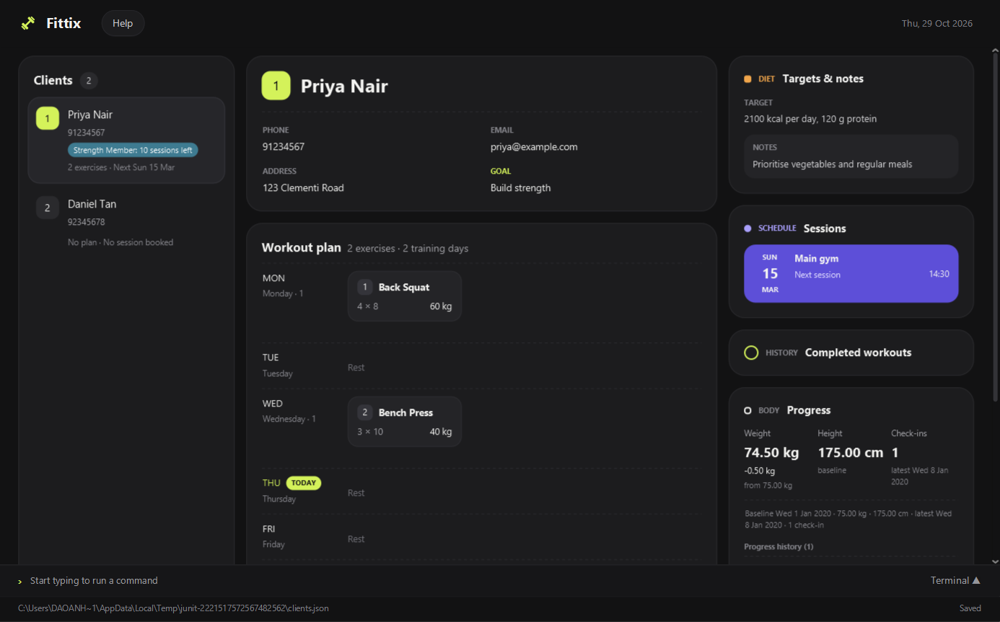

DESKTOP APP FOR GYM TRAINERS

# Your clients and training work, in one place.

Fittix helps trainers keep client details, workout plans, sessions, and progress close at hand. Enter commands quickly and review each client's information in a clear desktop interface.

<a class="fittix-button" href="https://github.com/AY2627S1-CS2103T-T14-1/tp/releases/latest">Download Fittix</a><a class="fittix-text-link" href="UserGuide.html#quick-start">Get started →</a>

<figure class="fittix-preview">
  
  <figcaption>Fittix workspace with demonstration client records</figcaption>
</figure>

## Everything you need between sessions

### Keep clients organized

Add, edit, find, and filter client records. Keep fitness goals, health considerations, and dietary restrictions with each profile.

### Plan and schedule training

Build day-by-day workout plans and book training sessions. Check each client's upcoming schedule from the same workspace.

### Track the work done

Log completed workouts and review session history. Record body measurements and compare the latest weight with a client's baseline.

### Manage the details

Record diet goals, membership plans, remaining sessions, and payments alongside your client records.

## Ready to use Fittix?

Download the latest release, then follow the [User Guide](UserGuide.html) for setup and commands. Building or contributing? Start with the [Developer Guide](DeveloperGuide.html).

